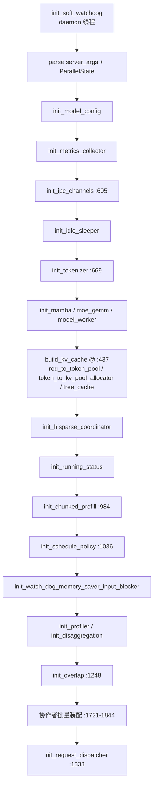

# 03.4.2 Scheduler init 编排链

## 定位

`Scheduler.__init__`（`scheduler.py:313`）跨越约 250 行，按严格顺序完成参数解析、拓扑建立、模型/分词装载、KV cache 构建、协作者装配。其中 `init_*` 系列方法把每个子系统拆成可单测/可重载的步骤。

## 职责

- 把 `ServerArgs` / `ParallelState` 翻译为 Scheduler 字段
- 装配 IPC（`SchedulerIpcChannels`）、分词器、TpModelWorker
- 经 `kv_cache_builder.build_kv_cache` 构建内存池（line 437 调用点）
- 装配 schedule policy、overlap、watchdog、profiler、各 scheduler_components
- 注册 `_request_dispatcher`

## 关键类与函数

| 名称 | 定义位置 | 说明 |
|---|---|---|
| `__init__` | `managers/scheduler.py:313` | 编排链入口 |
| `init_ipc_channels` | `managers/scheduler.py:605` | 建立 SchedulerIpcChannels |
| `init_tokenizer` | `managers/scheduler.py:669` | 多模态 fallback processor |
| `init_tp_model_worker` | `managers/scheduler.py:755` | 构造 TpModelWorker + draft worker |
| `init_memory_pools` | `managers/scheduler.py:822` | 入口包装；实际构建在 :437 |
| `init_chunked_prefill` | `managers/scheduler.py:984` | chunked prefill 状态 |
| `init_schedule_policy` | `managers/scheduler.py:1036` | `SchedulePolicy` 装配 |
| `init_overlap` | `managers/scheduler.py:1248` | FutureMap / streams |
| `init_request_dispatcher` | `managers/scheduler.py:1333` | `_request_dispatcher` |
| 协作者装配 | `managers/scheduler.py:1721`–`1844` | 一批 `init_<component>` |

## init_* 编排时序

## 关键装配点

- `build_kv_cache`（`scheduler.py:437`）返回 `{full_tokens_per_layer, req_to_token_pool, token_to_kv_pool_allocator, tree_cache, is_hybrid_swa/ssm}`；其上 `init_memory_pools:822` 是 SDK/自定义 cache 注入点
- `init_overlap:1248` 创建 `schedule_stream`、`forward_stream` 与 `FutureMap`（`overlap_utils.py:232`），为 [03.4.9](03.4.9-scheduler-overlap.md) 准备基础设施
- `init_request_dispatcher:1333` 注册 `TokenizedGenerateReqInput` → `handle_generate_request`、`AbortReq` → abort 处理、`WeightReqInput` → `weight_updater`、`FlushCacheReqInput` → flush_wrappers 等
- 协作者批量装配（:1721-1844）：`init_request_receiver`、`init_dp_attn_adapter`、`init_pool_stats_observer`、`init_invariant_checker`、`init_kv_events_publisher`、`init_load_inquirer`、`init_output_streamer`、`init_batch_result_processor`（详见 [03.5](03.5-scheduler-components.md)）

`is_initializing` 在 `__init__` 结尾被置 False，watchdog 开始监控行为。所有可重载的 `init_*` 都遵循 `large-class-style` 约定（见 skill）——`__init__` 只编排，业务写在 `init_*` 内。

## 交叉引用

- 上游: [03.4.1 结构](03.4.1-scheduler-structure.md)、[03.8 DP 控制器](03.8-dp-controller.md)
- 下游: [03.4.3 事件循环](03.4.3-scheduler-event-loop.md)、[03.5 协作者](03.5-scheduler-components.md)、[03.6 TpModelWorker](03.6-tp-worker.md)
- 下游: [`07 KV Cache`](../07-kv-cache/index.md)、[`08 分布式`](../08-distributed/index.md)
- 相关 skill: `.claude/skills/large-class-style`、`.claude/skills/sglang-runtime-context`

## 进一步阅读

- 源码: `python/sglang/srt/managers/scheduler.py`、`python/sglang/srt/men_cache/kv_cache_builder.py`
