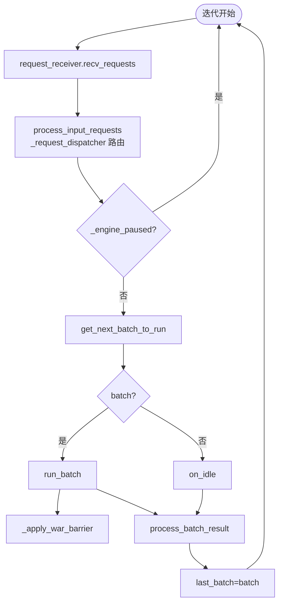

# 03.4.3 事件循环

## 定位

`Scheduler` 的全部行为由 `run_event_loop`（`scheduler.py:1464`）→ `dispatch_event_loop`（`scheduler.py:4444`）→ `event_loop_normal` / `event_loop_overlap`（或 PP/disagg 变体）驱动。"一迭代"的标准节奏是 `recv → plan → run → process`。

## 职责

- 选 normal/overlap/pp/disagg 分支
- normal: 同步串行的 recv-plan-run-process
- overlap: 把上一迭代的 `process` 推迟到当前迭代的 forward 期间，与 GPU 计算重叠
- 在 idle 时触发 `on_idle` 与 `IdleSleeper`
- 与 watchdog / invariant_checker 协同

## 关键类与函数

| 名称 | 定义位置 | 说明 |
|---|---|---|
| `run_event_loop` | `managers/scheduler.py:1464` | 设置 stream，dispatch |
| `dispatch_event_loop` | `managers/scheduler.py:4444` | 分支选择器 |
| `event_loop_normal` | `managers/scheduler.py:1503` | 同步循环 |
| `event_loop_overlap` | `managers/scheduler.py:1537` | overlap 循环 |
| `event_loop_pp` | `managers/scheduler_pp_mixin.py:68` | PP 循环 |
| `_apply_war_barrier` | `managers/scheduler.py:1485` | WAR barrier |
| `is_disable_overlap_for_batch` | `managers/scheduler.py:1610` | overlap 失能判定 |
| `process_input_requests` | `managers/scheduler.py:1645` | recv 帧分发 |

## 一迭代节奏

normal 路径（:1503）严格按上图的串行节奏：每迭代先 `request_receiver.recv_requests()`（聚合 ZMQ PULL），进入 `_request_dispatcher` 把请求类消息（如 `TokenizedGenerateReqInput`）转 `handle_generate_request`（[03.4.7](03.4.7-scheduler-request-admission.md)）、把控制类消息（`AbortReq`、`FlushCacheReqInput`）转对应处理器；如果 `_engine_paused`（pause 广播后置位）则立即 `continue`。随后 `get_next_batch_to_run`（[03.4.4](03.4.4-scheduler-next-batch.md)）出 plan，`run_batch`（[03.4.5](03.4.5-scheduler-run-batch-forward.md)）触发前向，`process_batch_result`（[03.4.6](03.4.6-scheduler-process-result.md)）把 token id 发出去。

overlap（:1537）多一个 `result_queue` 延迟结构：当前迭代只 `run_batch`、把 `(batch.copy(), result)` 入队；上一迭代的 `process_batch_result` 在当前迭代的 forward 进行中由 `pop_and_process()`（:1543）取出并消费。当 `is_disable_overlap_for_batch:1610` 判定不可重叠（连续 prefill、spec+grammar）时立刻 `pop_and_process()` 提前结算，避免 TTFT 损失。WAR barrier（`_apply_war_barrier:1485`）在前向 launch 之后、入队之前插入一次同步，保证下一迭代对共享 KV buffer 的写不会越过当前 forward 的读，详见 [03.4.9](03.4.9-scheduler-overlap.md)。

`event_loop_pp` 与 disagg 变体在 `scheduler_pp_mixin.py`，把一迭代拆为多个 microbatch 协调，详见 [`08 分布式`](../08-distributed/index.md) 与 [`09 分离式`](../09-disaggregation/index.md)。

## 交叉引用

- 上游: [03.4.2 init](03.4.2-scheduler-init.md)、[03.5 协作者](03.5-scheduler-components.md)
- 下游: [03.4.4 下一批](03.4.4-scheduler-next-batch.md)、[03.4.5 run_batch](03.4.5-scheduler-run-batch-forward.md)、[03.4.6 结果](03.4.6-scheduler-process-result.md)、[03.4.9 overlap](03.4.9-scheduler-overlap.md)
- 相关: [`08 分布式`](../08-distributed/index.md)、[`09 分离式`](../09-disaggregation/index.md)

## 进一步阅读

- 源码: `python/sglang/srt/managers/scheduler.py`、`python/sglang/srt/managers/scheduler_pp_mixin.py`
