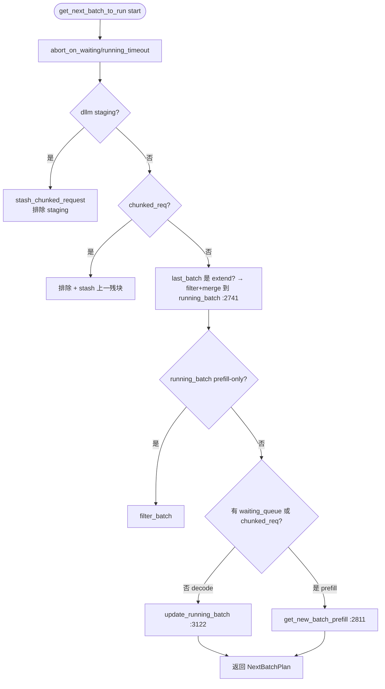

# 03.4.4 下一批构造

## 定位

`get_next_batch_to_run`（`scheduler.py:2670`）是一个迭代里"决策"步骤——把 `waiting_queue` 与 `running_batch` 折叠出一个可前向批，并由此决定 `forward_mode`（prefill/decode/idle）。它的策略直接决定 TTFT、吞吐与公平性。

## 职责

- 合并上一迭代 prefill 已完成的请求到 `running_batch`
- 处理 chunked_req 与 dllm staging 的 exclude
- 决定本迭代跑 prefill（`get_new_batch_prefill`）还是只跑 decode（`update_running_batch`）
- HiSparse 路径：用 `hisparse_coordinator.collect_ready_reqs` 替代普通合并
- DP attention：通过 `require_mlp_sync` 在 DP 组内同步决策

## 关键类与函数

| 名称 | 定义位置 | 说明 |
|---|---|---|
| `get_next_batch_to_run` | `managers/scheduler.py:2670` | 入口，返回 `NextBatchPlan` |
| `get_new_batch_prefill` | `managers/scheduler.py:2811` | prefill 批构造 |
| `update_running_batch` | `managers/scheduler.py:3122` | decode 批维护 + retract |
| `NextBatchPlan` | `managers/schedule_batch.py:3105` | `(batch_to_run, running_batch)` |
| `PrefillAdder` | `managers/schedule_policy.py:441` | 准入策略器（[03.10](03.10-schedule-policy.md)） |
| `predict_next_chunk_size` | `managers/scheduler.py:2893` / `scheduler_pp_mixin.py:768` | dynamic chunk 预测 |
| `process_pending_chunked_abort` | `managers/scheduler.py` | chunked abort 清理 |

## 决策流

## 实现要点

每次都先做 timeout/dllm 清理（:2677-2694）。若 `last_batch` 是 extend 类，先把 `chunked_req_to_exclude`（含 `self.chunked_req` 与 staging）摘掉，再 `last_batch.filter_batch()`，最后 `merge_batch` 进 `running_batch`（:2741-2746）——这就是"连续批=合并 last prefill 到 running_batch" 的关键点。HiSparse 路径（:2709-2719）有自己的 prefill→decode 转接，绕过 `merge_batch`。

随后决策分支：

- 若 `waiting_queue` 或 `chunked_req` 非空：`get_new_batch_prefill:2811` 调 `PrefillAdder`（[03.10](03.10-schedule-policy.md)）按 `max_prefill_tokens` / `chunked_prefill_size` / `max_running_requests` / KV budget / LoRA slots / priority 准入。`chunked_req` 优先续块；新 prefill 把 chunk 长度限制到 `chunked_prefill_size`（动态预测可改，:2890-2895）。
- 否则 `update_running_batch:3122`（[03.4.10](03.4.10-scheduler-retract-oom.md)）调 `filter_batch` + `check_decode_mem`，OOM 时 `retract_decode` 退一批；最后 `prepare_for_decode`。

DP attention 模式下需要在 DP 组里同步决策：用 `batch.is_extend_in_batch` 而非本地 `forward_mode`（`is_disable_overlap_for_batch:1618-1624`、`get_next_batch_to_run:2765+`），避免不同 rank 选择不同前向模式导致死锁。

## 交叉引用

- 上游: [03.4.3 事件循环](03.4.3-scheduler-event-loop.md)
- 下游: [03.4.5 run_batch](03.4.5-scheduler-run-batch-forward.md)、[03.4.8 chunked](03.4.8-scheduler-chunked-prefill.md)、[03.4.10 retract](03.4.10-scheduler-retract-oom.md)、[03.10 schedule_policy](03.10-schedule-policy.md)
- 下游: [`07 KV Cache`](../07-kv-cache/index.md) — `tree_cache` / `token_to_kv_pool_allocator`

## 进一步阅读

- 源码: `python/sglang/srt/managers/scheduler.py`、`python/sglang/srt/managers/schedule_policy.py`
