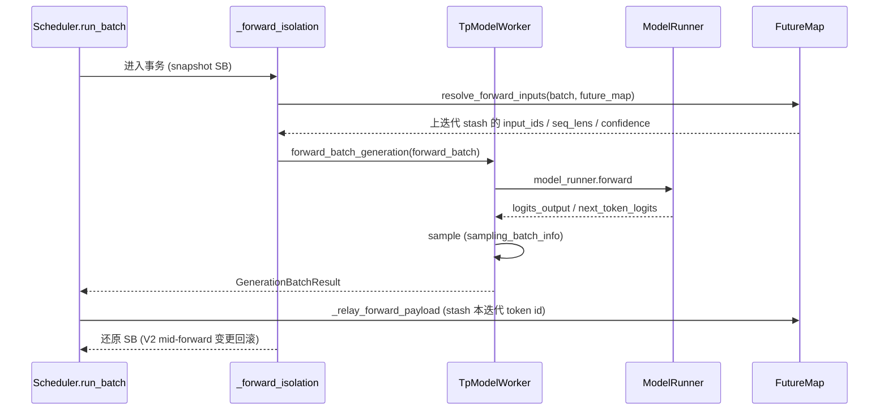

# 03.4.5 run_batch 前向

## 定位

`run_batch`（`scheduler.py:3272`）把决策出的 `ScheduleBatch` 送进 GPU 前向，并产出 `GenerationBatchResult` / `EmbeddingBatchResult`。它是 Scheduler 与 `TpModelWorker`（[03.6](03.6-tp-worker.md)）的接口点；overlap 模式下还负责跨迭代的输入 relay。

## 职责

- 用 `_forward_isolation` 把一次前向做成事务（snapshot + 还原）
- 调 `TpModelWorker.forward_batch_generation` 触发模型前向
- overlap 模式：`_relay_forward_payload` 把本迭代 token id stash 给下一迭代
- 处理 spec decoding 的 draft_extend / confidence relay

## 关键类与函数

| 名称 | 定义位置 | 说明 |
|---|---|---|
| `run_batch` | `managers/scheduler.py:3272` | 入口 |
| `_forward_isolation` | `managers/scheduler.py:3227` | SB 事务化上下文 |
| `_relay_forward_payload` | `managers/scheduler.py:3499` | FutureMap stash |
| `TpModelWorker.forward_batch_generation` | `managers/tp_worker.py:498` | 前向主入口 |
| `resolve_forward_inputs` | `managers/overlap_utils.py:84` | 从 FutureMap 拉取输入 |
| `FutureMap` | `managers/overlap_utils.py:232` | 跨迭代张量 relay |
| `GenerationBatchResult` | `managers/utils.py:39` | 采样结果包装 |

## 数据流

`run_batch` 在 `_forward_isolation`（:3227）上下文内执行。`_forward_isolation` 做三件事：

1. 对 spec V2 做全字段 snapshot（forward_mode / input_ids / seq_lens / spec_info 可能被 mid-forward 修改）
2. 替换 `sampling_info` 为 forward-only 副本（共享已累积 penalty buffer，避免多 init_new 双计），详见 [`11 采样控制`](../11-sampling-control/index.md)
3. overlap=True 时把 `(batch, snapshot)` 钉到 `batch_record_buf` 两迭代，避免 GPU 张量被 caching allocator 回收

overlap 模式下，进入前向前先 `resolve_forward_inputs(batch, self.future_map)`（`overlap_utils.py:84`）——根据 `FutureMap.spec_algo` 决定拉取哪些 tensor：decode/spec_v2 拉"上一迭代采样 token id"、seq_lens_cpu、confidence；prefill 直接用 batch 自带 input_ids。前向结束 `_relay_forward_payload`（:3499）把本迭代 `RelayPayload`（`overlap_utils.py:129`）通过 `FutureMap.publish/stash`（`overlap_utils.py:470/501`）放下，供下一迭代 resolve——这就是跨迭代 GPU 内存 relay（[03.4.9](03.4.9-scheduler-overlap.md)）。

实际 GPU 触发由 `TpModelWorker.forward_batch_generation`（`tp_worker.py:498`）→ `model_runner.forward`（`tp_worker.py:533`）完成；非末 PP rank 走 `tp_worker.py:589` 的 `pp_proxy_tensors` 路径（[03.6](03.6-tp-worker.md)）。`GenerationBatchResult`（`utils.py:39`）封装 `next_token_ids`、`logprobs`、`hidden_states` 等并附 `extra_keep_alive_refs` 给 overlap 防释放。

## 交叉引用

- 上游: [03.4.3 事件循环](03.4.3-scheduler-event-loop.md)、[03.4.4 下一批](03.4.4-scheduler-next-batch.md)
- 下游: [03.4.6 结果处理](03.4.6-scheduler-process-result.md)、[03.4.9 overlap](03.4.9-scheduler-overlap.md)、[03.6 TpWorker](03.6-tp-worker.md)
- 下游: [`04 模型执行`](../04-model-execution/04.1-model-runner.md)、[`10 投机解码`](../10-speculative/index.md)、[`11 采样控制`](../11-sampling-control/index.md)

## 进一步阅读

- 源码: `python/sglang/srt/managers/scheduler.py`、`python/sglang/srt/managers/overlap_utils.py`、`python/sglang/srt/managers/tp_worker.py`
