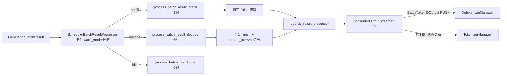

# 03.4.6 结果处理

## 定位

`process_batch_result`（`scheduler.py:3544`）把前向产物转成可输出的 token 序列与状态更新：稳态 decode 流块发给 Detokenizer；prefill 完成更新请求数据模型；logprob/hidden/embedding 各走对应处理器；空闲批走 idle 旁路。

## 职责

- prefill 完成判定（停止条件、长度、abort）
- decode 流切分：与 `output_streamer` 配合按 `stream_interval` 输出
- logprob 处理（`SchedulerLogprobResultProcessor`）
- 检测 finish，回收 KV cache slot 与 LoRA slot
- 把已 finish 请求经 `output_streamer` 最终输出，未完成请求回 running_batch

## 关键类与函数

| 名称 | 定义位置 | 说明 |
|---|---|---|
| `process_batch_result` | `managers/scheduler.py:3544` | 入口 |
| `SchedulerBatchResultProcessor` | `scheduler_components/batch_result_processor.py:64` | 处理器主体 |
| `process_batch_result_prefill` | `scheduler_components/batch_result_processor.py:180` | prefill 分支 |
| `process_batch_result_decode` | `scheduler_components/batch_result_processor.py:651` | decode 分支 |
| `SchedulerLogprobResultProcessor` | `scheduler_components/logprob_result_processor.py:21` | logprob 后处理 |
| `SchedulerOutputStreamer` | `scheduler_components/output_streamer.py:39` | 流切分与发送 |
| `process_batch_result_idle` | `scheduler_components/batch_result_processor.py:639` | idle 分支 |
| `process_batch_result_prebuilt` | `scheduler_components/batch_result_processor.py:84` | 离线批次复用 |

## 数据流

## 实现要点

`process_batch_result`（:3544）把工作几乎全委派给 `SchedulerBatchResultProcessor`（`batch_result_processor.py:64`），后者按 `batch.forward_mode` 选择分支：

- prefill（:180）：扩展 `req.output_ids`，更新 `req.check_finished` 的长度/stop 条件；`tree_cache.insert` 把新生成 KV 落盘 radix 节点（与 [`07`](../07-kv-cache/index.md) 联动）；finish 的请求把 `req.to_finish` 序列化；multimodal 释放 `multimodal_inputs.release_features`（:884）
- decode（:651）：把 `next_token_ids` 写入每个 req 的 `output_ids`；调 `SchedulerOutputStreamer.stream_output` 决定本迭代是否要发 `BatchTokenIDOutput`——`stream_interval` / `incremental_streaming_output` 控制密度；finish 处理同 prefill 但要走 `finish_reason`
- logprob（`logprob_result_processor.py:21`）：选择 top-k / top-p / mtp 等 logprob 模式，对 `BatchTokenIDOutput.customized_info:1274` 写回 `ReqLogprob`（`schedule_batch.py:683`）

`SchedulerOutputStreamer`（`output_streamer.py:39`）持有 `send_to_detokenizer` PUSH socket 与 `tree_cache` 引用，把 `BatchTokenIDOutput`（`io_struct.py:1209`）发出；分离式 P/D 模式有不同 sender（参见 [`09`](../09-disaggregation/index.md)）。spec decoding 在 decode 分支内还会调用 `spec_total_num_accept_tokens` 更新指标（与 [`10`](../10-speculative/index.md) 联动）。

## 交叉引用

- 上游: [03.4.5 run_batch](03.4.5-scheduler-run-batch-forward.md)
- 下游: [03.7 DetokenizerManager](03.7-detokenizer.md)、[03.5 协作者](03.5-scheduler-components.md)
- 下游: [`07 KV Cache`](../07-kv-cache/index.md)、[`10 投机解码`](../10-speculative/index.md)、[`11 采样控制`](../11-sampling-control/index.md)

## 进一步阅读

- 源码: `python/sglang/srt/managers/scheduler.py`、`python/sglang/srt/managers/scheduler_components/batch_result_processor.py`、`python/sglang/srt/managers/scheduler_components/output_streamer.py`
