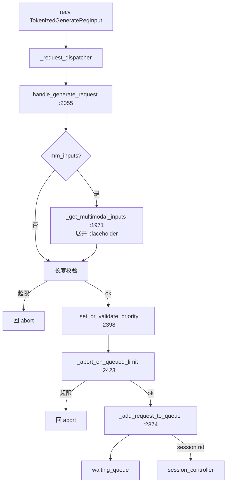

# 03.4.7 请求准入

## 定位

`handle_generate_request`（`scheduler.py:2055`）是 `TokenizedGenerateReqInput` 进入 Scheduler 后的第一站。它把 io_struct 消息翻译成内部 `Req`，做长度/优先级/排队上限校验后入 `waiting_queue`，未通过校验的请求立即回流 abort 给 TM。

## 职责

- 解析 `TokenizedGenerateReqInput` 成 `Req`（`schedule_batch.py:714`）
- 校验 `context_len`、`max_req_input_len`、image token 上限
- 多模态展开并填充 mm placeholder token
- 设定/校验 `priority`，必要时 abort 排队超限
- 维护 `waiting_queue` 与 `session_controller` 接力

## 关键类与函数

| 名称 | 定义位置 | 说明 |
|---|---|---|
| `handle_generate_request` | `managers/scheduler.py:2055` | 入口 |
| `_add_request_to_queue` | `managers/scheduler.py:2374` | 入队 |
| `_set_or_validate_priority` | `managers/scheduler.py:2398` | 优先级校验 |
| `_abort_on_queued_limit` | `managers/scheduler.py:2423` | 排队超限 abort |
| `_get_multimodal_inputs` | `managers/scheduler.py:1971` | mm 展开 |
| `process_input_requests` | `managers/scheduler.py:1645` | 上游帧入口 |
| `Req` | `managers/schedule_batch.py:714` | 请求内部模型（[03.9](03.9-schedule-batch.md)） |

## 数据流

## 实现要点

`handle_generate_request`（:2055）先 `TokenizedGenerateReqInput` → `Req` 字段映射（rid、input_ids、sampling_params、lora_path、session_id、priority）。多模态请求走 `_get_multimodal_inputs:1971`（实际逻辑在 :1971 拿 PickleWrapper → `MultimodalInputs`），把 mm placeholder token id 按 `mm_inputs` 偏移填回 `input_ids`；若 mm prompt 变长超过 `context_len`，立即向 TM 回 `FINISH_ABORT`（:2265）。

接着 `_set_or_validate_priority:2398`：若 `enable_priority_scheduling` 取 `req.priority`；否则把所有 `priority` 校成默认值，避免低优先级请求在高优先级队列里"作弊"。

`_abort_on_queued_limit:2423` 检查 `len(waiting_queue) >= server_args.max_queued_requests` 或估算总 token 超限；触发时通过 `ipc_channels.send_to_tokenizer` 直接发 abort，不再入队。`_add_request_to_queue:2374` 维护 `waiting_queue`（按 priority 排序）、更新 `session_controller`（`:maybe_reap` 由 `process_input_requests` 触发，详见 [`14`](../14-session-state/index.md)）和 `kv_events_publisher` 的 rid 注册。

非 `TokenizedGenerateReqInput` 的入口（控制类、health check、`EmbeddingReqInput`、`TokenizedEmbeddingReqInput`、score 路径）在 `_request_dispatcher`（`scheduler.py:1333`）分流；abort / weight / flush / lora 走 `scheduler_components` 内的对应处理器（[03.5](03.5-scheduler-components.md)）。

## 交叉引用

- 上游: [03.3.2 TM 生命周期](03.3.2-tm-generate-lifecycle.md)— 下发 `TokenizedGenerateReqInput`
- 下游: [03.4.4 下一批](03.4.4-scheduler-next-batch.md) — `waiting_queue` 被 `get_new_batch_prefill` 消费
- 相关: [03.9 schedule_batch](03.9-schedule-batch.md)、[03.10 schedule_policy](03.10-schedule-policy.md)、[`14 session-state`](../14-session-state/index.md)

## 进一步阅读

- 源码: `python/sglang/srt/managers/scheduler.py`、`python/sglang/srt/managers/schedule_batch.py`
