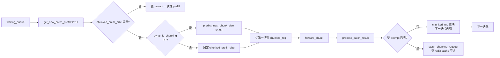

# 03.4.8 chunked prefill

## 定位

`chunked prefill` 把一条长 prompt 切成多个 ≤ `chunked_prefill_size` 的块，让一条长 prefill 与若干 decode 在同一前向迭代里共存，降低 TTFT 抖动、提升 GPU 利用率。状态由 `init_chunked_prefill`（`scheduler.py:984`）装配，决策由 `get_new_batch_prefill` + `predict_next_chunk_size` 完成。

## 职责

- 解析 `server_args.chunked_prefill_size` 与 `enable_mixed_chunk`
- 维护 `self.chunked_req` 单条续块指针
- `predict_next_chunk_size` 做 dynamic chunk（PP 路径）
- prefill 完成时调用 `stash_chunked_request` 把已处理 prefix 落 cache

## 关键类与函数

| 名称 | 定义位置 | 说明 |
|---|---|---|
| `init_chunked_prefill` | `managers/scheduler.py:984` | 状态初始化 |
| `get_new_batch_prefill` | `managers/scheduler.py:2811` | chunked 切分主体 |
| `predict_next_chunk_size` | `managers/scheduler.py:2893` / `scheduler_pp_mixin.py:768` | dynamic chunk |
| `_compute_chunked_req_next_prompt_token` | `managers/schedule_batch.py:1785` | 算下一块大小 |
| `stash_chunked_request` | `managers/scheduler.py` | cache 已 prefill 前缀 |
| `enable_dynamic_chunking` | `managers/scheduler.py:1010` | PP dynamic chunk 开关 |
| `ChunkSizePredictor` | `managers/scheduler_pp_mixin.py:1445` | PP 长度预测器 |
| `is_mixed_chunk` | `managers/scheduler.py:1004` | prefill+decode 混批开关 |

## 数据流

## 实现要点

`init_chunked_prefill`（:984）把 `server_args.chunked_prefill_size` 读入 `self.chunked_prefill_size`，但多模态模型用 Transformers 后端时强制 disable（:989-999），避免 mm partial chunk 错位。`is_mixed_chunk:1004` 只在 `chunked_prefill_size` 与 `enable_mixed_chunk` 同时启用时为真，意味着长 prompt chunk 与 decode 直接合并到同一 extend 批。

`get_new_batch_prefill:2811` 关键流程：

1. 若 `self.chunked_req` 非空：直接选它继续——避免新请求把它的 KV 写位置打断。`_compute_chunked_req_next_prompt_token`（`schedule_batch.py:1785`）算下一块长度，受 `chunked_prefill_size`、`max_prefill_tokens`、剩余 prompt 长度三者约束
2. 否则从 `waiting_queue` 取新 req，按 [03.10](03.10-schedule-policy.md) 的 `PrefillAdder` 准入；新请求也可能因 prompt > `chunked_prefill_size` 立即被标 `chunked_req`
3. PP 模式且 `enable_dynamic_chunking:1010` 时 `predict_next_chunk_size:2893` 调 `ChunkSizePredictor`（`scheduler_pp_mixin.py:1445`）按历史 latency 反推使每块"约一个 microbatch 时间"

`stash_chunked_request`（在 `process_batch_result_prefill` 与 `get_next_batch_to_run:2706` 调用）把已处理 prefix 经 `tree_cache.insert` 落到 radix 节点，下次续块直接复用 prefix_indices。

## 交叉引用

- 上游: [03.4.4 下一批](03.4.4-scheduler-next-batch.md)、[03.4.2 init](03.4.2-scheduler-init.md)
- 下游: [03.4.6 结果处理](03.4.6-scheduler-process-result.md)、[`07 KV Cache`](../07-kv-cache/index.md)
- 相关: [03.10 schedule_policy](03.10-schedule-policy.md)、[`08 分布式`](../08-distributed/index.md)（PP）

## 进一步阅读

- 源码: `python/sglang/srt/managers/scheduler.py`、`python/sglang/srt/managers/scheduler_pp_mixin.py`、`python/sglang/srt/managers/schedule_batch.py`
