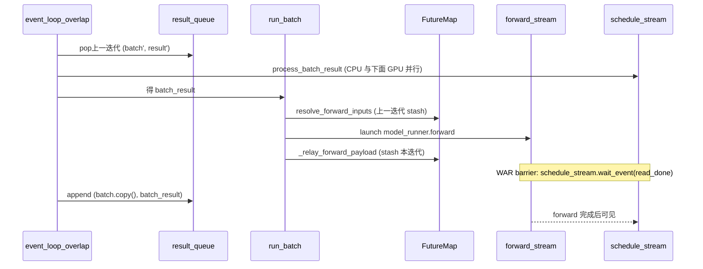

# 03.4.9 overlap 调度

## 定位

`event_loop_overlap`（`scheduler.py:1537`）通过把"上一迭代的 `process_batch_result`"延迟到当前迭代的 forward 期间执行，使 CPU 处理与 GPU 计算重叠；跨迭代共享的 GPU buffer 由 `FutureMap` + `_apply_war_barrier` + `_forward_isolation` 联合保障一致性。

## 职责

- 用 `result_queue` deque 把 process 推后一迭代
- `FutureMap` 跨迭代 stash/resolve `input_ids`、`seq_lens_cpu`、`confidence` 等 GPU 张量
- `_apply_war_barrier` 在 schedule_stream 上 fence 当前 forward 的共享读
- `_forward_isolation` 让一次前向变为可回滚事务
- `is_disable_overlap_for_batch` 在连续 prefill / spec+grammar 时退化为同步

## 关键类与函数

| 名称 | 定义位置 | 说明 |
|---|---|---|
| `event_loop_overlap` | `managers/scheduler.py:1537` | 主循环 |
| `pop_and_process` | `managers/scheduler.py:1543` | 取队首 `(batch, result)` |
| `_apply_war_barrier` | `managers/scheduler.py:1485` | WAR barrier |
| `_relay_forward_payload` | `managers/scheduler.py:3499` | FutureMap stash |
| `FutureMap` | `managers/overlap_utils.py:232` | 跨迭代张量容器 |
| `resolve_forward_inputs` | `managers/overlap_utils.py:84` | 下一迭代拉取 |
| `RelayPayload` | `managers/overlap_utils.py:129` | 单次 stash 数据 |
| `_forward_isolation` | `managers/scheduler.py:3227` | SB 事务化 |
| `is_disable_overlap_for_batch` | `managers/scheduler.py:1610` | 失能条件 |

## 重叠时序

## WAR barrier 与 relay

`event_loop_overlap`（:1537）每迭代：

1. `recv_requests` + `process_input_requests`
2. `get_next_batch_to_run` 出 plan
3. `is_disable_overlap_for_batch:1610` 判定。若失能（连续 prefill 由 `SGLANG_DISABLE_CONSECUTIVE_PREFILL_OVERLAP` 触发，或 spec+grammar）立即 `pop_and_process()` 提前结算上一批；否则推后
4. `run_batch(batch)` 调用 `_relay_forward_payload` 把 token id stash 进 FutureMap
5. `_apply_war_barrier`（:1485）在 launch 后立刻插 fence——schedule_stream 等 forward 的 read-done event；非 spec 走 fastpath（cuda graph snapshot 后的 event），spec V2 走 `force_coarse` 走整 stream wait
6. `pop_and_process()` 处理上一迭代的 `process_batch_result`（CPU）
7. `launch_batch_sample_if_needed`（grammar 等）

`FutureMap`（`overlap_utils.py:232`）持有 `RelayPayload` 缓冲：本迭代 `publish`（:470）/ `stash`（:501）写入；下迭代 `resolve_forward_inputs:84` 按当前 forward 模式读出。`ConfidenceRelay`（:153）专门处理 spec V2 的 confidence scatter，避免每 rank 都重算。这样 token id 张量从不在 host 上下游复制——纯 GPU 内存跨迭代 reusable。

`_forward_isolation:3227` 与 overlap 配合：overlap=True 时把 `(batch, snapshot)` 写入 `batch_record_buf`（双 buffer 切换）pin 两迭代，防 caching allocator 在 forward stream 完成前把张量回收。

## 退化为同步的条件

`is_disable_overlap_for_batch:1610` 失能：

- `SGLANG_DISABLE_CONSECUTIVE_PREFILL_OVERLAP` 且本次与上次均 extend（保 TTFT）
- spec + grammar 同批（overlap+spec+grammar 暂未支持，`need_grammar_sync:1635`）
- DP attention：用全局 `is_extend_in_batch` 替代本地 `forward_mode` 防 deadlock

## 交叉引用

- 上游: [03.4.3 事件循环](03.4.3-scheduler-event-loop.md)
- 下游: [03.4.5 run_batch](03.4.5-scheduler-run-batch-forward.md)、[03.10 schedule_policy](03.10-schedule-policy.md)
- 下游: [`10 投机解码`](../10-speculative/index.md)（FutureMap spec 路径）、[`08 分布式`](../08-distributed/index.md)（DP sync）
- 相关 skill: `.claude/skills/sglang-runtime-context`

## 进一步阅读

- 源码: `python/sglang/srt/managers/scheduler.py`、`python/sglang/srt/managers/overlap_utils.py`
