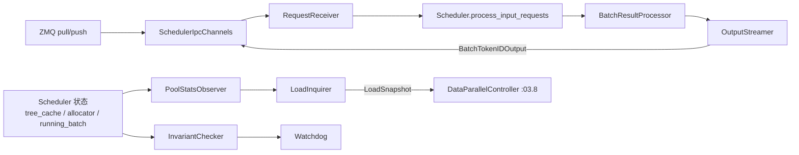

# 03.5 scheduler_components 协作者

## 定位

`scheduler_components/` 把 Scheduler 的"非核心"职责拆为独立类，经 `init_*`（`scheduler.py:1721-1844`）装配到 `self.<name>` 字段。每个组件单一职责，便于测试与自定义 fork。

## 职责

按职能分组：

- IPC 与接收: `SchedulerIpcChannels`、`SchedulerRequestReceiver`、`SenderWrapper`、`SchedulerRecvSkipper`、`IdleSleeper`、`SchedulerInputBlocker`
- 输出: `SchedulerOutputStreamer`、`SchedulerBatchResultProcessor`、`SchedulerLogprobResultProcessor`、`SchedulerFlushWrapper`
- 观测: `SchedulerMetricsReporter`（+ `PrefillStats`）、`SchedulerPoolStatsObserver`（+ `PoolStats`）、`SchedulerKvEventsPublisher`、`SchedulerLoadInquirer`、`SchedulerProfilerManager`
- 内存与一致性: `SchedulerInvariantChecker`（+ `create_scheduler_watchdog`）、`NewTokenRatioTracker`
- 控制面执行: `SchedulerWeightUpdaterManager`
- DP attention: `SchedulerDPAttnAdapter`、`MLPSyncBatchInfo`

## 关键类与函数

| 名称 | 定义位置 | 说明 |
|---|---|---|
| `SchedulerIpcChannels` | `scheduler_components/ipc_channels.py:17` | 持有全部 ZMQ socket |
| `SchedulerRequestReceiver` | `scheduler_components/request_receiver.py:46` | recv + 排队 + mm 共享内存 |
| `SchedulerOutputStreamer` | `scheduler_components/output_streamer.py:39` | 流切分 + `BatchTokenIDOutput` |
| `SchedulerBatchResultProcessor` | `scheduler_components/batch_result_processor.py:64` | prefill/decode/idle 分流 |
| `SchedulerLogprobResultProcessor` | `scheduler_components/logprob_result_processor.py:21` | logprob 后处理 |
| `SchedulerMetricsReporter` | `scheduler_components/metrics_reporter.py:90` | 指标聚合 |
| `PrefillStats` | `scheduler_components/metrics_reporter.py:55` | prefill 单批统计 |
| `SchedulerPoolStatsObserver` | `scheduler_components/pool_stats_observer.py:142` | pool 状态统计 |
| `PoolStats` | `scheduler_components/pool_stats_observer.py:24` | 快照数据类 |
| `SchedulerLoadInquirer` | `scheduler_components/load_inquirer.py:33` | 把状态写成 `LoadSnapshot` |
| `SchedulerKvEventsPublisher` | `scheduler_components/kv_events_publisher.py:45` | kv events |
| `SchedulerProfilerManager` | `scheduler_components/profiler_manager.py:51` | torch profiler 控制 |
| `SchedulerWeightUpdaterManager` | `scheduler_components/weight_updater.py:76` | 权重热更 |
| `SchedulerInvariantChecker` | `scheduler_components/invariant_checker.py:44` | self-check 与 watchdog |
| `create_scheduler_watchdog` | `scheduler_components/invariant_checker.py:464` | 启动 daemon watchdog |
| `SchedulerDPAttnAdapter` | `scheduler_components/dp_attn.py:364` | DP attention 适配 |
| `SchedulerFlushWrapper` | `scheduler_components/flush_wrapper.py:11` | flush cache 状态封装 |
| `IdleSleeper` | `scheduler_components/idle_sleeper.py:8` | idle 时 sleep |
| `SchedulerRecvSkipper` | `scheduler_components/recv_skipper.py:13` | 控制接收节奏 |
| `NewTokenRatioTracker` | `scheduler_components/new_token_ratio_tracker.py:14` | OOM 后 ratio 调整 |

## 协作者装配（init 链 1721-1844）

| init_* | 行号 | 目的 |
|---|---|---|
| `init_request_receiver` | `scheduler.py:1721` | 把 IPC socket、recv_skipper、input_blocker、mm_receiver、stream_output 包装 |
| `init_dp_attn_adapter` | `scheduler.py:1744` | DP attn + spec 协同配置 |
| `init_pool_stats_observer` | `scheduler.py:1759` | 监听 tree_cache / allocator / pool |
| `init_invariant_checker` | `scheduler.py:1776` | 一致性与 watchdog |
| `init_kv_events_publisher` | `scheduler.py:1794` | kv events 给外部订阅 |
| `init_load_inquirer` | `scheduler.py:1809` | 把 stats 写成 `LoadSnapshot`（`load_snapshot.py:193`）给 DPC |
| `init_output_streamer` | `scheduler.py:1832` | 流切分 |
| `init_batch_result_processor` | `scheduler.py:1844` | 把上面所有注入 |

## 子模块树

- `scheduler_components/__init__.py` — re-export
- IPC: `ipc_channels.py`、`request_receiver.py`、`output_sender.py`、`flush_wrapper.py`、`recv_skipper.py`、`idle_sleeper.py`
- 输出: `output_streamer.py`、`batch_result_processor.py`、`logprob_result_processor.py`
- 观测: `metrics_reporter.py`、`pool_stats_observer.py`、`kv_events_publisher.py`、`load_inquirer.py`、`profiler_manager.py`
- 一致性: `invariant_checker.py`、`new_token_ratio_tracker.py`
- 控制: `weight_updater.py`
- DP: `dp_attn.py`

## 数据流

## 交叉引用

- 上游: [03.4.1 结构](03.4.1-scheduler-structure.md)、[03.4.2 init](03.4.2-scheduler-init.md)
- 下游: [03.6 TpWorker](03.6-tp-worker.md)、[03.8 DPC](03.8-dp-controller.md)
- 下游: [`07 KV Cache`](../07-kv-cache/index.md)（pool_stats）、[`13 LoRA`](../13-lora/index.md)（weight_updater）、[`17 observability`](../17-observability-ops/index.md)（metrics/profile/kv-events）

## 进一步阅读

- 源码: `python/sglang/srt/managers/scheduler_components/`
