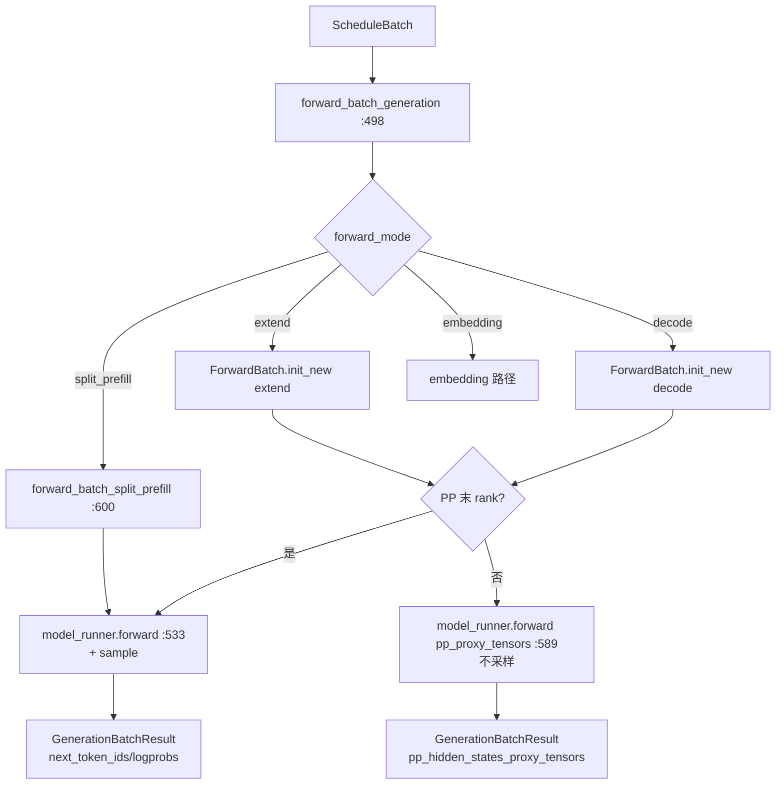

# 03.6 TpModelWorker

## 定位

`TpModelWorker`（`tp_worker.py:242`）是 Scheduler 与 `ModelRunner` 之间的薄层：把 `ScheduleBatch` 转成 `ForwardBatch`、触发 `model_runner.forward`、把结果包装回 `GenerationBatchResult`。它处理 PP 非末 rank 的 proxy 中转、CUDA graph 复用、注意力后端选择与内存池分配。

## 职责

- `forward_batch_generation`：decode / extend / split_prefill / embedding 多分支
- `alloc_memory_pool`：建 `req_to_token_pool` 与 `token_to_kv_pool_allocator`
- `init_attention_backends`：根据 server_args 选 flash/flashinfer/triton 等
- `init_cuda_graphs`：捕获 decode graph，配套 `war_fastpath_runner`
- PP 非末 rank：只跑前向，回 `pp_hidden_states_proxy_tensors` 不采样

## 关键类与函数

| 名称 | 定义位置 | 说明 |
|---|---|---|
| `BaseTpWorker` | `managers/tp_worker.py:68` | 抽象基类 |
| `TpModelWorker` | `managers/tp_worker.py:242` | 主实现 |
| `forward_batch_generation` | `managers/tp_worker.py:498` | 前向主入口 |
| `model_runner.forward`（末 rank） | `managers/tp_worker.py:533` | 真前向 + sample |
| `model_runner.forward`（PP 非末） | `managers/tp_worker.py:589` | 只拿 proxy 不采样 |
| `alloc_memory_pool` | `managers/tp_worker.py:330` | 内存池分配 |
| `init_attention_backends` | `managers/tp_worker.py:357` | attn backend 选择 |
| `init_cuda_graphs` | `managers/tp_worker.py:363` | cuda graph 捕获 |
| `forward_batch_split_prefill` | `managers/tp_worker.py:600` | 分块 prefill 路径 |
| `GenerationBatchResult` | `managers/utils.py:39` | 结果包装 |

## 子模块树

- `tp_worker.py` — 主类
- `TpModelWorker` 依赖: `ModelRunner`（[`04.1`](../04-model-execution/04.1-model-runner.md)）、`ForwardBatch`（[`04`](../04-model-execution/index.md)）、`SamplingBatchInfo`（[`11.1`](../11-sampling-control/11.1-sampling-params-sbi.md)）

## 数据流

## 实现要点

`TpModelWorker`（`:242`）的 `__init__`（`:245`）持有 `model_runner` 与 `server_args`、`gpu_id`、`tp_rank`。`alloc_memory_pool:330` 由 `init_memory_pools:822` 调用——基于 `max_running_requests:350` 与 `max_prefill_tokens` 算出 pool size，建 `req_to_token_pool`、`token_to_kv_pool_allocator`、`tree_cache`（实际逻辑在 `kv_cache_builder` 内，[04](../04-model-execution/index.md) 联动）。

`init_attention_backends:357` 根据 `server_args.attention_backend` 与模型架构选 `FlashInferAttnBackend` / `FlashAttentionAttnBackend` / `TritonAttnBackend` 等（详见 [`06 Layers`](../06-layers/index.md)、[`15 kernels`](../15-kernels-hardware/index.md)）。`init_cuda_graphs:363` 捕获 decode graph 并产出 `war_fastpath_runner`——overlap 模式下 `_apply_war_barrier:1485` 依赖它的 `war_fastpath_read_done_event` 做 fastpath 同步。

`forward_batch_generation:498` 把 `ScheduleBatch` 转 `ForwardBatch` 后，按 mode 分流：

- extend（含 chunked prefill 续块）/ decode / embedding：调 `model_runner.forward`（`:533`）；返回 `logits_output` 后 `model_runner.sample` 取 token，可选 `compute_logprobs_only`（:583）
- PP 非末 rank：调 `model_runner.forward(pp_proxy_tensors=...)`（`:589`），不 sample，只把 hidden states 作为 proxy 给下一 PP stage
- split_prefill（`:600`）：对 prefill 长度极大的请求二次切分，让 forward 在多个 split_forward_count 内完成

`GenerationBatchResult`（`utils.py:39`）封装 `next_token_ids`、`logits`、`logprobs`、`hidden_states`、`pp_hidden_states_proxy_tensors`、`can_run_cuda_graph` 与 `extra_keep_alive_refs`——overlap（[03.4.9](03.4.9-scheduler-overlap.md)）通过 `extra_keep_alive_refs` pin 住跨迭代张量。

## 交叉引用

- 上游: [03.4.5 run_batch](03.4.5-scheduler-run-batch-forward.md)、[03.4.2 init](03.4.2-scheduler-init.md)
- 下游: [`04 模型执行`](../04-model-execution/04.1-model-runner.md)、[`06 Layers`](../06-layers/index.md)、[`15 kernels`](../15-kernels-hardware/index.md)
- 相关: [`08 分布式`](../08-distributed/index.md)（PP/TP）、[`10 投机解码`](../10-speculative/index.md)（draft worker）、[`11 采样控制`](../11-sampling-control/11.1-sampling-params-sbi.md)

## 进一步阅读

- 源码: `python/sglang/srt/managers/tp_worker.py`、`python/sglang/srt/managers/utils.py`
