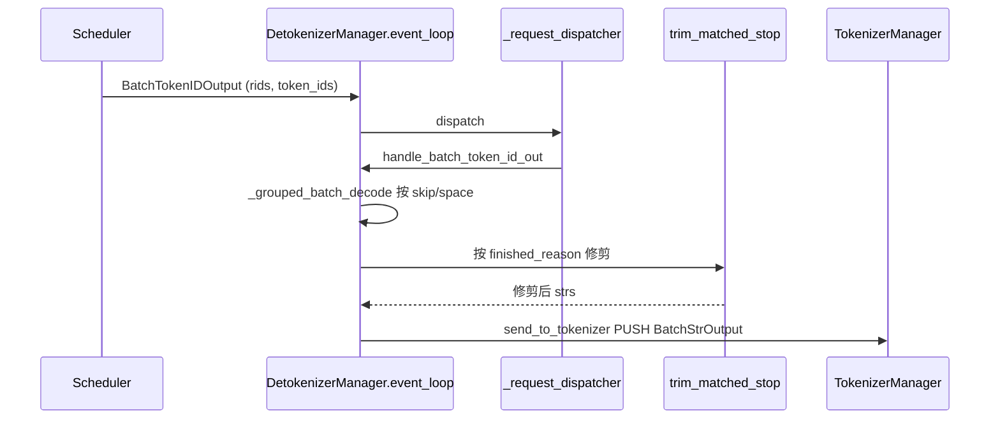

# 03.7 DetokenizerManager

## 定位

`DetokenizerManager`（`detokenizer_manager.py:91`）运行在独立子进程，接收 `Scheduler` 推来的 `BatchTokenIDOutput`（`io_struct.py:1209`），把 token id 解码为字符串、做 stop str/token 修剪后封成 `BatchStrOutput`（`io_struct.py:1300`）回推给 `TokenizerManager`。

## 职责

- 经 `_request_dispatcher` 区分 `BatchTokenIDOutput` / `BatchEmbeddingOutput` / `FreezeGCReq` / `ConfigureLoggingReq`
- `handle_batch_token_id_out` 按 rid 取历史 skip_list、space_list，分组调用 tokenizer
- `trim_matched_stop` 按 `finished_reason` 修剪输出
- 维持 `LimitedCapacityDict` rid→DecodeStatus 缓存，避免跨请求错位
- 多 HTTP worker 模式经 `MultiHttpWorkerDetokenizerMixin` 协同

## 关键类与函数

| 名称 | 定义位置 | 说明 |
|---|---|---|
| `DetokenizerManager` | `managers/detokenizer_manager.py:91` | 主类 |
| `init_request_dispatcher` | `managers/detokenizer_manager.py:151` | dispatcher 注册 |
| `event_loop` | `managers/detokenizer_manager.py:161` | while True |
| `trim_matched_stop` | `managers/detokenizer_manager.py:171` | stop 修剪 |
| `handle_batch_token_id_out` | `managers/detokenizer_manager.py:406` | 主处理 |
| `_decode_batch_token_id_output` | `managers/detokenizer_manager.py:271` | 分组解码 |
| `_grouped_batch_decode` | `managers/detokenizer_manager.py:207` | 按 skip/space 分组 |
| `DecodeStatus` | `managers/detokenizer_manager.py:64` | rid 状态缓存 |
| `MultiHttpWorkerDetokenizerMixin` | `managers/multi_tokenizer_mixin.py:374` | 多 worker |
| `run_detokenizer_process` | `managers/detokenizer_manager.py:488` | 进程入口 |

## 数据流

## 实现要点

`event_loop:161` 是同步 while True：`sock_recv` 阻塞拿 `BatchTokenIDOutput`，交 `_request_dispatcher:151`。dispatcher 注册四类：

- `BatchTokenIDOutput` → `handle_batch_token_id_out:406`
- `BatchEmbeddingOutput` → `handle_batch_embedding_out:203`（直接透传，无解码）
- `FreezeGCReq` → `handle_freeze_gc_req`
- `ConfigureLoggingReq` → `handle_configure_logging_req`

`handle_batch_token_id_out`（:406）先查 `DecodeStatus`（`:64`）缓存——detokenizer 持续迭代 decoder 需要"上一段已 decode 的字符"以增量取增量字符，缓存按 rid 与 `skip_special_tokens` / `spaces_between_special_tokens` 二元组分组。`_grouped_batch_decode:207` 把同分组批量喂 tokenizer 的一次 batch_decode；`_decode_batch_token_id_output:271` 串起分组与 trim。

`trim_matched_stop:171` 按 `finished_reason.matched` 的类型修剪：

- 字符串 matched：保留或截断 matched 子串前缀（`no_stop_trim` 决定）
- token id matched：丢最后 token；特殊工具调用 token（如 gpt-oss `200012`）保留
- regex matched：按 regex 长度截断

`LimitedCapacityDict`（`:475`）按容量淘汰 rid→DecodeStatus，防长尾请求内存泄漏。多 HTTP worker 场景下，`MultiHttpWorkerDetokenizerMixin:374` 按 `http_worker_ipc` 字段把 `BatchStrOutput` 选对 socket 发回，详见 [03.3.7](03.3.7-tm-multi-tokenizer.md)。

`init_ipc_channels:111` 建立 `recv_from_scheduler` 与 `send_to_tokenizer`；`init_tokenizer:124` 用 `get_tokenizer` 取得分词器。`soft_watchdog`（:141）防止 decode 卡死。

## 交叉引用

- 上游: [03.4.6 结果处理](03.4.6-scheduler-process-result.md)、[03.4.5 run_batch](03.4.5-scheduler-run-batch-forward.md)
- 下游: [03.3.4 TM handle_loop](03.3.4-tm-handle-loop-streaming.md)、[03.2 io_struct](03.2-io-struct.md)
- 下游: [`02 服务入口`](../02-server-api/index.md) — SSE 推送
- 相关: [03.1 管线总览](03.1-pipeline-overview.md)、[03.8 DPC](03.8-dp-controller.md)

## 进一步阅读

- 源码: `python/sglang/srt/managers/detokenizer_manager.py`
