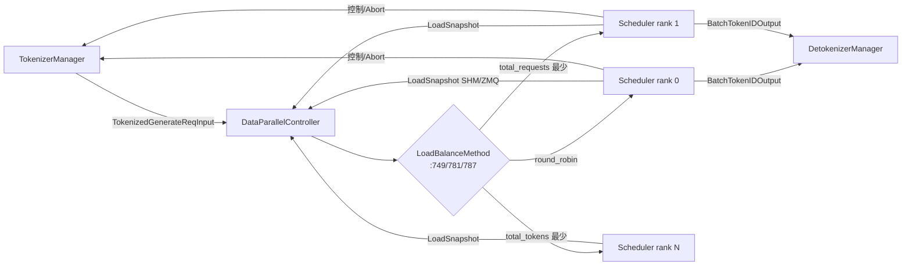

# 03.8 DataParallelController

## 定位

`DataParallelController`（`data_parallel_controller.py:130`）在 `dp_size>1` 时作为 Scheduler 前置路由器：TM 不再直连 Scheduler，而把请求交给 DPC，由 DPC 按负载均衡策略转发给某 rank 的 Scheduler 子进程；同时把各 Scheduler 的控制回包按 rid 还原给 TM。

## 职责

- 接收 TM 经 `tokenizer_worker_ipc` PUSH 来的请求/控制消息
- 按 `LoadBalanceMethod` 选 rank：`ROUND_ROBIN` / `TOTAL_REQUESTS` / `TOTAL_TOKENS`
- 经 `FanOutCommunicator` 把控制消息（flush/weight/lora/pause）广播到所有 DP rank
- 从各 Scheduler 收 `LoadSnapshot`，更新 `total_requests` / `total_tokens`
- forward 控制回包与状态回包给 TM

## 关键类与函数

| 名称 | 定义位置 | 说明 |
|---|---|---|
| `DataParallelController` | `managers/data_parallel_controller.py:130` | 主类 |
| `DPBudget` | `managers/data_parallel_controller.py:94` | 每 rank 预算/计数 |
| `LoadBalanceMethod` | `managers/data_parallel_controller.py:77` | 三选一枚举 |
| `event_loop` | `managers/data_parallel_controller.py:796` | 主循环 |
| `round_robin_scheduler` | `managers/data_parallel_controller.py:749` | RR 策略 |
| `total_requests_scheduler` | `managers/data_parallel_controller.py:781` | 总请求最少优先 |
| `total_tokens_scheduler` | `managers/data_parallel_controller.py:787` | 总 token 最少优先 |
| `init_dispatcher` | `managers/data_parallel_controller.py:342` | `_request_dispatcher` |
| `run_data_parallel_controller_process` | `managers/data_parallel_controller.py:807` | 进程入口 |
| `LoadSnapshot` | `managers/load_snapshot.py:193` | rank 负载快照 |

## 子模块树

- `data_parallel_controller.py` — 主类
- `load_snapshot.py` — `LoadSnapshot` 结构 + ZMQ/SHM 双写
- `min_free_slots_delayer.py` / `prefill_delayer.py` — 跨 DP 协调延迟器

## 数据流

## 实现要点

`event_loop:796` 同步 while True：`sock_recv` 从 `recv_from_tokenizer` 拿消息后 `_request_dispatcher`（`init_dispatcher:342`）分流。生成请求类消息走 `round_robin_scheduler:749` / `total_requests_scheduler:781` / `total_tokens_scheduler:787` 之一：

- `round_robin`（:749）：维护 `self.round_robin_counter`，简单取模；当某 rank `paused` 或不在 active 集合则跳过
- `total_requests`（:781）：取 `self.total_requests.index(min)`；`total_requests`（:97）每 rank 一项，每次下发时 +1（:125）
- `total_tokens`（:787）：取 `total_tokens` 最小、`total_requests` 作 tie-breaker（:119）；`total_tokens`（:98）按估算 token +1（:126）

`LoadSnapshot`（`load_snapshot.py:193`）由每个 Scheduler 经 `SchedulerLoadInquirer`（[03.5](03.5-scheduler-components.md)）写入——TM/DPC 的 `create_load_snapshot_reader`（`load_snapshot.py:641`）按 ZMQ 或 SHM 取一份。`LoadSnapshot` 字段含 `num_used_tokens`、`num_total_tokens`、`max_running_requests`、`queue_metrics` 等，由 DPC 的 `update_load` 更新 budget 计数（`:97/107/110`）。

控制类消息（`FlushCacheReqInput`、`WeightReqInput`、`PauseReq`）经 DPC 的 fallback 走 `send_control_message` 广播（`init_dispatcher:360`），它内部用 `FanOutCommunicator`（[03.3.5](03.3.5-tm-control-mixin.md)）的简化版做 fan-out + ack 收集。

DP attention 模式（`enable_dp_attention`）下，请求虽然经 DPC，但 forward 是所有 rank 联合的——DPC 不按负载挑 rank，而是把请求"广播到所有 rank"由它们同步处理；这与普通 DP（请求只去一个 rank）是关键差异，详见 [`08 分布式`](../08-distributed/index.md)。

## 交叉引用

- 上游: [03.1 管线总览](03.1-pipeline-overview.md)、[03.3.1 TM 结构](03.3.1-tokenizer-manager.md)
- 下游: [03.4.1 Scheduler](03.4.1-scheduler-structure.md)、[03.5 协作者](03.5-scheduler-components.md)（`SchedulerLoadInquirer`）
- 周边: [`08 分布式`](../08-distributed/index.md)、[`17 observability`](../17-observability-ops/index.md)（load snapshot 对外暴露）、[`09 分离式`](../09-disaggregation/index.md)（PD 拓扑下 DPC 承担路由）

## 进一步阅读

- 源码: `python/sglang/srt/managers/data_parallel_controller.py`、`python/sglang/srt/managers/load_snapshot.py`
