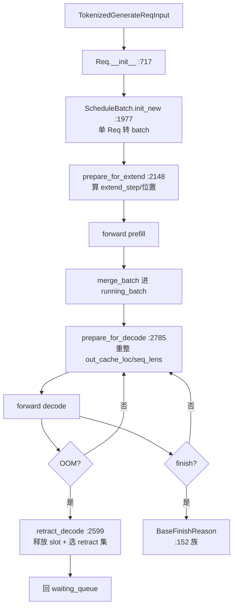

# 03.9 schedule_batch 数据模型

## 定位

`Req`（`schedule_batch.py:714`）与 `ScheduleBatch`（`schedule_batch.py:1803`）是 Scheduler 内部所有调度与前向的"共享数据模型"。30+ 字段的 `Req` 表达单请求生命周期；`ScheduleBatch` 把一组 `Req` 折叠成可被一次 forward 消费的批次，并携带 `prepare_for_extend` / `prepare_for_decode` / `retract_decode` 等 batch 级操作。

## 职责

- `Req`：rid、input_ids、sampling_params、lora、session、priority、mm_inputs、logprob、finish 状态
- `ScheduleBatch`：`reqs`、`forward_mode`、`out_cache_loc`、`seq_lens`、`sampling_info`、`spec_info`、`multimodal_inputs` 等
- 提供 `init_new` / `prepare_for_extend` / `prepare_for_decode` / `retract_decode` / `merge_batch` / `filter_batch`
- 表达 finish 原因族与多模态数据模型

## 关键类与函数

| 名称 | 定义位置 | 说明 |
|---|---|---|
| `BaseFinishReason` | `managers/schedule_batch.py:152` | finish 基类 |
| `FINISH_MATCHED_TOKEN` | `managers/schedule_batch.py:157` | stop token 命中 |
| `FINISH_MATCHED_STR` | `managers/schedule_batch.py:169` | stop str 命中 |
| `FINISHED_MATCHED_REGEX` | `managers/schedule_batch.py:181` | regex 命中 |
| `FINISH_LENGTH` | `managers/schedule_batch.py:193` | 达到 max_new_tokens |
| `FINISH_ABORT` | `managers/schedule_batch.py:205` | 被 abort |
| `MultimodalDataItem` | `managers/schedule_batch.py:247` | 单 mm 输入数据项 |
| `MultimodalProcessorOutput` | `managers/schedule_batch.py:415` | processor 输出 |
| `MultimodalInputs` | `managers/schedule_batch.py:499` | Scheduler 端 mm 模型 |
| `ReqLogprob` | `managers/schedule_batch.py:683` | logprob 状态 |
| `ReqKvInfo` | `managers/schedule_batch.py:704` | KV 节点引用 |
| `Req` | `managers/schedule_batch.py:714` | 请求主体（30+字段） |
| `ScheduleBatch` | `managers/schedule_batch.py:1803` | 批次主体 |
| `init_new` | `managers/schedule_batch.py:1977` | 单 req 转 batch |
| `prepare_for_extend` | `managers/schedule_batch.py:2148` | prefill 前整理 |
| `prepare_for_decode` | `managers/schedule_batch.py:2785` | decode 前整理 |
| `retract_decode` | `managers/schedule_batch.py:2599` | 退一批回 waiting |
| `merge_batch` | `managers/schedule_batch.py` | 合并两批 |
| `filter_batch` | `managers/schedule_batch.py` | 移除 finished |
| `NextBatchPlan` | `managers/schedule_batch.py:3105` | 决策结果 |

## 数据流

## 实现要点

`Req`（`:714`）字段分四组：身份（`rid`、`client_id`、`session_id`）、输入（`origin_input_ids`、`prefix_indices`、`extend_range`、`multimodal_inputs`、`lora_path`、`priority`、`sampling_params`/`SamplingBatchInfo`）、输出（`output_ids`、`output_text`、`finish_reason`）、辅助（`logprob`、`kv_info`、`dllm_incomplete_ids`、`spec_info`）。`cross-encoder model` 字段（`:792`）标 score 路径请求。

`ScheduleBatch`（`:1803`）字段（部分）：`reqs`、`forward_mode`、`out_cache_loc`、`seq_lens`、`seq_lens_cpu`、`input_ids`、`extend_num_tokens`、`is_extend_in_batch`、`batch_is_full`、`chunked_req`、`split_index`、`multimodal_inputs:1948`、`spec_info`、`sampling_info`、`hisparse_coordinator`。

`prepare_for_extend:2148` 算 prefill 位置（`extend_step`、`slot_mapping`、`seq_lens`）、合并 mm_inputs（:2206-2381）、设置采样 batch info。`prepare_for_decode:2785` 重整 decode tensor，clip mm_inputs（:2895）。`merge_batch` 把两批的 reqs/tensors 拼接、`multimodal_inputs` extend。`filter_batch` 移除 `finished()` 的 req。

`retract_decode:2599`（[03.4.10](03.4.10-scheduler-retract-oom.md)）：按 `server_args.retract_check` 选 retract 集、`tree_cache.free_req` 释放、把 retract 请求的 `prefix_indices` 与 `extend_range` 重置为"上一段已 cache 的位置"，让下次重 prefill 还能走 radix prefix 复用。

`NextBatchPlan`（`:3105`）是 `msgspec.Struct`，把 `get_next_batch_to_run` 的双输出（`batch_to_run`、`running_batch`）显式化，避免歧义。

## 交叉引用

- 上游: [03.4.7 准入](03.4.7-scheduler-request-admission.md)、[03.4.4 下一批](03.4.4-scheduler-next-batch.md)
- 下游: [03.4.5 run_batch](03.4.5-scheduler-run-batch-forward.md)、[03.4.10 retract](03.4.10-scheduler-retract-oom.md)
- 下游: [`07 KV Cache`](../07-kv-cache/07.3-radix-cache.md)（`tree_cache`、prefix_indices）、[`11 采样控制`](../11-sampling-control/11.1-sampling-params-sbi.md)（`SamplingBatchInfo`）、[`12 多模态`](../12-multimodal/index.md)（mm_inputs）、[`13 LoRA`](../13-lora/index.md)（lora_path）

## 进一步阅读

- 源码: `python/sglang/srt/managers/schedule_batch.py`
