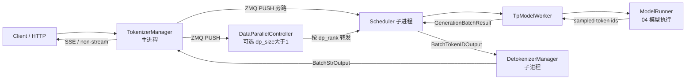

# 03 核心调度与编排管线

## 子系统定位

SGLang 的 serving 实例由三个长驻组件经 ZMQ IPC 串联：`TokenizerManager`（主进程内）→ `Scheduler`（worker 子进程，可选经 `DataParallelController` 转发）→ `DetokenizerManager`（另一子进程）。三者由 `engine.py:187-194` 的 `Engine` 类拉起，并构成单次请求的闭环：HTTP 请求经 `TokenizerManager` 编码为 `TokenizedGenerateReqInput` 后入队 `Scheduler`；`Scheduler` 在连续批调度循环里通过 `TpModelWorker` 驱动 `ModelRunner` 前向；生成的 token id 流回 `DetokenizerManager`，反编码为字符串后再回 `TokenizerManager` 推送给客户端。本子系统覆盖这条管线上的全部消息契约、调度循环、批/请求模型、overlap/retract/OOM 策略与协作者装配，是 SGLang 性能与正确性的中枢。

## 管线总览

## 子系统导航

- [03.1 管线总览](03.1-pipeline-overview.md) — 三组件契约、进程树与 io_struct 消息流
- [03.2 io_struct 消息契约](03.2-io-struct.md) — msgspec 结构族与 ZMQ 编解码
- TokenizerManager 体系
  - [03.3.1 TokenizerManager 结构](03.3.1-tokenizer-manager.md)
  - [03.3.2 generate_request 生命周期](03.3.2-tm-generate-lifecycle.md)
  - [03.3.3 分词与多模态](03.3.3-tm-tokenize-mm.md)
  - [03.3.4 handle_loop 与流式聚合](03.3.4-tm-handle-loop-streaming.md)
  - [03.3.5 控制面广播 mixin](03.3.5-tm-control-mixin.md)
  - [03.3.6 score mixin](03.3.6-tm-score-mixin.md)
  - [03.3.7 多 tokenizer 路由](03.3.7-tm-multi-tokenizer.md)
- Scheduler 体系
  - [03.4.1 Scheduler 类结构](03.4.1-scheduler-structure.md)
  - [03.4.2 init 编排链](03.4.2-scheduler-init.md)
  - [03.4.3 事件循环](03.4.3-scheduler-event-loop.md)
  - [03.4.4 下一批构造](03.4.4-scheduler-next-batch.md)
  - [03.4.5 run_batch 前向](03.4.5-scheduler-run-batch-forward.md)
  - [03.4.6 结果处理](03.4.6-scheduler-process-result.md)
  - [03.4.7 请求准入](03.4.7-scheduler-request-admission.md)
  - [03.4.8 chunked prefill](03.4.8-scheduler-chunked-prefill.md)
  - [03.4.9 overlap 调度](03.4.9-scheduler-overlap.md)
  - [03.4.10 retract/OOM](03.4.10-scheduler-retract-oom.md)
- [03.5 scheduler_components 协作者](03.5-scheduler-components.md) — 拆分的子模块全表
- [03.6 TpModelWorker](03.6-tp-worker.md) — Scheduler 与 ModelRunner 之间的并发层
- [03.7 DetokenizerManager](03.7-detokenizer.md) — token id → 文本
- [03.8 DataParallelController](03.8-dp-controller.md) — DP 路由与负载均衡
- [03.9 schedule_batch 数据模型](03.9-schedule-batch.md) — `Req` / `ScheduleBatch`
- [03.10 schedule_policy 准入策略](03.10-schedule-policy.md) — `PrefillAdder` / `AddReqResult`

## 交叉引用

- 上游: [`02 服务入口`](../02-server-api/index.md) — HTTP/gRPC 把请求交给 `TokenizerManager`
- 下游: [`04 模型执行`](../04-model-execution/index.md) — 由 `TpModelWorker` 触发
- 下游: [`07 KV Cache`](../07-kv-cache/index.md) — Scheduler 调用 `tree_cache` / `token_to_kv_pool_allocator`
- 下游: [`08 分布式`](../08-distributed/index.md) — TP/PP/DP/EP 通信
- 下游: [`11 采样控制`](../11-sampling-control/index.md) — `SamplingBatchInfo` 在 `run_batch` 内消费
- 相关 skill: `.claude/skills/sglang-runtime-context`、`.claude/skills/large-class-style`

## 进一步阅读

- 源码: `python/sglang/srt/entrypoints/engine.py`、`python/sglang/srt/managers/`
