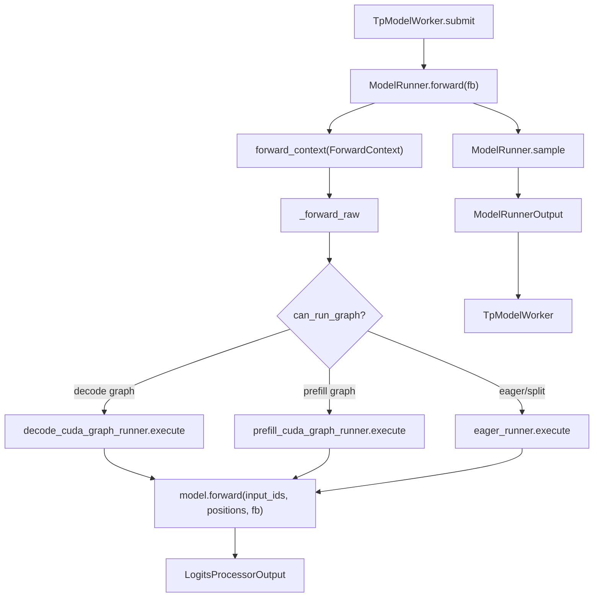

# 04.1 ModelRunner

## 定位

`ModelRunner` 是 04 子系统的总控类，由 [`03.6 TpModelWorker`](../03-orchestration/03.6-tp-worker.md) 持有，负责一次 forward 的完整生命周期：注意力后端初始化、模型加载、CUDA graph 捕获、forward 分发、采样。它把 `ScheduleBatch` 包装成 `ForwardBatch`，调用 `nn.Module.forward`，再把 logits 转成 `ModelRunnerOutput`。

## 职责

- 持有 `model`、`attn_backend` / `decode_attn_backend`、`req_to_token_pool`、`token_to_kv_pool_allocator`、`sampler`。
- 持有 `eager_runner` / `decode_cuda_graph_runner` / `prefill_cuda_graph_runner` 三条执行路径。
- `initialize()`：内存 saver、EPLB/LoRA/采样器初始化、`load_model`、`prepare_moe_topk`、KV cache dtype 配置。
- `init_attention_backends()` / `init_cuda_graphs()`：构建注意力后端与三条 runner。
- `forward()`：进入 `ForwardContext`，调用 `_forward_raw` 选择路径，挂专家分布度量。
- `sample()` / `compute_logprobs_only()`：logits 预处理与采样。
- 协调 ngram embedding、EPLB、elastic EP、msprobe、cuda graph canary 等子能力。

## 关键类与函数

| 名称 | 定义位置 | 说明 |
|---|---|---|
| `ModelRunner` | `model_executor/model_runner.py:235` | 单步前向执行总控（`__init__` 在 `:238`） |
| `ModelRunner.initialize` | `model_executor/model_runner.py:556` | 串起 load_model + moe_topk + lora + KV dtype 等初始化 |
| `ModelRunner.init_attention_backends` | `model_executor/model_runner.py:818` | 委托 `build_attention_backends`，配置 aux hidden 捕获 |
| `ModelRunner.init_cuda_graphs` | `model_executor/model_runner.py:837` | 委托 `capture_cuda_graphs`，产出三条 runner |
| `ModelRunner.load_model` | `model_executor/model_runner.py:901` | 构建 LoadConfig，调用 `load_model_with_memory_saver` |
| `ModelRunner.forward` | `model_executor/model_runner.py:1231` | 入口：profile range + `_forward_raw` + 采样前置 |
| `ModelRunner._forward_raw` | `model_executor/model_runner.py:1375` | 按 `ForwardMode` 分发到 cuda graph / prefill cg / eager |
| `ModelRunner.sample` | `model_executor/model_runner.py:1491` | `_preprocess_logits` + `sampler` + ngram update |

## 子模块树

- `model_executor/model_runner.py` — `ModelRunner` 主体
- `model_executor/model_runner_components/` — 拆分的初始化/捕获/EPLB 子组件（见 [04.5](04.5-runner-components.md)）
- `model_executor/runner/` — eager / cuda graph runner（见 [04.4](04.4-runners.md)）
- `model_executor/forward_batch_info.py` — `ForwardBatch`/`ForwardMode`（见 [04.2](04.2-forward-batch-mode.md)）
- `model_executor/forward_context.py` — `ForwardContext`（见 [04.3](04.3-forward-context.md)）

## 数据流 / 控制流

`forward()` 先包一层 profile range 与 expert distribution recorder，再调用 `_forward_raw`。后者先发布 `ForwardContext`（除非 caller 已发布），用 `can_run_graph` 判定走哪条路径：decode CUDA graph → 直接 replay；prefill CUDA graph → `prefill_cuda_graph_runner.execute`；其余（含 split prefill 与 idle）→ `eager_runner.execute`。回 `LogitsProcessorOutput` 后，`forward` 调用 experts/indexer capturer、EPLB manager，最后由 `TpModelWorker` 选择 `sample` 或 `compute_logprobs_only`。

## 交叉引用

- 上游: [`03.6 TpModelWorker`](../03-orchestration/03.6-tp-worker.md) — 持有并调用 `ModelRunner`
- 下游: [`06.2 RadixAttention`](../06-layers/06.2-radix-attention-module.md) — Layer 通过 `ForwardContext` 读 `attn_backend`
- 下游: [`07.6 内存池`](../07-kv-cache/07.6-memory-pools.md) — `req_to_token_pool` / `token_to_kv_pool_allocator`
- 上游: [`05.1 加载器分发`](../05-model-loading/05.1-loader-dispatch.md) — `load_model` 调用 `get_model_loader`
- 详见: [04.2 ForwardBatch](04.2-forward-batch-mode.md) / [04.3 ForwardContext](04.3-forward-context.md) / [04.4 Runners](04.4-runners.md)
- 相关 skill: `.claude/skills/large-class-style`

## 进一步阅读

- 源码: `python/sglang/srt/model_executor/model_runner.py`
- 类 docstring: `python/sglang/srt/model_executor/model_runner.py:236`
