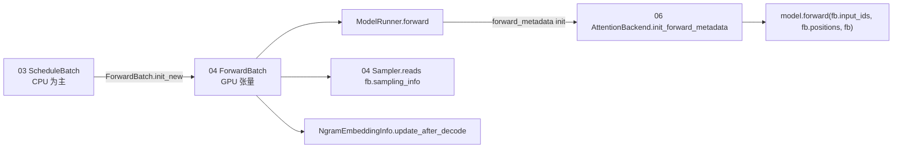

# 04.2 ForwardBatch 与 ForwardMode

## 定位

`ForwardBatch` 是 ModelRunner 真正喂给 `model.forward` 的低层张量容器，由 `ScheduleBatch` 经 `ForwardBatch.init_new` 转换而来。`ForwardMode` 枚举决定本次 forward 走哪条路径。本模块属于 04 子系统，是 03 编排世界和 06 Layers 世界之间的"数据契约"。

## 职责

- 用 `ForwardMode` 标识 EXTEND / DECODE / MIXED / IDLE / TARGET_VERIFY / DRAFT_EXTEND_V2 / PREBUILT / SPLIT_PREFILL / DLLM_EXTEND。
- 在 `init_new` 中把 `ScheduleBatch` 的 CPU 数据 + GPU 张量按引用绑定到 `ForwardBatch`。
- 携带 `capture_hidden_mode`、`sampling_info`、`spec_info`、`mm_inputs`、`out_cache_loc` 等。
- 提供 `mark_forward_metadata_ready` / `needs_forward_metadata_init` 两侧钩子供 runner 触发 `attn_backend.init_forward_metadata`。
- 嵌入 `ForwardBatchDeepSeekMHAMixin` 提供 DeepSeek MHA 专用字段组合。

## 关键类与函数

| 名称 | 定义位置 | 说明 |
|---|---|---|
| `ForwardMode` | `model_executor/forward_batch_info.py:98` | IntEnum；提供 `is_decode/extend/cuda_graph/cpu_graph/split_prefill` 等判定 |
| `CaptureHiddenMode` | `model_executor/forward_batch_info.py:200` | NULL / LAST / FULL，控制 hidden state 捕获用于投机解码 |
| `NgramEmbeddingInfo` | `model_executor/forward_batch_info.py:301` | LongCat n-gram 嵌入的 token_table 与列偏移 |
| `ForwardBatch` | `model_executor/forward_batch_info.py:353` | `@dataclass`，所有 forward 输入都在其字段中 |
| `ForwardBatch.init_new` | `model_executor/forward_batch_info.py:643` | 从 `ScheduleBatch` + `model_runner` 构造 FB 的唯一入口 |
| `PPProxyTensors` | `model_executor/forward_batch_info.py:1577` | 流水并行中间激活容器（dict[str,Tensor]） |

模块 docstring（`forward_batch_info.py:14-26`）明确："ScheduleBatch → ForwardBatch"是单向流：前者由 `Scheduler` 管理、数据多在 CPU；后者由 `ModelRunner` 管理、多为 GPU 张量，并通过 `init_new` 一次性构造。

## 数据流 / 控制流

`init_new` 内：先根据 `batch.return_hidden_states` / `batch.spec_info.capture_hidden_mode` 推得 `CaptureHiddenMode`；区分 decode/idle 与 extend 决定 `extend_seq_lens` 是否为 None；按引用 alias ScheduleBatch 的 `seq_lens_cpu` / `out_cache_loc` 等字段到 `ForwardBatch`；最后转交模型 device 完成可选的 rids 哈希、bootstrap room、kv-committed 长度等附加项。`init_new` 不能 mutate `ScheduleBatch`（除一处 `seq_lens_sum` 后填的容忍项）。

## 交叉引用

- 上游: [`03 核心编排`](../03-orchestration/index.md) — `ScheduleBatch` 由 `Scheduler.run_batch` 提供
- 下游: [`06.2 RadixAttention`](../06-layers/06.2-radix-attention-module.md) — 读 `out_cache_loc`/`seq_lens`
- 详见: [04.1 ModelRunner](04.1-model-runner.md) / [04.3 ForwardContext](04.3-forward-context.md)
- 相关: [`10 投机解码`](../10-speculative/index.md) — `TARGET_VERIFY` / `DRAFT_EXTEND_V2` / `CaptureHiddenMode`

## 进一步阅读

- 源码: `python/sglang/srt/model_executor/forward_batch_info.py`
- 模块 docstring: `python/sglang/srt/model_executor/forward_batch_info.py:14-26`
