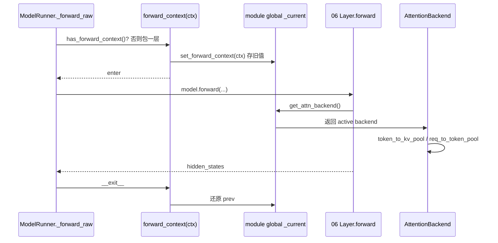

# 04.3 ForwardContext

## 定位

`ForwardContext` 是 SGLang 单次 forward 的"frozen 控制上下文"。它把当次激活的 `attn_backend`（以及从中派生的 KV 池引用）通过模块级全局变量发布给任意深度的 Layer，避免把这两个对象沿 `nn.Module.forward` 调用栈显式下传。属于 04 子系统的运行期控制层。

## 职责

- 用一个 frozen dataclass 携带当次 forward 的 `attn_backend`。
- 经 `forward_context()` context manager 发布/还原模块级 `_current`。
- 提供访问器 `get_forward_context` / `get_attn_backend` / `get_token_to_kv_pool` / `get_req_to_token_pool`，供 Layer 在 forward 内任意深度读取。
- 让 per-call override（PDmux per-stream backend、frozen-KV MTP draft loop、TBO per-child dispatch）用 `dataclasses.replace` 派生新 ctx 后包一层 `forward_context()` 即可。

## 关键类与函数

| 名称 | 定义位置 | 说明 |
|---|---|---|
| `ForwardContext` | `model_executor/forward_context.py:35` | `@dataclass(frozen=True, slots=True)`，唯一必填字段 `attn_backend: AttentionBackend` |
| `set_forward_context` | `model_executor/forward_context.py:46` | 直接写 `_current`，返回前值用于显式 save/restore |
| `get_forward_context` | `model_executor/forward_context.py:58` | 读取 `_current`，未发布则 assert |
| `get_attn_backend` | `model_executor/forward_context.py:66` | `get_forward_context().attn_backend` |
| `get_token_to_kv_pool` | `model_executor/forward_context.py:70` | `attn_backend.token_to_kv_pool` |
| `get_req_to_token_pool` | `model_executor/forward_context.py:74` | `attn_backend.req_to_token_pool` |
| `forward_context` | `model_executor/forward_context.py:79` | `@contextmanager`，进入时 set、退出时还原 |

模块 docstring（`forward_context.py:1-21`）说明：唯一必填字段是 `attn_backend`；池引用从 `attn_backend.*` 派生（每个 backend 在 `__init__` 缓存了它们），所以发布一个 `ForwardContext` 已足够解析 active pools，不需要单独的全局。`_current` 是模块级普通变量（非 thread-local），这与 `global_server_args` 先例一致；每个 worker 进程一次 forward 同步在单 Python 线程上跑，因此安全。

## 数据流 / 控制流

`ModelRunner._forward_raw` 在调用 `model.forward` 前，若 `has_forward_context()` 为否，会包一层 `forward_context(ForwardContext(attn_backend=self.attn_backend))`；PDmux 等 override 路径则用 `dataclasses.replace` 推新 ctx 再包一层。Layer 在 forward 内通过 `get_attn_backend()` / `get_token_to_kv_pool()` 读到当次 active 后端，而不需要看签名。

## 交叉引用

- 上游: [`04.1 ModelRunner`](04.1-model-runner.md) — `_forward_raw` 发布 ctx
- 下游: [`06.2 RadixAttention`](../06-layers/06.2-radix-attention-module.md) — Layer 在深度处读 backend
- 下游: [`07.6 内存池`](../07-kv-cache/07.6-memory-pools.md) — 通过 backend 派生的池引用
- 相关: `TcPiecewiseForwardContext`（`runner_backend/tc_piecewise_cuda_graph_backend.py`）—— 编译期的另一 ctx，与本运行期 ctx 区分
- 相关 skill: `.claude/skills/sglang-runtime-context`

## 进一步阅读

- 源码: `python/sglang/srt/model_executor/forward_context.py`
- 模块 docstring: `python/sglang/srt/model_executor/forward_context.py:1-21`
