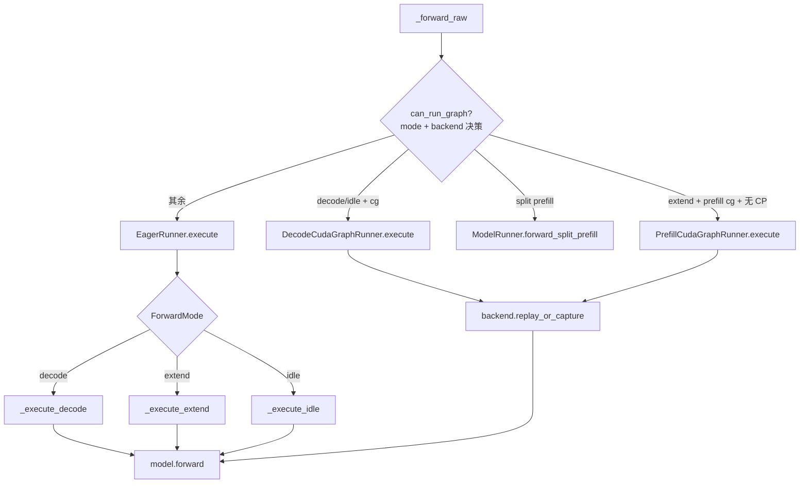

# 04.4 Runners

## 定位

Runners 是 04 子系统中"具体执行 strategy"层。`ModelRunner._forward_raw` 根据 `ForwardMode` 与 `can_run_graph` 把 forward 分派给其中之一：eager（always live） / decode CUDA graph / prefill CUDA graph / CPU graph / MindSpore。每条路径都包装了 buffer 拷贝、attention metadata init、graph replay/捕获、输出切片等细节。

## 职责

- `BaseRunner`：定义 `warmup` / `_dummy_run` / `can_run_graph` / `load_batch` / `execute` 抽象接口。
- `EagerRunner`：无 graph 的"直跑"路径，按 `_execute_decode/_execute_extend/_execute_idle` 分派，初始化 attention metadata 后直接调用 `model.forward`；也是 prefill graph 禁用时的 fallback。
- `DecodeCudaGraphRunner`：按 capture-bs 列表重放预捕获的 decode graph，支持 two-batch-overlap、PDmux、DeepEP、ragged verify 等变体。
- `PrefillCudaGraphRunner`：按 num_tokens 桶捕获/重放 piecewise prefill graph，处理 multimodal deepstack、context parallel、logits buffer 等。
- `CPUGraphRunner`：用 `torch.compile` 在 CPU 上捕获/重放 decode graph（含 enc-dec cross-attention 变体）。
- `runner_backend/`：CUDA graph 的"如何 capture/replay"由可插拔 backend 实现。

## 关键类与函数

| 名称 | 定义位置 | 说明 |
|---|---|---|
| `BaseRunner` | `model_executor/runner/base_runner.py:194` | 抽象基类，定义 `can_run_graph/load_batch/execute` |
| `EagerRunner` | `model_executor/runner/eager_runner.py:64` | eager 路径，三个 `_execute_*` 私有方法 |
| `EagerRunner.execute` | `model_executor/runner/eager_runner.py:194` | 按 `ForwardMode` 分派 |
| `EagerRunner._execute_decode` | `model_executor/runner/eager_runner.py:219` | decode/idle：load_batch → init metadata → model.forward |
| `EagerRunner._execute_extend` | `model_executor/runner/eager_runner.py:252` | extend/prefill：含 DCP/CV2 metadata 准备 |
| `BaseCudaGraphRunner` | `model_executor/runner/base_cuda_graph_runner.py:106` | 共享的 buffer/capture 工具 |
| `DecodeCudaGraphRunner` | `model_executor/runner/decode_cuda_graph_runner.py:183`（`__init__` 在 `:191`） | 持有 capture 列表 + 可插拔 `self.backend` |
| `PrefillCudaGraphRunner` | `model_executor/runner/prefill_cuda_graph_runner.py:157`（`__init__` 在 `:166`） | 按 num_tokens 桶 capture/replay |
| `CPUGraphRunner` | `model_executor/cpu_graph_runner.py:558` | `torch.compile` 路径，含 `graphs_cross` 变体 |
| `init_ms_distributed` | `model_executor/mindspore_runner.py:108` | MindSpore/NPU 通信初始化 |

`runner_backend/` 下的可插拔 capture 后端：

| 名称 | 定义位置 | 说明 |
|---|---|---|
| `BaseCudaGraphBackend` | `model_executor/runner_backend/base_cuda_graph_backend.py:28` | 抽象 capture/replay 接口 |
| `FullCudaGraphBackend` | `model_executor/runner_backend/full_cuda_graph_backend.py:47` | 整 forward 一张图 |
| `BreakableCudaGraphBackend` | `model_executor/runner_backend/breakable_cuda_graph_backend.py:56` | 按集合通信点拆段捕获（prefill 默认） |
| `TcPiecewiseCudaGraphBackend` | `model_executor/runner_backend/tc_piecewise_cuda_graph_backend.py:81` | `torch.compile` piecewise 捕获，bs-invariant |

`cuda_graph_config.py` 提供 `Phase`（`DECODE`/`PREFILL`）、`Backend`（`FULL`/`BREAKABLE`/`TC_PIECEWISE`/`DISABLED`）、`PhaseConfig`、`CudaGraphConfig`，把"哪个 phase 用哪个 backend"做成纯配置（详见 [04.6](04.6-pool-graph-config.md)）。

## 数据流 / 控制流

所有 runner 共享同一规范：`load_batch` 把 live `ForwardBatch` 拷到固定上限的静态 buffer（cuda graph 必需）；`can_run_graph` 决定本 batch 是否能 replay；`execute` 完成"准备 metadata → 调用 model → 返回 logits/proxy"。EagerRunner 的 `can_run_graph` 永远返回 False，确保 caller 用 `isinstance` 判定路径时不会误把 eager batch 走 replay 分支。

## 交叉引用

- 上游: [`04.1 ModelRunner`](04.1-model-runner.md) — `_forward_raw` 分发到本模块
- 下游: [`06.2 RadixAttention`](../06-layers/06.2-radix-attention-module.md) — runner 触发 `attn_backend.init_forward_metadata`
- 下游: [`15.2 sgl-kernel`](../15-kernels-hardware/15.2-sgl-kernel-aot.md) — graph 内核
- 详见: [04.6 池与图配置器](04.6-pool-graph-config.md) — `cuda_graph_config`/buffer registry
- 相关: [`08 分布式`](../08-distributed/index.md) — TP/DP/EP 影响捕获策略

## 进一步阅读

- 源码: `python/sglang/srt/model_executor/runner/`、`python/sglang/srt/model_executor/runner_backend/`、`python/sglang/srt/model_executor/cpu_graph_runner.py`、`python/sglang/srt/model_executor/mindspore_runner.py`
