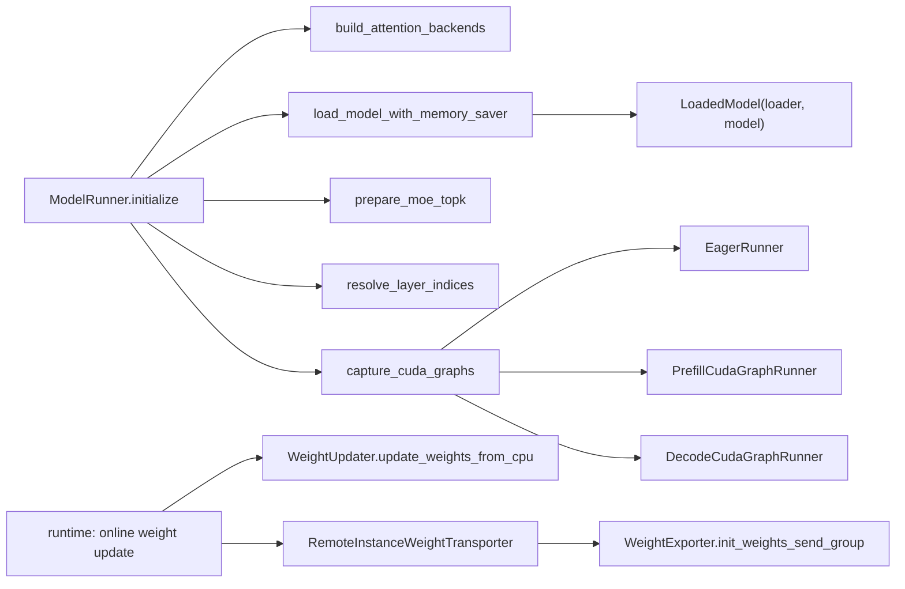

# 04.5 runner_components 编排器

## 定位

`model_runner_components/` 是从 `ModelRunner` 拆出的"初始化/加载/捕获/EPLB"子组件集合。每个文件负责一类副作用，主类用薄包装函数调用它们，使 `ModelRunner.__init__`/`initialize` 保持线性可读。属于 04 子系统的"辅助编排层"。

## 职责

- `attention_backend_setup.py`：解析 prefill/decode backend 字符串，PDmux / TBO 模式下构造多后端组。
- `cuda_graph_setup.py`：构造 `EagerRunner`、`PrefillCudaGraphRunner`、`DecodeCudaGraphRunner` 的统一入口。
- `layer_setup.py`：扫描模型找出 attention / MoE / fusion / indexer / mha_companion 层，并解析 PP 层范围。
- `load_model_utils.py`：dtype 降级、LoadConfig 构建、`load_model_with_memory_saver`、KV cache scales、dist barrier。
- `moe_ep_setup.py`：waterfill balancer 初始化、LP 线性规划求解器、MoE 量化兼容性检查。
- `weight_updater.py` / `weight_exporter.py` / `remote_instance_weight_transporter.py`：在线权重更新（RLHF）、权重导出（remote instance）、mooncake/Nixl 转输。
- `spec_aux_hidden_state.py`：EAGLE/DFlash/DSpark aux hidden 捕获配置。
- `ngram_embedding_manager.py`：LongCat n-gram embedding token table 维护。
- `kv_pool_runtime.py`：post-capture KV resize 计算。
- `pool_configurator.py` 在 `model_executor/` 根，详见 [04.6](04.6-pool-graph-config.md)。

## 关键类与函数

| 名称 | 定义位置 | 说明 |
|---|---|---|
| `build_attention_backends` | `model_runner_components/attention_backend_setup.py:68` | 返回 `AttentionBackends`（attn + decode group + 字符串） |
| `capture_cuda_graphs` | `model_runner_components/cuda_graph_setup.py:73` | 返回 `CudaGraphsCapture`（eager + prefill + decode） |
| `AttentionAndMoeLayers` | `model_runner_components/layer_setup.py:12` | NamedTuple，含 attention/moe/moe_fusions/dsa_indexers/mha_companion |
| `LoadedModel` | `model_runner_components/load_model_utils.py:43` | `msgspec.Struct`，返回 loader/model/remote_instance_weight_info |
| `load_model_with_memory_saver` | `model_runner_components/load_model_utils.py:205` | 调用 `get_model_loader`，套 memory_saver region |
| `prepare_moe_topk` | `model_runner_components/moe_ep_setup.py:27` | 为每个 TopK 装上 waterfill balancer |
| `init_lplb_solvers` | `model_runner_components/moe_ep_setup.py:77` | EP dispatch=lp 时初始化线性规划求解器 |
| `WeightUpdater` | `model_runner_components/weight_updater.py:36` | 在线权重更新的核心，构造 `_model_update_group` |
| `WeightExporter` | `model_runner_components/weight_exporter.py:18` | remote instance 发送端，构造 `_weights_send_group` |
| `RemoteInstanceWeightTransporter` | `model_runner_components/remote_instance_weight_transporter.py:21` | mooncake transfer engine 包装 |
| `SpecAuxHiddenStateConfig` | `model_runner_components/spec_aux_hidden_state.py:17` | EAGLE/DFlash aux hidden 配置 |
| `NgramEmbeddingManager` | `model_runner_components/ngram_embedding_manager.py:22` | token table 创建与 decode 后更新 |
| `PostCaptureKVResize` | `model_runner_components/kv_pool_runtime.py:32` | capture 后 KV 池 resize 计算 |

## 子模块树

- `model_runner_components/`
  - `attention_backend_setup.py` — backend string 解析与多后端构造
  - `cuda_graph_setup.py` — 三 runner 统一捕获入口
  - `layer_setup.py` — layer 扫描 + PP 层范围
  - `load_model_utils.py` — 模型加载流程辅助 + `LoadedModel`
  - `moe_ep_setup.py` — MoE EP topk / waterfill / LP solver
  - `weight_updater.py` — 在线权重更新（RLHF）
  - `weight_exporter.py` / `remote_instance_weight_transporter.py` — 权重导出/远程传输
  - `spec_aux_hidden_state.py` / `ngram_embedding_manager.py` / `kv_pool_runtime.py` / `misc_utils.py`

## 数据流 / 控制流

`ModelRunner.initialize` 把这些子组件按顺序串起：先 `init_memory_saver_adapter` → 调用 `load_model`（内部走 `load_model_with_memory_saver`）→ `prepare_moe_topk` → `resolve_layer_indices` → `init_attention_backends` → `init_cuda_graphs`。运行期 `WeightUpdater` / `RemoteInstanceWeightTransporter` 在收到 RLHF/remote-instance 请求时被外部 trigger 调用。

## 交叉引用

- 上游: [`04.1 ModelRunner`](04.1-model-runner.md) — `initialize` / `load_model` / `init_*` 委托本模块
- 下游: [`05.1 加载器分发`](../05-model-loading/05.1-loader-dispatch.md) — `load_model_with_memory_saver` 调用 `get_model_loader`
- 下游: [`08 分布式`](../08-distributed/index.md) — EP/EPLB/MoE topk
- 相关: [`14 会话状态`](../14-session-state/index.md) — 在线权重更新入口
- 相关 skill: `.claude/skills/large-class-style`

## 进一步阅读

- 源码: `python/sglang/srt/model_executor/model_runner_components/`
