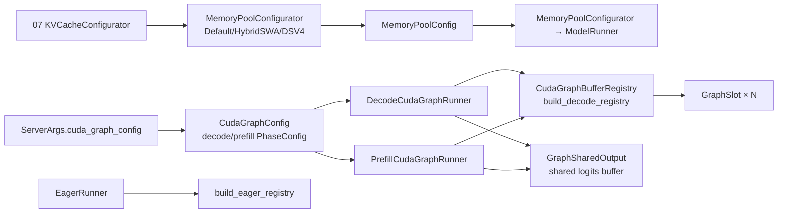

# 04.6 池与图配置器

## 定位

本页汇总 04 子系统中"配置 + 静态资源"两类辅助：CUDA graph 的 phase/backend 配置、内存池大小配置器、以及 runner 共享的 buffer registry 与共享 logits 输出。它们让 [04.4 Runners](04.4-runners.md) 可以专注于 capture/replay 逻辑，而把"用哪个 backend"、"池多大"、"buffer 在哪"作为输入。

## 职责

- `cuda_graph_config.py`：用 `Phase`（DECODE/PREFILL）× `Backend`（FULL/BREAKABLE/TC_PIECEWISE/DISABLED）二维配置 + `PhaseConfig`/`CudaGraphConfig` 描述每个 phase 的 capture 行为。
- `pool_configurator.py`：给 `KVCacheConfigurator` 提供 `MemoryPoolConfigurator` 抽象，按 coeff+bias 模型从可用显存反推 `MemoryPoolConfig`（max_total_num_tokens 等）。`DefaultPoolConfigurator`、`HybridSWAPoolConfigurator`、`DSV4PoolConfigurator` 处理不同架构。
- `cuda_graph_buffer_registry.py`：`CudaGraphBufferRegistry` + `GraphSlot` + `PaddingPolicy`，把 `ForwardBatch` 字段镜像成 graph-resident 静态 buffer，eager/capture/replay 三态共用。
- `graph_shared_output.py`：`GraphSharedOutput`，进程级单例的 `(max_rows, vocab)` logits buffer，被所有 cuda-graph runner 共享。
- `input_buffers.py`：`ForwardInputBuffers` dataclass 基类，提供 buffer 去重共享。

## 关键类与函数

| 名称 | 定义位置 | 说明 |
|---|---|---|
| `Phase` / `Backend` | `model_executor/cuda_graph_config.py:30` / `:38` | 枚举：DECODE/PREFILL 与 FULL/BREAKABLE/TC_PIECEWISE/DISABLED |
| `PhaseConfig` | `model_executor/cuda_graph_config.py:79` | 单 phase：backend/max_bs/bs/tc_compiler/full_prefill_max_req |
| `CudaGraphConfig` | `model_executor/cuda_graph_config.py:105` | 顶层：`decode`+`prefill` 两 `PhaseConfig`，含 `from_dict/to_dict` |
| `MemoryPoolConfig` | `model_executor/pool_configurator.py:46` | resolved 池大小（含 DSV4 压缩池字段） |
| `MemoryPoolConfigurator` | `model_executor/pool_configurator.py:88` | 抽象：`calculate_pool_sizes` / `calculate_pool_sizes_from_max_tokens` |
| `DefaultPoolConfigurator` | `model_executor/pool_configurator.py:114` | MHA/MLA/DSA/FP4：coeff=cell_size, bias=0 |
| `HybridSWAPoolConfigurator` | `model_executor/pool_configurator.py:295` | Gemma2/Command-R/MiMo：full+SWA 双池划分 |
| `CudaGraphBufferRegistry` | `model_executor/cuda_graph_buffer_registry.py:262` | FB→graph-resident buffer 镜像，`fill_from`/`extract_buffer` |
| `GraphSlot` / `PaddingPolicy` | `model_executor/cuda_graph_buffer_registry.py:118` / `:68` | 单字段 slot 定义与填充策略（ZERO/FILL_SENTINEL/REPEAT_LAST 等） |
| `build_decode_registry` / `build_prefill_registry` / `build_eager_registry` | `model_executor/cuda_graph_buffer_registry.py:507/781/903` | 各 runner 一次性的 slot 注册工厂 |
| `GraphSharedOutput` | `model_executor/graph_shared_output.py:13` | 进程级 logits buffer 单例 |
| `ForwardInputBuffers` | `model_executor/input_buffers.py:70` | dataclass 基类，提供 `share_buffers` 去重重定向 |

## 数据流 / 控制流

`cuda_graph_config.py` 把 `--cuda-graph-backend-decode/prefill` 等 CLI 解析为 `CudaGraphConfig`；`PhaseConfig.backend` 告诉 [04.5 capture_cuda_graphs](04.5-runner-components.md) 走 FULL / BREAKABLE / TC_PIECEWISE 还是 DISABLED（DISABLED 时 prefill 直接返 `EagerRunner`）。`pool_configurator.py` 由 07 子系统的 `KVCacheConfigurator` 持有，反演出池大小后塞进 `ModelRunner.memory_pool_config`，target/draft worker 共享同一份 resolved 大小。

`CudaGraphBufferRegistry` 是 runner 的"静态 buffer 池"：每个 `GraphSlot` 镜像 `ForwardBatch` 的一个字段（如 `input_ids`/`seq_lens`），`fill_from(fb)` 把 live batch 拷进 graph 静态区，`extract_buffer(...)` 切片返回可送入 `model.forward` 的 view。`PaddingPolicy` 决定 padding 区填 0 / sentinel / 重复最后值。`GraphSharedOutput` 让 decode/prefill graph 共用同一块 `(max_rows, vocab)` logits 输出，省一份大 buffer。

## 交叉引用

- 上游: [`07.6 内存池`](../07-kv-cache/07.6-memory-pools.md) — `KVCacheConfigurator` 持有 `MemoryPoolConfigurator`
- 上游: [`16 配置`](../16-config-runtime/index.md) — `ServerArgs.cuda_graph_config` 解析路径
- 详见: [04.4 Runners](04.4-runners.md) — runner 消费本页产物
- 相关: [`15.2 sgl-kernel`](../15-kernels-hardware/15.2-sgl-kernel-aot.md) — graph 内核 workspace 由 backend 自管（不在 registry）

## 进一步阅读

- 源码: `python/sglang/srt/model_executor/cuda_graph_config.py`、`pool_configurator.py`、`cuda_graph_buffer_registry.py`、`graph_shared_output.py`、`input_buffers.py`
