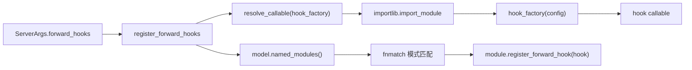

# 04.7 hook_manager

## 定位

`hook_manager` 让用户在不修改 SGLang 模型源码的前提下，把任意 `nn.Module.forward` 后置 hook 挂载到模型的指定子模块上（如 `model.layers.*.mlp`）。属于 04 子系统的可观测/调试扩展点；与 `server_args.forward_hooks` 配合，可在 `capture_cuda_graphs` 完成后注册。

## 职责

- 解析 `server_args.forward_hooks`（一个 dict 列表），逐 spec 解析 `target_modules`/`hook_factory`/`config`。
- 用 `fnmatch` 把 glob 模式（如 `model.layers.*.mlp`）匹配到 `model.named_modules()` 中的具体子模块。
- 通过可导入的 `hook_factory` 路径（`module.sub:factory` 或 `module.sub.factory`）动态加载工厂函数，传入 `config` 后产出真正的 hook。
- 用 `module.register_forward_hook(hook)` 完成挂载。

## 关键类与函数

| 名称 | 定义位置 | 说明 |
|---|---|---|
| `register_forward_hooks` | `model_executor/hook_manager.py:11` | 主入口：将 `hook_specs` 解析为模块 hook 挂上去 |
| `resolve_callable` | `model_executor/hook_manager.py:59` | 把 `module.sub:factory` 字符串解析为 Python 可调用对象 |

## 数据流 / 控制流

使用方式：用户在 YAML/CLI 给出形如 `{name: debug_mlp, target_modules: ["model.layers.*.mlp"], hook_factory: "mypkg.debug:make_mlp_hook", config: {log: true}}` 的 spec，框架在 [04.5 capture_cuda_graphs](04.5-runner-components.md) 完成后调用 `register_forward_hooks`。注意它在 capture 之后注册，确保 hook 的张量操作不会被 trace 进 capture graph——hook 只在 eager forward 路径触发。

## 交叉引用

- 上游: [`16 配置`](../16-config-runtime/index.md) — `server_args.forward_hooks` 字段
- 触发点: [04.5 runner_components](04.5-runner-components.md) — `capture_cuda_graphs` 末尾注册
- 相关: [`17 可观测性`](../17-observability-ops/index.md) — profiling/debug hook 的另一种入口
- 相关: `enable_layerwise_nvtx_marker` 路径（`PytHooks`，在 `ModelRunner.load_model` 内）

## 进一步阅读

- 源码: `python/sglang/srt/model_executor/hook_manager.py`
