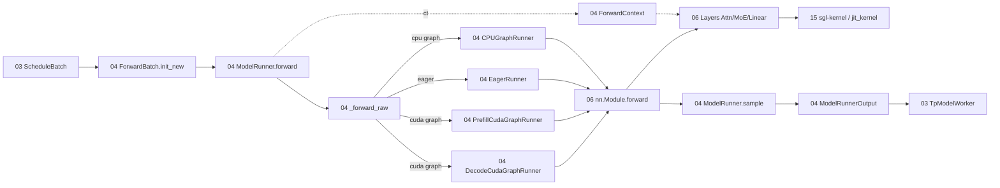

# 04 模型执行

## 定位

子系统 04 是 GPU/NPU/CPU 上的"单步前向执行器"。它接收 [`03 编排`](../03-orchestration/index.md) 中 `TpModelWorker` 提交的 `ScheduleBatch`，将其转换为 GPU 张量化的 `ForwardBatch`，选择 eager / decode CUDA graph / prefill CUDA graph / CPU graph 路径，调用模型的 `nn.Module.forward`，最终把 logits 交给 `Sampler` 产出 token。本子系统是连接"调度世界"与"Layers / 内核世界"的桥梁。

## 职责

- 把 CPU 形态的 `ScheduleBatch` 转换为 GPU 形态的 `ForwardBatch`。
- 持有 `model`、`attn_backend`、`req_to_token_pool`、`token_to_kv_pool_allocator` 等运行期对象。
- 初始化注意力后端、捕获/重放 CUDA graph、加载模型权重。
- 在 `forward()` 中按 `ForwardMode` 分发到 eager runner / decode cuda graph runner / prefill cuda graph runner。
- 通过 `ForwardContext` 让任意深度的 Layer 拿到当次的注意力后端与 KV 池。
- 协调采样、logprobs、n-gram embedding 更新、专家分布度量等后处理。

## 子系统边界图

## 子系统内导航

| 编号 | 页面 | 一句话定位 |
|---|---|---|
| 04.1 | [ModelRunner](04.1-model-runner.md) | 单步执行的总控类，持有 model/attn_backend/各 runner |
| 04.2 | [ForwardBatch 与 ForwardMode](04.2-forward-batch-mode.md) | ScheduleBatch→ForwardBatch 的张量化与模式枚举 |
| 04.3 | [ForwardContext](04.3-forward-context.md) | 每次 forward 的 frozen 控制上下文，供 Layer 读取 |
| 04.4 | [Runners](04.4-runners.md) | eager / decode cuda graph / prefill cuda graph / cpu graph runner 与 cuda_graph_backend |
| 04.5 | [runner_components 编排器](04.5-runner-components.md) | 拆分出去的初始化/加载/捕获/EPLB 子组件 |
| 04.6 | [池与图配置器](04.6-pool-graph-config.md) | 内存池配置、CUDA graph capture 后端、buffer registry |
| 04.7 | [hook_manager](04.7-hook-manager.md) | 用户自定义 nn.Module forward hook 注册 |

## 交叉引用

- 上游: [`03 核心编排`](../03-orchestration/index.md) — `TpModelWorker` 调用 `ModelRunner.forward`
- 下游: [`06 Layers`](../06-layers/index.md) — `model.forward` 调用注意力/MoE/Linear
- 下游: [`15 内核与硬件`](../15-kernels-hardware/index.md) — Attention/MoE 内核实现
- 依赖: [`07 KV Cache`](../07-kv-cache/index.md) — 内存池与 RadixCache
- 依赖: [`05 模型加载`](../05-model-loading/index.md) — `load_model` 调用加载器
- 相关: [`10 投机解码`](../10-speculative/index.md) — draft worker 复用 `ModelRunner`

## 进一步阅读

- 源码: `python/sglang/srt/model_executor/`
- 模块 docstring: `python/sglang/srt/model_executor/forward_batch_info.py:14-26`
- 相关 skill: `.claude/skills/large-class-style`、`.claude/skills/sglang-runtime-context`
