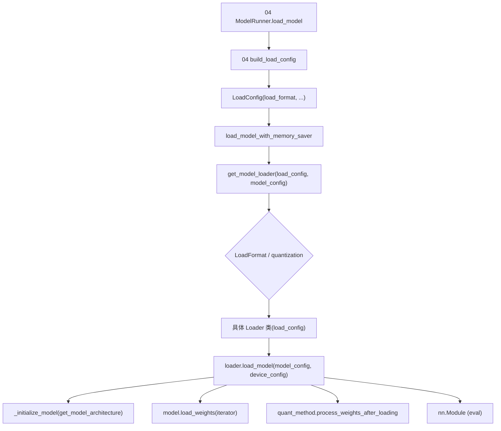

# 05.1 加载器分发

## 定位

`get_model_loader` 是 05 子系统的入口：根据 `LoadConfig.load_format` 与 `model_config.quantization` 分派到具体的 loader 类。`get_model` 是更顶层的便捷函数——`get_model_loader` + `loader.load_model` 一步到位。它由 [`04.5 load_model_with_memory_saver`](../04-model-execution/04.5-runner-components.md) 调用，处于"任意 forward 之前"的初始化阶段。

## 职责

- 顶层 `get_model`：拿到 loader 后直接 `load_model`，返回 `nn.Module`。
- `get_model_loader`：按 `LoadFormat` 与量化配置选 loader 类并实例化。
- `LoadFormat` 在 `configs/load_config.py:17` 枚举所有支持格式（AUTO/PT/SAFETENSORS/NPCACHE/DUMMY/SHARDED_STATE/GGUF/BITSANDBYTES/LAYERED/FLASH_RL/REMOTE/REMOTE_INSTANCE/RDMA/RUNAI_STREAMER 等）。
- `BaseModelLoader` 抽象基类约定 `load_model(model_config, device_config) -> nn.Module`。

## 关键类与函数

| 名称 | 定义位置 | 说明 |
|---|---|---|
| `get_model` | `model_loader/__init__.py:23` | `get_model_loader` + `loader.load_model` 顶层入口 |
| `get_model_loader` | `model_loader/loader.py:3223` | 按 `load_format` 与 quantization 分派 |
| `LoadFormat` | `configs/load_config.py:17` | 全部加载格式枚举 |
| `BaseModelLoader` | `model_loader/loader.py:333` | 抽象基类，`load_model` 抛 `NotImplementedError` |
| `load_model_with_memory_saver` | `model_executor/model_runner_components/load_model_utils.py:205` | 04 侧调用方：套 memory saver region 后调用 `get_model_loader` |

`get_model_loader` 的分派优先级（`loader.py:3223-3309`）：

1. `LoadFormat.DUMMY` → `DummyModelLoader`。
2. `model_config.quantization == "auto-round-int8"` → `IncModelLoader`。
3. 非 RUNAI_STREAMER/REMOTE_INSTANCE 且 `modelopt_quant` 或 quant ∈ {modelopt_fp8, modelopt_fp4, modelopt_mixed, modelopt} → `ModelOptModelLoader`（已预量化或在线量化都走这里）。
4. `load_format` 是类（非枚举）→ 直接实例化（外部 hook）。
5. `SHARDED_STATE` → `ShardedStateLoader`；
6. `BITSANDBYTES` → `BitsAndBytesModelLoader`；
7. `GGUF` → `GGUFModelLoader`；
8. `LAYERED` → `LayeredModelLoader`（内部 fallback回 AUTO）；
9. `FLASH_RL` → `QuantizedRLModelLoader`（同时把 quant 置为 "fp8"）；
10. `REMOTE` → `RemoteModelLoader`；`REMOTE_INSTANCE` → `RemoteInstanceModelLoader`；
11. `RUNAI_STREAMER` → `RunaiModelStreamerLoader`；
12. 其余 → `DefaultModelLoader`。

## 数据流 / 控制流

`build_load_config` 把 `ServerArgs` + `tp_rank` + remote_instance engine/session 收集为 `LoadConfig`；`load_model_with_memory_saver` 套 `memory_saver_adapter.region(GPU_MEMORY_TYPE_WEIGHTS, ...)`，把"加载期间放 GPU / CPU 备份"策略下沉到 adapter，再调用 `get_model_loader`。各 loader 类共有的"`_initialize_model` → 选 weights iterator → `model.load_weights` → `quant_method.process_weights_after_loading`"流程详见 [05.2](05.2-loader-classes.md)。

## 交叉引用

- 上游: [`04.5 runner_components`](../04-model-execution/04.5-runner-components.md) — `load_model_with_memory_saver`
- 上游: [`04.1 ModelRunner`](../04-model-execution/04.1-model-runner.md) — `load_model` 在 `:901`
- 详见: [05.2 加载器类](05.2-loader-classes.md) / [05.3 weight_utils](05.3-weight-utils.md) / [05.4 架构解析](05.4-architecture-resolution.md)
- 相关: [`16 配置`](../16-config-runtime/index.md) — `ServerArgs.load_format` / `remote_instance_*`

## 进一步阅读

- 源码: `python/sglang/srt/model_loader/__init__.py`、`python/sglang/srt/model_loader/loader.py`、`python/sglang/srt/configs/load_config.py`
