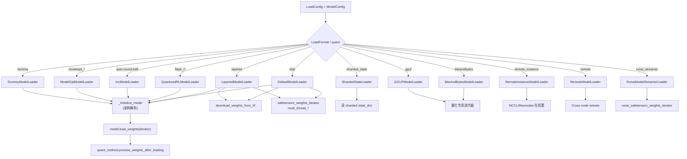

# 05.2 加载器类

## 定位

`model_loader/loader.py` 实现了 12 个具体 loader 类。它们都继承 `BaseModelLoader`，复用 [05.4 架构解析](05.4-architecture-resolution.md) 的 `_initialize_model` 与 [05.3 weight_utils](05.3-weight-utils.md) 的权重迭代器；差异主要在"权重来源 / 内存策略 / 量化后处理"。属于 05 子系统的核心实现层。

## 职责

- `DefaultModelLoader`：磁盘 safetensors/pt 默认路径，支持多线程；含 `load_weights_and_postprocess` 统一后处理。
- `LayeredModelLoader`：一层一层加载，便于加载时即时量化、压低峰值显存。
- `QuantizedRLModelLoader`：FLASH_RL 路径，把 FP8 量化与 RL 在线权重更新打通。
- `DummyModelLoader`：用 `initialize_dummy_weights` 随机初始化，用于 profiling/CI。
- `ShardedStateLoader`：直接读已按 TP 切好的 SGLang state_dict（checkpoint）。
- `BitsAndBytesModelLoader` / `GGUFModelLoader`：nf4 / GGUF 量化格式解码。
- `RemoteInstanceModelLoader`：从种子实例经 NCCL/Mooncake 流式拉权重，配合 04 的 `RemoteInstanceWeightTransporter`。
- `RemoteModelLoader`：跨节点远程权重加载（不同于 instance 流式）。
- `IncModelLoader`：AutoRound INT8 量化适配。
- `ModelOptModelLoader`：NVIDIA ModelOpt 在线 FP8/FP4 量化与导出。
- `RunaiModelStreamerLoader`：Run:ai 流式 safetensors 加载（S3/HF）。

## 关键类与函数

| 名称 | 定义位置 | 父类 | 说明 |
|---|---|---|---|
| `BaseModelLoader` | `loader.py:333` | ABC | 抽象 `load_model` |
| `DefaultModelLoader` | `loader.py:355` | `BaseModelLoader` | `_get_all_weights` + `load_weights_and_postprocess`；`Source` 嵌套类描述权重来源 |
| `LayeredModelLoader` | `loader.py:852` | `DefaultModelLoader` | 把 `load_format` 重置为 AUTO，按层加载 |
| `QuantizedRLModelLoader` | `loader.py:926` | `DefaultModelLoader` | FP8 RL 训练侧权重兼容 |
| `DummyModelLoader` | `loader.py:1399` | `BaseModelLoader` | `initialize_dummy_weights` 随机值 |
| `ShardedStateLoader` | `loader.py:1455` | `BaseModelLoader` | 读已 TP 切分的 state_dict |
| `BitsAndBytesModelLoader` | `loader.py:1632` | `BaseModelLoader` | nf4 量化 + stacked params mapping |
| `GGUFModelLoader` | `loader.py:2110` | `BaseModelLoader` | `gguf_quant_weights_iterator` |
| `RemoteInstanceModelLoader` | `loader.py:2218` | `BaseModelLoader` | NCCL/Mooncake 拉权重，回 `remote_instance_transfer_engine_weight_info` |
| `RemoteModelLoader` | `loader.py:2428` | `BaseModelLoader` | 跨节点远程全局权重 |
| `IncModelLoader` | `loader.py:2609` | `DefaultModelLoader` | AutoRound INT8 pack/unpack |
| `ModelOptModelLoader` | `loader.py:2713` | `DefaultModelLoader` | ModelOpt FP8/FP4/mixed 在线量化 + 导出 |
| `RunaiModelStreamerLoader` | `loader.py:2982` | `BaseModelLoader` | Run:ai 流式加载，`runai_safetensors_weights_iterator` |

## 数据流 / 控制流

所有 loader 都把"实例化模型"委托给 `_initialize_model`（内部调 `get_model_architecture` → `ModelRegistry.resolve_model_cls` → `EntryClass(...)`），差异集中在 weights iterator 来源与后处理：Default/Layered/Inc/ModelOpt 共用 `safetensors_weights_iterator`/`multi_thread_safetensors_weights_iterator`；Dummy 不下载而是填充随机值；ShardedState 直接逐 tensor `copy_`；BitsAndBytes/GGUF 走专用反量化迭代器；RemoteInstance/Remote/Runai 把 iterator 替换为网络流。后处理（`quant_method.process_weights_after_loading`）由 `DefaultModelLoader.load_weights_and_postprocess` 统一编排。

## 交叉引用

- 上游: [`04.5 runner_components`](../04-model-execution/04.5-runner-components.md) — `load_model_with_memory_saver`
- 上游: [05.1 加载器分发](05.1-loader-dispatch.md) — `get_model_loader` 选具体类
- 下游: [05.3 weight_utils](05.3-weight-utils.md) — 各迭代器实现
- 下游: [05.4 架构解析](05.4-architecture-resolution.md) — `_initialize_model`
- 相关: [`08 分布式`](../08-distributed/index.md) / [`09 分离式`](../09-disaggregation/index.md) — Remote/RemoteInstance 走 NCCL/Mooncake

## 进一步阅读

- 源码: `python/sglang/srt/model_loader/loader.py:333-3321`
