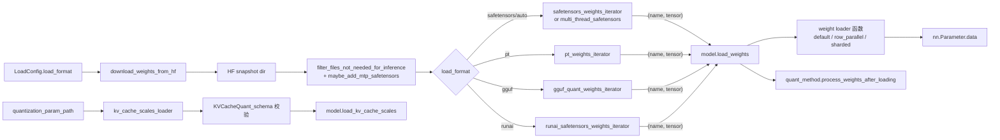

# 05.3 weight_utils

## 定位

`weight_utils.py` 是 05 子系统的"权重 I/O 工具箱"：HuggingFace Hub 下载、各类文件格式迭代器（safetensors/pt/gguf/multi-thread）、weight loader 函数（拷贝到 `nn.Parameter`）、KV cache scale 解析、量化配置探测、dummy 初始化。各 loader 类都把它作为底层依赖。

## 职责

- 下载：`download_weights_from_hf` 拉取 HF snapshot；`maybe_add_mtp_safetensors` 决定是否带 MTP 权重；`filter_files_not_needed_for_inference` 过滤。
- 迭代器：safetensors（含 multi-thread / fastsafetensors / np-cache）、pt（含 multi-thread）、gguf，统一产出 `(name, tensor)` 流。
- weight loader 函数：`default_weight_loader`、`row_parallel_weight_loader`、`sharded_weight_loader`、`composed_weight_loader`。
- KV cache scale：`KVCacheQuant_schema`、`QuantParamSchema`、`kv_cache_scales_loader`、`maybe_remap_kv_scale_name`。
- 量化探测：`get_quant_config`、`probe_routed_expert_weight_dtype`。
- 其他：`initialize_dummy_weights`、`should_async_load`、`maybe_executor_submit`、`DisabledTqdm`、`runai_safetensors_weights_iterator`。

## 关键类与函数

| 名称 | 定义位置 | 说明 |
|---|---|---|
| `download_weights_from_hf` | `model_loader/weight_utils.py:534` | HF Hub snapshot 下载，allow/ignore patterns |
| `safetensors_weights_iterator` | `model_loader/weight_utils.py:947` | 默认 safetensors 流式迭代 |
| `multi_thread_safetensors_weights_iterator` | `model_loader/weight_utils.py:1039` | 多线程并发读多分片 |
| `pt_weights_iterator` | `model_loader/weight_utils.py:1172` | `.bin/.pt` 文件迭代 |
| `gguf_quant_weights_iterator` | `model_loader/weight_utils.py:1233` | GGUF 量化张量迭代 |
| `default_weight_loader` | `model_loader/weight_utils.py:1346` | `param.data.copy_(loaded_weight)`，含 scalar broadcast |
| `row_parallel_weight_loader` | `model_loader/weight_utils.py:1367` | row-parallel 切片后 `default_weight_loader` |
| `sharded_weight_loader` | `model_loader/weight_utils.py:1385` | 按 axis shard 的工厂 |
| `composed_weight_loader` | `model_loader/weight_utils.py:1419` | 串联多个 loader |
| `initialize_dummy_weights` | `model_loader/weight_utils.py:1493` | 随机 uniform(-1e-3,1e-3)，含 FP8 路径 |
| `KVCacheQuant_schema` | `model_loader/weight_utils.py:1610` | pydantic 模型：dtype + `{tp_rank: {layer: scale}}`，含 tp/layer 校验 |
| `kv_cache_scales_loader` | `model_loader/weight_utils.py:1684` | 从 json 读 fp8 KV 缩放因子到 layer map |
| `get_quant_config` | `model_loader/weight_utils.py:238` | 由 model_config.quantization 解析 quantization config |
| `maybe_remap_kv_scale_name` | `model_loader/weight_utils.py:1528` | 把 HF 命名映射到模型参数名 |

## 数据流 / 控制流

权重迭代器把文件流变成 `(name, tensor)` 序列，模型 `load_weights` 内部根据 `stacked_params_mapping`（如 `.q_proj/.k_proj/.v_proj` 三合一为 `.qkv_proj`）拆分后，通过 weight loader 函数 `copy_` 到对应 `nn.Parameter`。`row_parallel_weight_loader` 会按 `tp_rank` 切片再 copy；`sharded_weight_loader(axis)` 提供 generic 分片。`KVCacheQuant_schema` 校验 tp_size/num_hidden_layers 匹配，防止 fp8 KV scale 配错。

## 交叉引用

- 上游: [05.2 加载器类](05.2-loader-classes.md) — 各 loader 调用迭代器
- 下游: [05.5 模型实现模式](05.5-model-pattern.md) — `model.load_weights` 消费迭代器
- 下游: [`06 Layers`](../06-layers/index.md) — `quant_method` 在 quant Layer 上定义
- 下游: [`07 KV Cache`](../07-kv-cache/index.md) — fp8 KV scale 应用到 `KVCache`
- 相关: [`15.2 sgl-kernel`](../15-kernels-hardware/15.2-sgl-kernel-aot.md) — 量化 repack 内核

## 进一步阅读

- 源码: `python/sglang/srt/model_loader/weight_utils.py`
