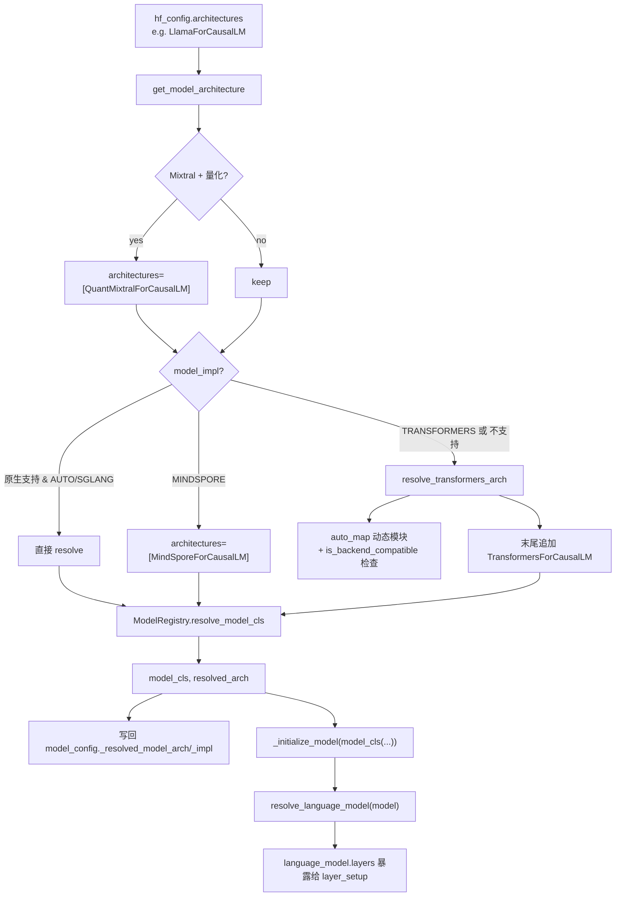

# 05.4 架构解析

## 定位

架构解析是 05 子系统中"从 HF `config.json` 的 `architectures` 字段到 SGLang `nn.Module` 子类"的桥梁。它在 loader 实例化模型之前运行，决定到底是使用 SGLang 原生实现、走 Transformers fallback、还是切到 MindSpore。属于"loader → registry"之间的解析层。

## 职责

- `get_model_architecture(model_config)`：从 `hf_config.architectures` 出发，处理 Mixtral 量化的特殊重写，调用 `ModelRegistry.resolve_model_cls`；同时把解析结果写回 `model_config._resolved_model_arch`/`_resolved_model_impl`。
- `resolve_transformers_arch`：在架构未原生支持、或显式 `--model-impl=transformers` 时，加载 `auto_map` 动态模块、检查 `is_backend_compatible`，最终回退为 `TransformersForCausalLM`。
- `_model_impl_from_architecture`：按架构名前缀（`Transformers` / `MindSpore`）推断 `ModelImpl`。
- `get_resolved_model_impl`：读回缓存或现算。
- `resolve_language_model`：从可能包了 vision tower 的顶层模块中剥离出 language model（如 `Qwen3OmniMoeForConditionalGeneration`）。
- `ModelRegistry.resolve_model_cls`：在 `models/registry.py` 中按 `architectures` 列表顺序第一个找到的返回。

## 关键类与函数

| 名称 | 定义位置 | 说明 |
|---|---|---|
| `get_model_architecture` | `model_loader/utils.py:195` | 主入口：返回 `(model_cls, resolved_arch)` 并写回 model_config |
| `resolve_transformers_arch` | `model_loader/utils.py:108` | Transformers fallback 与动态 `auto_map` 解析 |
| `_model_impl_from_architecture` | `model_loader/utils.py:100` | 名称前缀 → `ModelImpl.{SGLANG,TRANSFORMERS,MINDSPORE}` |
| `get_resolved_model_impl` | `model_loader/utils.py:233` | 读 `_resolved_model_impl` 或现算并缓存 |
| `get_architecture_class_name` | `model_loader/utils.py:248` | 返回 class name 字符串 |
| `resolve_language_model` | `model_loader/utils.py:317` | 从顶层 module 抽出 language model（处理 VLM/omni） |
| `_ModelRegistry` | `models/registry.py:20` | `models: Dict[str, Type[nn.Module]]`，`register`/`resolve_model_cls`/`get_supported_archs` |
| `ModelRegistry.resolve_model_cls` | `models/registry.py:80` | `_normalize_archs` 后按序返回首个匹配；找不到追加 `TransformersForCausalLM` 兜底 |
| `import_model_classes` | `models/registry.py:95` | 扫描 `sglang.srt.models` 包，按 `EntryClass` 收集 arch→cls |
| `ModelRegistry` | `models/registry.py:130` | 全局单例；`register("sglang.srt.models")` + 可选 external package |

## 数据流 / 控制流

`_normalize_archs`（`registry.py:61`）会过滤出已注册架构并确保 `TransformersForCausalLM` 永远在末尾作为 fallback，因此即便 `model_impl=AUTO` 且无原生实现也能继续加载。`import_model_classes` 用 `pkgutil.iter_modules` 扫包，每个文件暴露的 `EntryClass`（类或列表）即注册为 `arch_name → cls`，故 [05.5](05.5-model-pattern.md) 描述的 `EntryClass` 约定是加入注册表的唯一方式。

## 交叉引用

- 上游: [05.2 加载器类](05.2-loader-classes.md) — `_initialize_model` 调用解析链
- 下游: [05.5 模型实现模式](05.5-model-pattern.md) — `EntryClass` 是注册的源头
- 下游: [`06 Layers`](../06-layers/index.md) — `model_cls` 是 Layers 的组合
- 相关: [`16 配置`](../16-config-runtime/index.md) — `ServerArgs.model_impl` 决定回退策略
- 相关: [`10 投机`](../10-speculative/index.md) — draft model 同样走架构解析

## 进一步阅读

- 源码: `python/sglang/srt/model_loader/utils.py`、`python/sglang/srt/models/registry.py`
- 适配来源: `Adapted from vLLM`（见两文件头部 SPDX）
