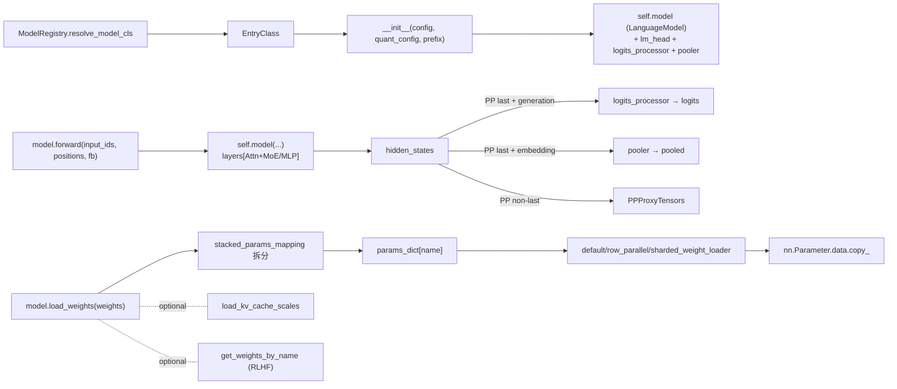

# 05.5 模型实现模式

## 定位

SGLang 的 `python/sglang/srt/models/` 下有约 200 个模型文件，但它们都遵循统一的"`EntryClass` + `forward` + `load_weights` + 可选 `get_weights_by_name`/`load_kv_cache_scales`"模式。本页以 `llama.py` 为参考实现，提炼这套约定，并指出 MoE / VLM / reward / embedding 模型的差异。属于 05 子系统的"模型侧契约文档"。

## 职责（统一约定）

- **`EntryClass`**：每个模型文件在模块级暴露一个类或类列表（`EntryClass = LlamaForCausalLM` 或 `EntryClass = [DeepseekV2ForCausalLM, DeepseekV3ForCausalLM, ...]`），类名即注册到 `ModelRegistry` 的 architecture key，必须与 HF `config.architectures` 匹配。
- **`__init__(config, quant_config, prefix)`**：构建 `PPGroup`、`quant_config`、内部 `model:<LanguageModel>`、`lm_head:ParallelLMHead`（或 tie 到 `embed_tokens`）、`logits_processor`、`pooler`；声明 `stacked_params_mapping`（如 `qkv_proj`）。
- **`forward(input_ids, positions, forward_batch, ...)`**：调 `self.model(...)` 跑出 `hidden_states`，PP last rank 经 `logits_processor`/`pooler` 产 `LogitsProcessorOutput`；非 last rank 直接回 `hidden_states`（PP proxy）。
- **`load_weights(weights)`**：按 `stacked_params_mapping` 把 `(name, tensor)` 流拆分、按名查 `params_dict`、调 weight loader 函数 `copy_`；可在此处理 `activation_scale`、`weight_scale_inv` 等量化重命名。
- **可选 `get_weights_by_name`/`load_kv_cache_scales`/`forward_split_prefill`**：在线权重更新、fp8 KV scale、split prefill 等扩展钩子。

## 关键代表

| 名称 | 定义位置 | 说明 |
|---|---|---|
| `LlamaForCausalLM` | `models/llama.py:458` | 标准生成模型参考实现 |
| `LlamaForCausalLM.forward` | `models/llama.py:525` | `@torch.no_grad()`，含 `capture_aux_hidden_states` 分支 |
| `LlamaForCausalLM.load_weights` | `models/llama.py:625` | 处理 `stacked_params_mapping` 与量化 scale 重命名 |
| `LlamaForCausalLM.get_weights_by_name` | `models/llama.py:698` | 在线权重读取（RLHF） |
| `EntryClass` (llama) | `models/llama.py:847` | `[LlamaForCausalLM, Phi3ForCausalLM, InternLM3ForCausalLM, IQuestCoderForCausalLM]` |

## 模型变体差异

- **Dense 生成模型**（llama.py, gemma2.py, qwen.py）：上面四件套即可。`forward` 末尾对 PP last rank 用 `logits_processor`，否则返回 `hidden_states`。
- **MoE 模型**（`deepseek_v2.py`、`cohere2_moe.py`、`bailing_moe.py`）：`MLP` 换成 `FusedMoE`/`DeepseekV2MoE`，`load_weights` 需处理 `experts_WEIGHT` 子命名与 EP shard；同时模型暴露 `routed_experts` 等供 [04.5 moe_ep_setup](../04-model-execution/04.5-runner-components.md) 中的 `prepare_moe_topk` 安装 waterfill balancer。`EntryClass` 经常是列表（如 `deepseek_v2.py:3005` `[DeepseekV2ForCausalLM, DeepseekV3ForCausalLM, DeepseekV32ForCausalLM]`）。
- **VLM 模型**（`qwen2_vl.py`、`deepseek_vl2.py`、`dots_vlm.py`）：顶层类名形如 `Qwen2VLForConditionalGeneration`，`forward` 内先跑 vision tower 再拼接到语言模型；`forward_batch.mm_inputs` 提供图像 embedding。`resolve_language_model`（[05.4](05.4-architecture-resolution.md)）会从中剥离出 language model 供 layer 扫描。
- **Embedding / Reward / SequenceClassification**（`bert.py`、`clip.py`、reward 模型）：`forward` 用 `get_embedding=True` 走 `pooler`，`EntryClass` 多为列表（`bert.py:501` `[BertModel, Contriever, BertForSequenceClassification]`），无 `lm_head`，权重加载更简单但需处理 pooling 层权重。
- **Mamba / Hybrid**（NemotronH、Jamba）：模型层混合 attention 与 mamba/linear_attn；`layer_setup.compute_attention_and_moe_layers` 通过 `hasattr(layer,'mixer')` 等适配，`EntryClass` 需暴露对应类。

约 200 个模型不逐一展开——它们都遵循上述"四件套"约定，差异主要在 `EntryClass` 数量、MLP 类型（dense/MoE）、是否有 vision tower、输出 head 类型四点。

## 数据流 / 控制流

## 交叉引用

- 上游: [05.4 架构解析](05.4-architecture-resolution.md) — `resolve_model_cls` 找到 `EntryClass`
- 上游: [05.3 weight_utils](05.3-weight-utils.md) — `load_weights` 内部使用的迭代器与 loader 函数
- 下游: [`06 Layers`](../06-layers/index.md) — `LanguageModel.layers` 的具体 Layer 实现
- 下游: [`04.5 runner_components`](../04-model-execution/04.5-runner-components.md) — `layer_setup` 扫描模型结构
- 相关: [`12 多模态`](../12-multimodal/index.md) — VLM 的 vision tower 与 mm_inputs
- 相关: [`08 分布式`](../08-distributed/index.md) — EP shard 与 stacked params

## 进一步阅读

- 源码: `python/sglang/srt/models/`（约 210 个文件，`llama.py` 为参考实现）
- 注册入口: `python/sglang/srt/models/registry.py:130-134`
