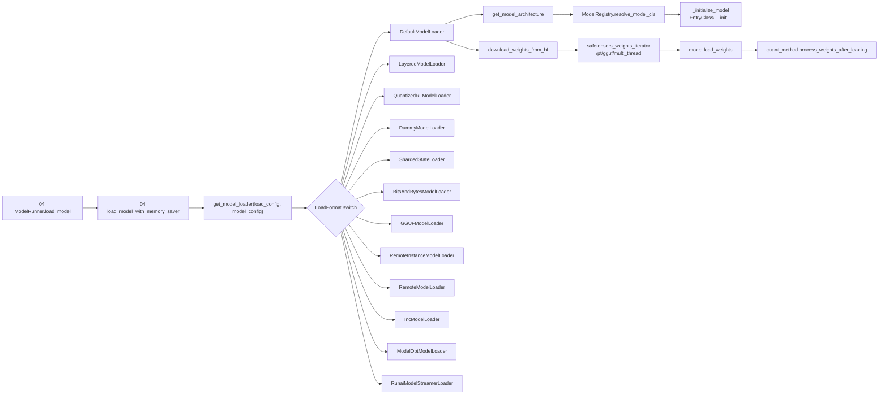

# 05 模型加载与注册

## 定位

子系统 05 负责"把 HuggingFace/远程/量化权重变成 GPU 上一个 `nn.Module`"的全过程：根据 `LoadFormat` 选 loader，loader 内部解析模型架构、下载权重、实例化模型、调 `model.load_weights` 把张量灌进去。它由 [`04 模型执行`](../04-model-execution/index.md) 的 `ModelRunner.load_model` 触发，也支撑在线权重更新与 remote instance 转输。

## 职责

- `LoadFormat` 枚举 + `get_model_loader` 工厂：按 `load_format` 分派到具体 loader 类。
- `get_model` 顶层入口：`get_model_loader` + `loader.load_model`。
- 各 loader 类（Default/Layered/QuantizedRL/Dummy/ShardedState/BitsAndBytes/GGUF/RemoteInstance/Remote/Inc/ModelOpt/Runai）实现 `_get_weights_iterator` + `_initialize_model` + 后处理。
- `weight_utils.py`：HF 下载、safetensors/pt/gguf 迭代器、`default_weight_loader`/`row_parallel_weight_loader` 等加载函数、kv cache scale、`KVCacheQuant_schema`。
- `utils.py`：架构解析（`get_model_architecture`/`resolve_transformers_arch`/`get_resolved_model_impl`/`resolve_language_model`）。
- `models/registry.py`：`_ModelRegistry` + `ModelRegistry.resolve_model_cls`，扫描 `sglang.srt.models` 包内 `EntryClass`。

## 子系统边界图

## 子系统内导航

| 编号 | 页面 | 一句话定位 |
|---|---|---|
| 05.1 | [加载器分发](05.1-loader-dispatch.md) | `get_model_loader` 按 `LoadFormat` 选择 loader |
| 05.2 | [加载器类](05.2-loader-classes.md) | 12 个具体 loader 的职责与差异 |
| 05.3 | [weight_utils](05.3-weight-utils.md) | HF 下载、各类权重迭代器与 weight loader 函数 |
| 05.4 | [架构解析](05.4-architecture-resolution.md) | HF architectures → `ModelRegistry.resolve_model_cls` |
| 05.5 | [模型实现模式](05.5-model-pattern.md) | `EntryClass` + `forward` + `load_weights` 的统一约定 |

## 交叉引用

- 上游: [`04.1 ModelRunner`](../04-model-execution/04.1-model-runner.md) — `load_model` 调用 `get_model_loader`
- 上游: [`04.5 runner_components`](../04-model-execution/04.5-runner-components.md) — `load_model_with_memory_saver`
- 下游: [`06 Layers`](../06-layers/index.md) — 各 `EntryClass` 是 Layers 的组合
- 下游: [`15.2 sgl-kernel`](../15-kernels-hardware/15.2-sgl-kernel-aot.md) — 量化 repack 调用内核
- 相关: [`08 分布式`](../08-distributed/index.md) — sharded / remote loader 走 NCCL/RDMA

## 进一步阅读

- 源码: `python/sglang/srt/model_loader/`、`python/sglang/srt/models/registry.py`
- 适配来源: `loader.py` 头部 SPDX 标注 `Adapted from vLLM`
