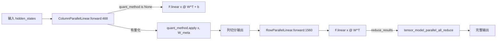

# 06.1 Linear

## 定位

`Linear` 是 06 子系统中最基础的 `nn.Module` 构建块，承担所有 TP 列并行/行并行线性投影，并作为量化 method 的挂载点。它被几乎所有 Transformer 模型的 Attention QKV/Output projection 与 MLP gated/down projection 复用。

## 职责

- 提供一套 `LinearBase` 抽象，让模型代码无视底层是 `ReplicatedLinear` 还是 `ColumnParallelLinear`/`RowParallelLinear`。
- 按 TP 维度自动切分权重（列切分结果按行拼回，行切分走 all-reduce），并通过 `quant_method.apply` 把 matmul 委托给具体量化 scheme（FP8/FP4/Marlin/AWQ/GPTQ…）。
- 支持合并的列并行（`MergedColumnParallelLinear` 把 gate/up 合并成一个权重）、QKV 并行（`QKVParallelLinear` 处理 num_heads 与 num_kv_heads 不等的复制）、重复张量并行（`MergedColumnParallelRepeatedLinear`）与批处理线性（`ColumnParallelBatchedLinear`）。

## 关键类与函数

| 名称 | 定义位置 | 说明 |
|---|---|---|
| `LinearBase` | `layers/linear.py:145` | 所有线性层基类，持有 `quant_method`、`create_weights` 钩子 |
| `ReplicatedLinear` | `layers/linear.py:194` | 不做 TP 切分的复制型线性层 |
| `ColumnParallelLinear` | `layers/linear.py:292` | 列并行（输出维度按 TP 切分），`forward` 在 `:468` |
| `MergedColumnParallelLinear` | `layers/linear.py:491` | 合并多个列并行权重（gate/up） |
| `QKVParallelLinear` | `layers/linear.py:920` | 处理 GQA/MQA 复制的 QKV 并行层 |
| `RowParallelLinear` | `layers/linear.py:1379` | 行并行（输入维度按 TP 切分），`forward` 在 `:1560`，默认 all-reduce |
| `MergedColumnParallelRepeatedLinear` | `layers/linear.py:1623` | 支持重复张量并行的合并列并行层 |
| `ColumnParallelBatchedLinear` | `layers/linear.py:1693` | 同一权重对多组输入做批处理 matmul |

## 子模块树

- `layers/linear.py` — TP 线性层主体
- `layers/quantization/` — `LinearMethodBase` 各 scheme 实现（见 [06.5](06.5-quantization.md)）
- `layers/parameter.py` — `BasevLLMParameter` 体系为权重提供切分元信息（见 [06.12](06.12-parameter.md)）
- `layers/clippable_linear.py`、`layers/int4fp8_utils.py`、`layers/rocm_linear_utils.py` — 与特定量化/硬件耦合的辅助路径

## 数据流 / 控制流

`LinearBase.__init__` 调用 `self.quant_config.get_quant_method(self)` 注入 `quant_method` 与权重 parameter；`create_weights` 在模型构建期由 loader 触发。`forward()` 把张量按 TP 维度 reshape 后委托给 `quant_method.apply`（FP8/Marlin 等会在这里调用专用内核），再按列/行语义做切分恢复或 all-reduce。

## 交叉引用

- 上游: [`05.5 模型实现模式`](../05-model-loading/05.5-model-pattern.md) — 模型代码引用这些类
- 下游: [`06.5 量化`](06.5-quantization.md) — `quant_method.apply` 的具体实现
- 下游: [`06.12 Parameter`](06.12-parameter.md) — `create_weights` 创建的权重对象
- 下游: [`06.13 LayerCommunicator`](06.13-layer-communicator.md) — all-reduce / reduce-scatter 融合
- 下游: [`08.2 parallel_state`](../08-distributed/08.2-parallel-state.md) — TP 组信息

## 进一步阅读

- 源码: `python/sglang/srt/layers/linear.py`
- 类 docstring: `python/sglang/srt/layers/linear.py:145`
