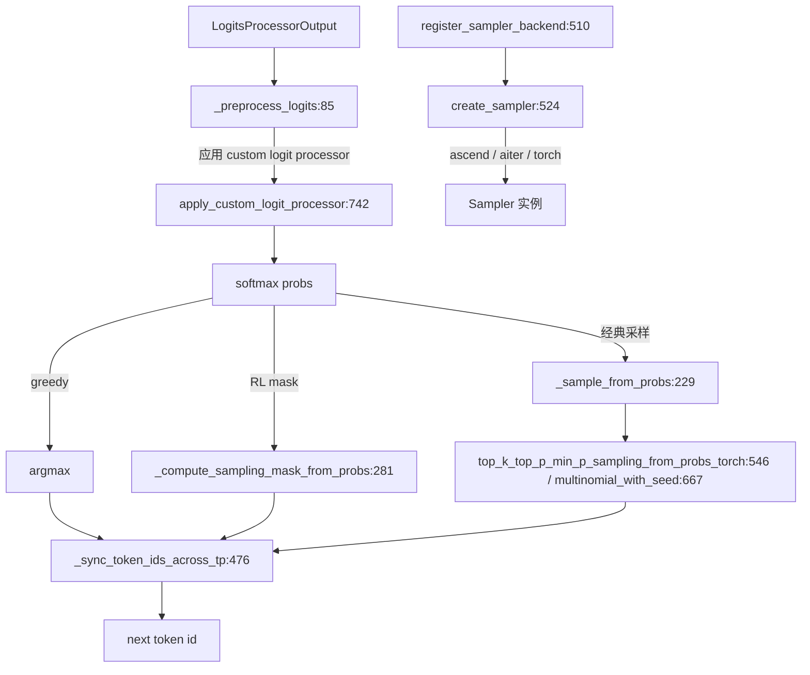

# 06.10 Sampler 层

## 定位

`Sampler` 是 06 子系统的最后一个 `nn.Module`：把 `LogitsProcessor` 产出的 logits 转成采样后的 token id。它既负责 greedy/temperature/top-k/top-p/min-p 等经典采样，也负责 RL 训练用的 `_compute_sampling_mask_from_probs` 与跨 TP 的 `_sync_token_ids_across_tp`。backend 抽象让 ascend/aiter/torch 各硬件复用同一个 `Sampler.forward`。

## 职责

- `_preprocess_logits`：应用 temperature/top-k/top-p/min-p 与 custom logit processor。
- `_sample_from_probs:229`：按概率类别采样；`_sample_from_logits`/`_sample_from_logprobs` 转换接口。
- `_compute_sampling_mask_from_probs:281`：RL 的 mask 采样路径。
- `_sync_token_ids_across_tp:476`：跨 attn_tp 同步各 rank 的采样结果（避免多 rank 选不同 token）。
- backend 注册：`register_sampler_backend:510` / `create_sampler:524` 让 ascend/aiter/torch 各自注册。
- 顶层 helper：`top_k_top_p_min_p_sampling_from_probs_torch:546`、`multinomial_with_seed:667`、`apply_custom_logit_processor:742`。

## 关键类与函数

| 名称 | 定义位置 | 说明 |
|---|---|---|
| `Sampler(nn.Module)` | `layers/sampler.py:69` | 采样器本体，`forward` 在 `:94` |
| `Sampler._preprocess_logits` | `layers/sampler.py:85` | logits 预处理 |
| `Sampler._sample_from_probs` | `layers/sampler.py:229` | 概率采样核心 |
| `Sampler._compute_sampling_mask_from_probs` | `layers/sampler.py:281` | RL mask 采样 |
| `Sampler._attach_greedy_sampling_mask_to_output` | `layers/sampler.py:310` | greedy mask 输出 |
| `Sampler._attach_sampling_mask_to_output` | `layers/sampler.py:329` | sampling mask 输出 |
| `Sampler._sample_from_logprobs` / `_sample_from_logits` | `layers/sampler.py:395` / `:414` | 入口转换 |
| `Sampler._forward_ascend_backend` | `layers/sampler.py:450` | ascend 后端路径 |
| `Sampler._sync_token_ids_across_tp` | `layers/sampler.py:476` | 跨 TP token 同步 |
| `Sampler.compute_logprobs_only` | `layers/sampler.py:493` | logprobs-only 路径 |
| `register_sampler_backend` | `layers/sampler.py:510` | backend 注册装饰器 |
| `create_sampler` | `layers/sampler.py:524` | 按名字构造 backend |
| `top_k_top_p_min_p_sampling_from_probs_torch` | `layers/sampler.py:546` | torch 顶层采样 helper |
| `top_k_top_p_min_p_sampling_from_logits_ascend` | `layers/sampler.py:594` | ascend helper |
| `multinomial_with_seed` | `layers/sampler.py:667` | 带种子 multinomial（`@torch.compile` 在 `:666`） |
| `sampling_from_probs_torch` / `top_p_normalize_probs_torch` | `layers/sampler.py:709` / `:730` | torch 辅助 |
| `apply_custom_logit_processor` | `layers/sampler.py:742` | 自定义 logit processor |

## 子模块树

- `layers/sampler.py` — 采样器主体 + helper + backend 注册
- backend 注册由 [11.4 sampler-layer](../11-sampling-control/11.4-sampler-layer.md) 等 model_exec 下游引用
- 与之协作的 penalty/grammar 在 [11 子系统](../11-sampling-control/index.md)

## 数据流 / 控制流

`Sampler.forward:94` 先调 `_preprocess_logits` 把 temperature/top-k/top-p/min-p/penalty/grammar 等全部应用到 logits，转成概率后按 `sampling_strategy` 选择 greedy / RL mask / 经典 multinomial。`_sync_token_ids_across_tp` 在 attn_tp > 1 时强制各 rank 同步采样结果（避免 rank 之间选不同 token 导致 EB/PP/EP 下游错位）。`register_sampler_backend` 让 ascend/aiter/torch 三类硬件注册自己的工厂，`create_sampler` 在 init 时按 `ServerArgs.sampler_backend` 解析。

## 交叉引用

- 上游: [`06.9 logits/logprob`](06.9-logits-logprob.md) — `LogitsProcessorOutput` 来源
- 上游: [`04.1 ModelRunner`](../04-model-execution/04.1-model-runner.md) — `ModelRunner.sample` 调用
- 下游: [`11.4 Sampler 层`](../11-sampling-control/11.4-sampler-layer.md) — 语义对应
- 相关: [`11.2 penalty 库`](../11-sampling-control/11.2-penalty-lib.md) — penalty 在 preprocess 阶段应用
- 相关: [`11.5 受限解码`](../11-sampling-control/11.5.1-constrained-base-registry.md) — grammar mask 在 preprocess 阶段应用

## 进一步阅读

- 源码: `python/sglang/srt/layers/sampler.py`
- 类: `python/sglang/srt/layers/sampler.py:69`
- 注册: `python/sglang/srt/layers/sampler.py:510`
