# 06.11 Vocab/Embedding/LMHead

## 定位

`VocabParallelEmbedding` 与 `ParallelLMHead` 是 06 子系统中负责词表分布与最终 logits 投影的两个 `nn.Module`。词表维度按 TP 切分到各 rank，rank 间通过 all-reduce/`vocab_parallel_unpad` 合并；它们是 `model.forward` 起点的 embedding 与 `LogitsProcessor._compute_lm_head` 终点的 head。

## 职责

- `VocabParallelEmbedding.forward:562` 按 token id 在本 rank 的词表分片内查表，超出范围置零，再 all-reduce（in-place）合并。
- `ParallelLMHead.forward:663` 复用 `VocabParallelEmbedding` 的 TP 切分，输出 logits（行并行 → all-reduce）。
- `pad_vocab_size:57` 把 `vocab_size` 向上对齐到 TP 的倍数，以避免最后一行 shard 不均。
- `VocabParallelEmbeddingShardIndices:80` / `get_masked_input_and_mask:139` 提供分片索引与越界 mask。
- `get_embedding_tp_kwargs:166` 返回 embedding 层的 TP 配置（是否拆分 head_dim 等）。

## 关键类与函数

| 名称 | 定义位置 | 说明 |
|---|---|---|
| `pad_vocab_size` | `layers/vocab_parallel_embedding.py:57` | 把 vocab 对齐到 TP 倍数 |
| `vocab_range_from_per_partition_vocab_size` | `layers/vocab_parallel_embedding.py:62` | 每 rank 词表范围 |
| `vocab_range_from_global_vocab_size` | `layers/vocab_parallel_embedding.py:70` | 全局范围映射 |
| `VocabParallelEmbeddingShardIndices` | `layers/vocab_parallel_embedding.py:80` | 分片索引计算 |
| `get_masked_input_and_mask` | `layers/vocab_parallel_embedding.py:139` | 越界 mask |
| `get_embedding_tp_kwargs` | `layers/vocab_parallel_embedding.py:166` | embedding TP 配置 |
| `VocabParallelEmbedding` | `layers/vocab_parallel_embedding.py:188` | 词表并行 embedding，`forward:562` |
| `ParallelLMHead` | `layers/vocab_parallel_embedding.py:587` | LM head，`forward:663` |

## 子模块树

- `layers/vocab_parallel_embedding.py` — embedding 与 LM head 主体
- `layers/parameter.py:484 PackedvLLMParameter` — embedding 权重的 packed 形态（见 [06.12](06.12-parameter.md)）
- `layers/n_gram_embedding.py:11` — n-gram embedding（投机 N-gram 用，见 [10.6](../10-speculative/10.6-ngram-corpus-embedding.md)）

## 数据流 / 控制流

```mermaid
flowchart LR
    IDS["input_ids"] --> VPE["VocabParallelEmbedding.forward:562"]
    VPE --> MASK["get_masked_input_and_mask:139"]
    MASK --> EMB["本 rank embedding 行"]
    EMB -->|"all-reduce"| AR["merged hidden_states"]
    AR --> BLK["transformer blocks"]
    BLK --> HS["final hidden_states"]
    HS --> LMH["ParallelLMHead.forward:663"]
    LMH -->|"本 rank logits"| LOG["local logits"]
    LOG -->|"attn_tp all-gather"| OUT["full vocab logits"]
```

`VocabParallelEmbedding` 把全局词表按 TP 切分：每个 rank 只持有自己那一段的 embedding 表；查询时 token id 落在其他 rank 分段的结果为 0，求和后通过 all-reduce 还原完整 embedding。`ParallelLMHead` 行方向同理——每个 rank 的 logits 是 partial sum，all-reduce 后得到全局 logits。`LogitsProcessor._gather_attn_tp_logits:778` 在 attn_tp > 1 时完成最后拼接。

## 交叉引用

- 上游: [`04.1 ModelRunner`](../04-model-execution/04.1-model-runner.md) — `model.forward` 首/末步
- 下游: [`06.9 logits/logprob`](06.9-logits-logprob.md) — `LogitsProcessor._compute_lm_head:719` 调 `ParallelLMHead`
- 下游: [`06.12 Parameter`](06.12-parameter.md) — `PackedvLLMParameter:484` / `ModelWeightParameter:340`
- 相关: [`10.6 N-gram corpus/embedding`](../10-speculative/10.6-ngram-corpus-embedding.md) — `NgramEmbedding`
- 相关: [`06.5 量化`](06.5-quantization.md) — `should_apply_lm_head_quant_method` 判定

## 进一步阅读

- 源码: `python/sglang/srt/layers/vocab_parallel_embedding.py`
- Embedding: `python/sglang/srt/layers/vocab_parallel_embedding.py:188`
- LM head: `python/sglang/srt/layers/vocab_parallel_embedding.py:587`
