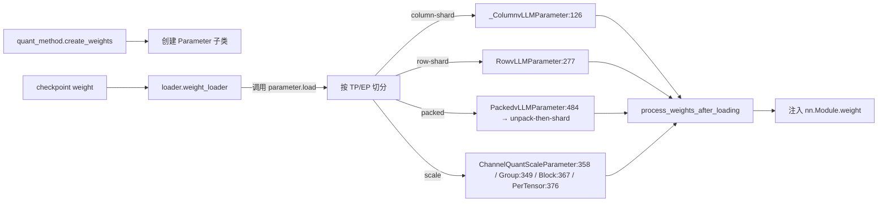

# 06.12 Parameter

## 定位

`layers/parameter.py` 定义 SGLang 权重加载的"形状语义学"。每个权重张量都被包成 `BasevLLMParameter` 的子类，子类携带该权重在 TP/EP 下该如何切分、如何 unpack、如何 align 的元信息——`model_loader` 据此把磁盘上的 checkpoint 分片加载到每个 rank。

## 职责

- 定义 column/row/packed/channel/group/block/per-tensor 七种切分语义，覆盖 Linear、Embedding、MoE、量化 scale 等各种权重形态。
- `_ColumnvLLMParameter` / `RowvLLMParameter` 是 column-shard / row-shard 基类；`ModelWeightParameter` 同时具备两种能力。
- `PackedColumnParameter` / `PackedvLLMParameter` 处理 INT4/INT8 pack 权重的 unpack-then-shard。
- 与 `quant_method.create_weights` 协作：scheme 决定创建哪种 parameter，loader 调用 `parameter.load` 完成切分加载。
- 计算 `shard`/`shard_size`/`shard_offset` 通过 `permute_param_layout_` 支持多维 layout 切换。

## 关键类与函数

| 名称 | 定义位置 | 说明 |
|---|---|---|
| `BasevLLMParameter` | `layers/parameter.py:82` | 所有权重 parameter 的基类 |
| `_ColumnvLLMParameter` | `layers/parameter.py:126` | column-shard 基类 |
| `RowvLLMParameter` | `layers/parameter.py:277` | row-shard 基类 |
| `ModelWeightParameter` | `layers/parameter.py:340` | 同时支持 column/row（典型 Linear 权重） |
| `GroupQuantScaleParameter` | `layers/parameter.py:349` | group-quant scale（GPTQ/AWQ） |
| `ChannelQuantScaleParameter` | `layers/parameter.py:358` | channel-quant scale（FP8） |
| `BlockQuantScaleParameter` | `layers/parameter.py:367` | block-quant scale（MXFP4） |
| `PerTensorScaleParameter` | `layers/parameter.py:376` | per-tensor scale |
| `PackedColumnParameter` | `layers/parameter.py:444` | pack 后的 column-shard 权重 |
| `PackedvLLMParameter` | `layers/parameter.py:484` | 同时支持 column/row 的 packed 权重（embedding/qkv） |
| `permute_param_layout_` | `layers/parameter.py:528` | 多维 layout 转换辅助 |
| `_adjust_shard_indexes_for_marlin` | `layers/parameter.py:586` | Marlin tile 对齐 |
| `_adjust_shard_indexes_for_packing` | `layers/parameter.py:590` | packed 分片偏移调整 |
| `copy_with_check` | `layers/parameter.py:51` | 带形状校验的拷贝 |
| `_dtype_rank` | `layers/parameter.py:33` | dtype 排序（用于 scale 比较） |

## 子模块树

- `layers/parameter.py` — 全部 parameter 类与 layout 辅助
- `layers/quantization/` — scheme 决定 create_weights 创建哪种类（见 [06.5](06.5-quantization.md)）
- `model_loader/loader.py` / `weight_utils.py` — 调 parameter.load 落盘（见 [05.3](../05-model-loading/05.3-weight-utils.md)）

## 数据流 / 控制流

模型构建期 `quant_method.create_weights` 决定 parameter 子类；加载期 `loader.weight_loader` 按 parameter 类型把 checkpoint 切到每个 rank。`PackedvLLMParameter` 先 unpack 再 shard；scale parameter 决定 scale 张量是 per-tensor / per-channel / per-group / per-block。"切完"之后 `quant_method.process_weights_after_loading` 还可能做 transpose/pack/quantize-again 等后处理。

## 交叉引用

- 上游: [`05.3 weight_utils`](../05-model-loading/05.3-weight-utils.md) — loader 调 `parameter.load`
- 上游: [`06.5 量化`](06.5-quantization.md) — scheme 决定创建哪种类
- 下游: [`06.1 Linear`](06.1-linear.md) — `create_weights` 输出挂在 Linear 上
- 下游: [`06.4.1 MoE 模块与流程`](06.4.1-moe-module-flow.md) — MoE weight 也用此体系
- 下游: [`06.11 Vocab/Embedding/LMHead`](06.11-vocab-embedding-lmhead.md) — `PackedvLLMParameter:484`
- 相关: [`08.2 parallel_state`](../08-distributed/08.2-parallel-state.md) — TP/EP 组大小
- 相关: [`08.11 weight_sync`](../08-distributed/08.11-weight-sync.md) — 在线权重更新

## 进一步阅读

- 源码: `python/sglang/srt/layers/parameter.py`
- 基类: `python/sglang/srt/layers/parameter.py:82`
- Layout 辅助: `python/sglang/srt/layers/parameter.py:528`
