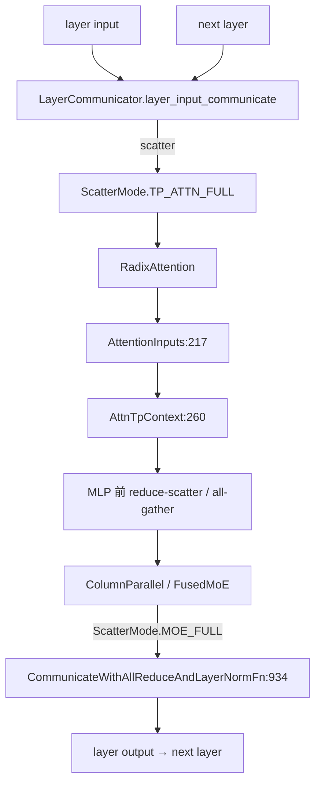

# 06.13 LayerCommunicator

## 定位

`LayerCommunicator` 是 06 子系统中 TP/DP/EP 三种并行下每层 hidden states 的"传动装置"。它支持 `ScatterMode.SCATTERED` / `TP_ATTN_FULL` / `FULL` / `MOE_FULL` 多种模式：在 attention 前后做 reduce-scatter / all-gather，让 dense TP 与 DP attention / EP MoE 在同一 transformer block 内混合切换。它还把 all-reduce 与 RMSNorm 融合（`CommunicateWithAllReduceAndLayerNormFn`）以减少跨 rank 通信。

## 职责

- `LayerCommunicator`：每层一个，根据 `LayerScatterModes` 在 layer 输入、attention 输入、MLP 输入、layer 输出做对应 scatter/gather/reduce。
- `CommunicateContext` / `AttnTpContext`：保存当前 layer 的 scatter state 与 attention 输入，让 attention backend 能取到正确切片。
- `CommunicateSimpleFn` / `CommunicateWithAllReduceAndLayerNormFn` / `CommunicateSummableTensorPairFn`：具体通信函数族，封装 all-reduce / reduce-scatter / all-gather + norm 融合。
- `ScatterMode`：模式枚举，描述 tensor 在 TP 间的形态。
- `DSACPLayerCommunicator:95`：CP + DSA 路径专用子类。`FlashInferWorkspaceManager:378`：FlashInfer 融合路径的 workspace 管理。

## 关键类与函数

| 名称 | 定义位置 | 说明 |
|---|---|---|
| `ScatterMode` | `layers/communicator.py:193` | 散播模式枚举 |
| `AttentionInputs` | `layers/communicator.py:217` | attention 输入容器 |
| `AttnTpContext` | `layers/communicator.py:260` | 当前层 attention TP 上下文 |
| `LayerScatterModes` | `layers/communicator.py:356` | 每层 scatter 模式集合 |
| `LayerCommunicator` | `layers/communicator.py:439` | 主通信器 |
| `CommunicateContext` | `layers/communicator.py:822` | 通信上下文 |
| `CommunicateSimpleFn` | `layers/communicator.py:868` | 简单通信函数基类 |
| `CommunicateWithAllReduceAndLayerNormFn` | `layers/communicator.py:934` | all-reduce+norm 融合 |
| `CommunicateSummableTensorPairFn` | `layers/communicator.py:1242` | 双 tensor 求和通信 |
| `_LayerModeComputationContext` | `layers/communicator.py:337` | 模式计算上下文 |
| `enable_moe_dense_fully_dp` | `layers/communicator.py:435` | dense MoE 全 DP 开关 |
| `DSACPLayerCommunicator` | `layers/communicator_dsa_cp.py:95` | DSA + CP 子类 |
| `FlashInferWorkspaceManager` | `layers/flashinfer_comm_fusion.py:378` | FlashInfer allreduce fusion workspace |
| `apply_flashinfer_allreduce_fusion` | `layers/communicator.py:164` | FlashInfer 融合入口 |
| `apply_aiter_all_reduce_fusion` | `layers/communicator.py:178` | Aiter 融合入口 |

## 子模块树

- `layers/communicator.py` — 主通信器与 `ScatterMode`/`LayerScatterModes`/`AttentionInputs`
- `layers/communicator_dsa_cp.py` — DSA + CP 子类
- `layers/flashinfer_comm_fusion.py` — FlashInfer all-gather/allreduce 融合 workspace
- 与之协作：[`06.8 RMSNorm`](06.8-norm-activation-conv-pooler.md) (`forward_with_allreduce_fusion:597`)、[`06.1 Linear`](06.1-linear.md) (`RowParallelLinear` 的 all-reduce)

## 数据流 / 控制流

`LayerCommunicator` 按 `LayerScatterModes` 在 layer 输入、attention 输入、MLP 输入、layer 输出四个点位做对应通信。`CommunicateSimpleFn` 是基类，`CommunicateWithAllReduceAndLayerNormFn` 把 all-reduce 与下一层 RMSNorm 融合以掩盖延迟。DP attention / EP MoE 路径上 `mlp_mode` 会是 `ScatterMode.MOE_FULL`，让 dense 与稀疏/moe 模式在同一 block 切换。`AttnTpContext` 持有当前层的 `AttentionInputs` 供 backend 取用。

## 交叉引用

- 上游: [`04.1 ModelRunner`](../04-model-execution/04.1-model-runner.md) — 在 init 期为每层创建 `LayerCommunicator`
- 上游: [`08.6 DP attention`](../08-distributed/08.6-dp-attention.md) — DP scatter 模式
- 下游: [`06.2 RadixAttention`](06.2-radix-attention-module.md) — backend 通过 `AttnTpContext` 取 attn_inputs
- 下游: [`06.8 norm`](06.8-norm-activation-conv-pooler.md) — `forward_with_allreduce_fusion:597`
- 下游: [`06.7 上下文并行 cp`](06.7-context-parallel-cp.md) — `DSACPLayerCommunicator`
- 相关: [`08.12 batch overlap TBO`](../08-distributed/08.12-batch-overlap-tbo.md) — 与 TBO 协作

## 进一步阅读

- 源码: `python/sglang/srt/layers/communicator.py`、`communicator_dsa_cp.py`、`flashinfer_comm_fusion.py`
- 主类: `python/sglang/srt/layers/communicator.py:439`
- 模式枚举: `python/sglang/srt/layers/communicator.py:193`
