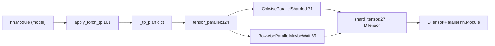

# 06.14 model_parallel(DTensor)

## 定位

`layers/model_parallel.py` 是 SGLang 对 PyTorch 原生 `torch.distributed.tensor.parallel` 的薄封装。它提供 `ColwiseParallelSharded` / `RowwiseParallelMaybeWait` 两种 DTensor parallel style，`tensor_parallel`/`apply_torch_tp` 把一个 `nn.Module` 的权重与 IO 按 `_tp_plan` 转成 DTensor 形态。本页是 SGLang 与上游 PyTorch DTensor TP 对接的入口。

## 职责

- 当模型标记为 native DTensor TP 模式（`ServerArgs.enable_torch_tp` 或 `_tp_plan` 显式声明）时，替代 [06.12 Parameter](06.12-parameter.md) + [06.1 Linear](06.1-linear.md) 手动分片路径。
- `ColwiseParallelSharded`：列并行 shard，输入 gather、输出本地切片。
- `RowwiseParallelMaybeWait`：行并行 shard，输出 reduce（可选择延迟 wait 以与下一层 overlap）。
- `apply_torch_tp`：按 `_tp_plan` 把 module 的子层逐个变 DTensor parallel。

## 关键类与函数

| 名称 | 定义位置 | 说明 |
|---|---|---|
| `_shard_tensor` | `layers/model_parallel.py:27` | 底层 DTensor shard 辅助 |
| `ColwiseParallelSharded` | `layers/model_parallel.py:71` | 列并行 style |
| `RowwiseParallelMaybeWait` | `layers/model_parallel.py:89` | 行并行 style（可延迟 wait） |
| `tensor_parallel` | `layers/model_parallel.py:124` | TP 装配入口（按 plan 转换 module） |
| `apply_torch_tp` | `layers/model_parallel.py:161` | 模型级 TP 应用入口 |

## 子模块树

- `layers/model_parallel.py` — DTensor TP 封装
- 与之协作：[`06.1 Linear`](06.1-linear.md)（手动分片路径）、[`06.13 LayerCommunicator`](06.13-layer-communicator.md)（融合通信路径）
- `layers/model_parallel.py` 与 PyTorch 上游 `torch.distributed.tensor.parallel` 直接交互

## 数据流 / 控制流

`apply_torch_tp` 在模型加载完成后调用：遍历模型 `_tp_plan` 字典，对每个声明的子层按 `ColwiseParallelSharded` / `RowwiseParallelMaybeWait` 走 `torch.distributed.tensor.parallel` 接口把 weight 变 DTensor、把 IO 在 forward 时按 style 转换。`RowwiseParallelMaybeWait` 的"MaybeWait"允许把 reduce wait 推迟到下一层输入端，与 [06.13 LayerCommunicator](06.13-layer-communicator.md) 的 `CommunicateWithAllReduceAndLayerNormFn` 类似但走 PyTorch 原生路径。

## 交叉引用

- 上游: [`05.5 模型实现模式`](../05-model-loading/05.5-model-pattern.md) — 模型 `_tp_plan` 声明
- 上游: [`04.1 ModelRunner`](../04-model-execution/04.1-model-runner.md) — 加载后调 `apply_torch_tp`
- 下游: [`08.2 parallel_state`](../08-distributed/08.2-parallel-state.md) — DTensor 使用的 group
- 对比: [`06.1 Linear`](06.1-linear.md) / [`06.12 Parameter`](06.12-parameter.md) — 手动分片路径
- 对比: [`06.13 LayerCommunicator`](06.13-layer-communicator.md) — 融合通信路径

## 进一步阅读

- 源码: `python/sglang/srt/layers/model_parallel.py`
- 装配入口: `python/sglang/srt/layers/model_parallel.py:161`
- Style 类: `python/sglang/srt/layers/model_parallel.py:71`、`:89`
