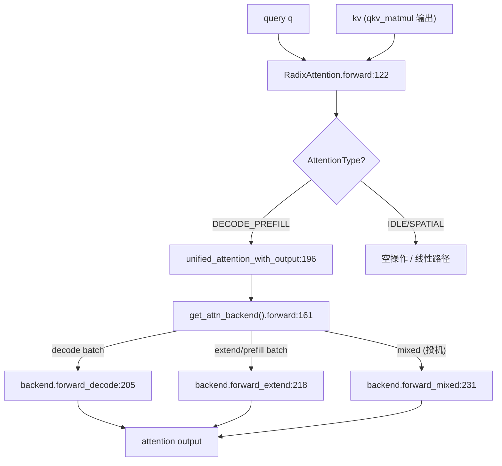

# 06.2 RadixAttention 模块

## 定位

`RadixAttention` 是 SGLang 中所有"需要 KV cache"的注意力层的统一 `nn.Module` 入口。它本身不实现任何 attention 数学，而是把请求转交给当前 `ForwardContext.attn_backend`，从而让同一份模型代码可以无感切换 FlashInfer / TRT-LLM MLA / FlashAttention / Triton / Ascend / Aiter 等几十种后端。

## 职责

- 持有每层的 `q_size`/`kv_size`/`head_dim`/`scaling`/`logit_cap` 等几何参数与 `layer_id`。
- 在 `forward` 中按 `AttentionType`（DECODE_PREFILL / IDLE / SPATIAL_LINEAR_ATTN）选择对应 backend 函数。
- 通过自定义 op `unified_attention_with_output` / `unified_sparse_attention_with_output` 提供编译器 split 边界（`@register_split_op()`）。
- 暴露给投机解码的 `forward_decode` / `forward_extend` / `forward_mixed` 三态入口。

## 关键类与函数

| 名称 | 定义位置 | 说明 |
|---|---|---|
| `AttentionType` | `layers/radix_attention.py:56` | 区分 DECODE_PREFILL / IDLE / SPATIAL 等模式 |
| `RadixAttention` | `layers/radix_attention.py:70` | 注意力模块本体，`__init__` 在 `:75` |
| `RadixAttention.forward` | `layers/radix_attention.py:122` | 分发到 `attn_backend.forward` |
| `unified_attention_with_output` | `layers/radix_attention.py:196` | 全注意力自定义 op，`@register_split_op()` 在 `:195` |
| `unified_sparse_attention_with_output` | `layers/radix_attention.py:284` | 稀疏注意力自定义 op，`@register_split_op()` 在 `:283` |
| `breakable_unified_attention_with_output` | `layers/radix_attention.py:340` | 允许图断裂的 eager_on_graph 包装版本 |

## 子模块树

- `layers/radix_attention.py` — 注意力模块本体与 custom op 注册
- `layers/attention/` — 所有 `AttentionBackend` 实现（见 [06.3.1](06.3.1-attn-backend-abstraction.md)）
- `layers/radix_linear_attention.py` — 线性注意力的 RadixAttention 等价物
- `layers/sparse_pooler.py` — 稀疏路径的池化支持

## 数据流 / 控制流

`RadixAttention.forward` 取出 `ForwardContext.local_attn_backend`（每 forward 由 `ForwardContext.__enter__` 发布），把 `q`/`kv`/`forward_batch` 与必要的 scaling 传给 `unified_attention_with_output`，后者在 eager 模式直接调用 `attn_backend.forward`，但在 torch.compile / Inductor 看来是一个 split 边界，可避免跨层 fuse 引发的尺寸问题。稀疏注意力模型（NSA / DSV4）走 `unified_sparse_attention_with_output` 路径。

## 交叉引用

- 上游: [`04.1 ModelRunner`](../04-model-execution/04.1-model-runner.md) — `ModelRunner.init_attention_backends:818` 装配后端
- 上游: [`04.3 ForwardContext`](../04-model-execution/04.3-forward-context.md) — `local_attn_backend` 来源
- 下游: [`06.3.1 注意力后端抽象`](06.3.1-attn-backend-abstraction.md) — `AttentionBackend` ABC
- 下游: [`06.3.5 Hybrid wrapper`](06.3.5-attn-hybrid-wrapper.md) — 由 wrapper 注入 hybrid 行为
- 依赖: [`07.3 RadixCache`](../07-kv-cache/07.3-radix-cache.md) — backend 读写 KV
- 依赖: [`15.4 jit_kernel`](../15-kernels-hardware/15.4-jit-kernel.md) — `register_split_op` 编译注解

## 进一步阅读

- 源码: `python/sglang/srt/layers/radix_attention.py`
- 类 docstring: `python/sglang/srt/layers/radix_attention.py:70`
