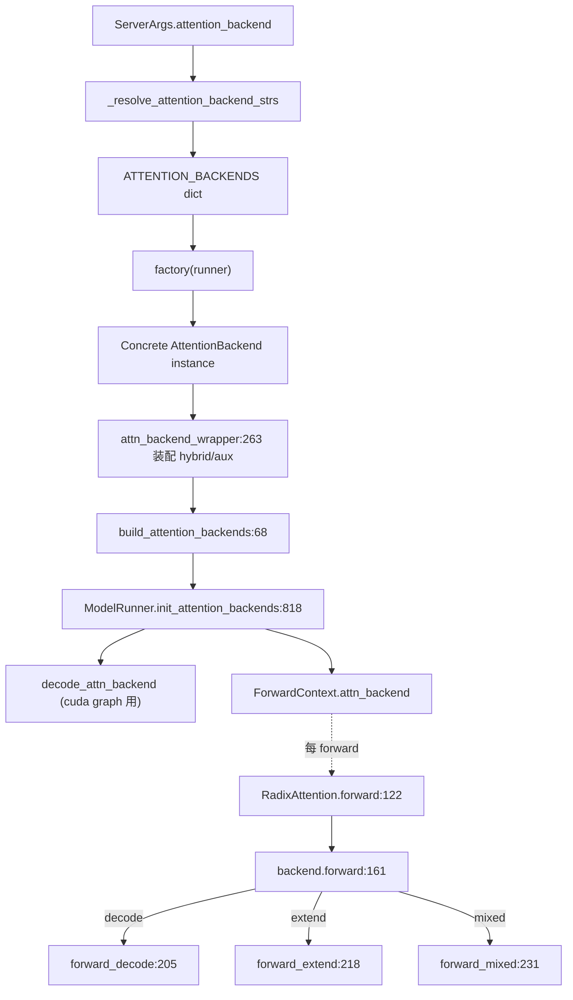

# 06.3.1 注意力后端抽象

## 定位

`AttentionBackend` 是 06 子系统的核心抽象：所有"能完成一次 decode/extend/mixed forward"的实现都实现这个 ABC。配合 `attention_registry.ATTENTION_BACKENDS` factory 字典，SGLang 把后端选择从模型代码里彻底剥离——模型只声明 `RadixAttention`，由 `ModelRunner` 在 init 时把一个具体 backend 实例投递到 `ForwardContext`。

## 职责

- 定义统一生命周期：`init_cuda_graph_state` → `init_forward_metadata` → `forward`（内部按 batch 类型分派到 `forward_decode` / `forward_extend` / `forward_mixed`）。
- 提供两类 metadata 初始化接口：`init_forward_metadata`（capture 时调用，通常不可中断）与 `init_forward_metadata_in_graph` / `init_forward_metadata_out_graph`（breakable cuda graph capture 用）。
- 暴露 cuda graph 钩子：`get_cuda_graph_seq_len_fill_value`、`on_after_cuda_graph_warmup`、`get_verify_buffers_to_fill_after_draft` 等，让 runner 在重放期间可注入 spec verify buffer。
- 通过 `attention_registry` 提供注册名→factory 映射；`attn_backend_wrapper` 装配 hybrid（GDN/Mamba2/ShortConv/KDA/Lightning）与 aux hidden 捕获。

## 关键类与函数

| 名称 | 定义位置 | 说明 |
|---|---|---|
| `AttentionBackend` | `layers/attention/base_attn_backend.py:18` | 所有后端的 ABC |
| `AttentionBackend.init_forward_metadata` | `layers/attention/base_attn_backend.py:47` | 主 metadata 构建入口 |
| `AttentionBackend.init_forward_metadata_in_graph` | `layers/attention/base_attn_backend.py:77` | 图内可重放 metadata |
| `AttentionBackend.forward` | `layers/attention/base_attn_backend.py:161` | 总入口，按 mode 分派 |
| `AttentionBackend.forward_decode` | `layers/attention/base_attn_backend.py:205` | decode 路径 |
| `AttentionBackend.forward_extend` | `layers/attention/base_attn_backend.py:218` | extend/prefill 路径 |
| `AttentionBackend.forward_mixed` | `layers/attention/base_attn_backend.py:231` | 投机 verify 混合路径 |
| `ATTENTION_BACKENDS` | `layers/attention/attention_registry.py:30` | 全局注册字典 |
| `register_attention_backend` | `layers/attention/attention_registry.py:33` | 装饰器，写入 `ATTENTION_BACKENDS` |
| `attn_backend_wrapper` | `layers/attention/attention_registry.py:263` | 把 hybrid backend 与 aux 钩子装到 full backend 上 |
| `build_attention_backends` | `model_executor/model_runner_components/attention_backend_setup.py:68` | 由 `ModelRunner.init_attention_backends` 调用，产出主/decode 后端 |

注册的后端 factory（约 19 个）：`create_flashinfer_backend`、`create_trtllm_mla_backend`、`create_tokenspeed_mla_backend`、`create_cutedsl_mla_backend`、`create_aiter_backend`、`create_wave_backend`、`create_ascend_backend`、`create_dsa_backend`、`create_dsv4_backend`、`create_triton_backend`、`create_torch_native_backend`、`create_flex_attention_backend`、`create_flashmla_backend`、`create_flashattention_v3_backend`、`create_flashattention_v4_backend`、`create_cutlass_mla_backend`、`create_trtllm_mha_backend`、`create_intel_amx_backend`、`create_dual_chunk_flash_attn_backend`，外加 `intel_xpu` 与 `nsa` 兼容 wrapper。

## 子模块树

- `layers/attention/base_attn_backend.py` — `AttentionBackend` ABC
- `layers/attention/attention_registry.py` — 注册表 + factory + wrapper
- `model_executor/model_runner_components/attention_backend_setup.py` — `build_attention_backends` 总装
- `layers/attention/hybrid_linear_attn_backend.py` — hybrid 后端（见 [06.3.5](06.3.5-attn-hybrid-wrapper.md)）

## 数据流 / 控制流

`build_attention_backends` 解析 `ServerArgs.attention_backend` → 调用 factory → 调用 `attn_backend_wrapper` 注入 hybrid（当模型架构是 GLM4.5/MiniMax 等含 linear/mamba 层时）与 aux hidden 状态捕获；最后把主后端与 decode 后端存到 `ModelRunner`，并在每个 forward 通过 `ForwardContext.local_attn_backend` 把它送到任意深度的 Layer。

## 交叉引用

- 上游: [`04.1 ModelRunner`](../04-model-execution/04.1-model-runner.md) — `init_attention_backends:818`
- 下游: [`06.2 RadixAttention`](06.2-radix-attention-module.md) — 调用 backend 的入口
- 下游: [`06.3.2-06.3.7 各种后端`](06.3.2-attn-full-backends.md)
- 下游: [`15.2 sgl-kernel`](../15-kernels-hardware/15.2-sgl-kernel-aot.md) — backend 调用的内核
- 依赖: [`08.2 parallel_state`](../08-distributed/08.2-parallel-state.md) — TP/DP 组信息
- 依赖: [`07.6 内存池`](../07-kv-cache/07.6-memory-pools.md) — `token_to_kv_pool` / `req_to_token_pool`

## 进一步阅读

- 源码: `python/sglang/srt/layers/attention/base_attn_backend.py`、`python/sglang/srt/layers/attention/attention_registry.py`
- ABC docstring: `python/sglang/srt/layers/attention/base_attn_backend.py:18`
- 装配路径: `python/sglang/srt/model_executor/model_runner_components/attention_backend_setup.py:68`
