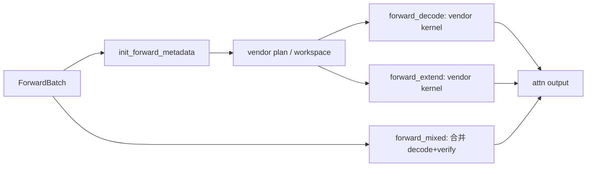

# 06.3.2 全注意力后端

## 定位

Full-attention 后端族是 06.3.1 抽象的具体实现，覆盖所有"非稀疏、非线性、非视觉"的稠密注意力变体——MHA / GQA / MLA。这是 SGLang 在 GPU/NPU/CPU 上最常用的几条路径。

## 职责

- 为每个硬件厂商与每种 KV 布局（page/paged/radix/MHA chunk）提供 `AttentionBackend` 子类。
- 在 `forward_decode` / `forward_extend` / `forward_mixed` 中分别构造 plan/workspace/metadata，调用对应 vendor kernel。
- 提供 cuda graph 友好的 metadata 复用接口，支持 `MultiStepDraftBackend` 子类供投机解码使用。

## 关键类与函数

| 名称 | 定义位置 | 说明 |
|---|---|---|
| `FlashInferAttnBackend` | `layers/attention/flashinfer_backend.py:300` | FlashInfer 通用后端，含 `FlashInferIndicesUpdaterDecode:1480` / `Prefill:1748` / `MultiStepDraftBackend:2216` |
| `FlashInferMLAAttnBackend` | `layers/attention/flashinfer_mla_backend.py:204` | FlashInfer MLA（DeepSeek 风格） |
| `TRTLLMMLABackend` | `layers/attention/trtllm_mla_backend.py:125` | TRT-LLM MLA，`forward_decode:705` / `forward_extend:802` |
| `TRTLLMMLAMultiStepDraftBackend` | `layers/attention/trtllm_mla_backend.py:1061` | TRT-LLM MLA 投机后端 |
| `TokenspeedMLABackend` | `layers/attention/tokenspeed_mla_backend.py:89` | 基于 `TRTLLMMLABackend` 的 TokenSpeed 后端 |
| `TRTLLMHAAttnBackend` | `layers/attention/trtllm_mha_backend.py:80` | TRT-LLM MHA（非 MLA）后端 |
| `CutlassMLABackend` | `layers/attention/cutlass_mla_backend.py:51` | CUTLASS MLA decode 后端 |
| `FlashMLABackend` | `layers/attention/flashmla_backend.py:57` | FlashMLA（基于 `FlashInferMLAAttnBackend`） |
| `FlashAttentionBackend` | `layers/attention/flashattention_backend.py:113` | FA3/FA4 通用后端，`forward_extend:970` / `forward_decode:1518` |
| `TritonAttnBackend` | `layers/attention/triton_backend.py:110` | 纯 Triton 后端，`forward_extend:1207` / `forward_decode:1647` |
| `TorchNativeAttnBackend` | `layers/attention/torch_native_backend.py:19` | PyTorch 原生 SDPA 后端 |
| `TorchFlexAttnBackend` | `layers/attention/torch_flex_backend.py:17` | `torch.nn.attention.flex_attention` 后端 |
| `DualChunkFlashAttentionBackend` | `layers/attention/dual_chunk_flashattention_backend.py:106` | Qwen 双 chunk FA 后端 |
| `WaveAttnBackend` | `layers/attention/wave_backend.py:40` | Wave kernel 后端 |
| `AiterAttnBackend` | `layers/attention/aiter_backend.py:129` | AMD Aiter 后端，`forward_extend:1887` / `forward_decode:2390` |
| `IntelAMXAttnBackend` | `layers/attention/intel_amx_backend.py:17` | Intel CPU AMX 后端 |
| `XPUAttentionBackend` | `layers/attention/xpu_backend.py:28` | Intel XPU 后端 |
| `hip_flash_mla` 入口 | `layers/attention/hip_flash_mla.py:12` | AMD HIP FlashMLA 入口 |

## 子模块树

- `layers/attention/flashinfer_backend.py` / `flashinfer_mla_backend.py` — NVIDIA FlashInfer 系
- `layers/attention/trtllm_mla_backend.py` / `trtllm_mha_backend.py` / `tokenspeed_mla_backend.py` — TRT-LLM 系
- `layers/attention/flashattention_backend.py` / `flashmla_backend.py` / `dual_chunk_flashattention_backend.py` — FA 系
- `layers/attention/cutlass_mla_backend.py` / `hip_flash_mla.py` — CUTLASS / HIP 系
- `layers/attention/triton_backend.py` / `torch_native_backend.py` / `torch_flex_backend.py` — Triton/原生 系
- `layers/attention/wave_backend.py` + `wave_ops/` — Wave 系
- `layers/attention/aiter_backend.py` + `aiter_utils.py` — AMD Aiter 系
- `layers/attention/intel_amx_backend.py` / `xpu_backend.py` — Intel 系

## 数据流 / 控制流

每个后端的内部流程高度一致：`init_forward_metadata` 一次性构建 plan/workspace（可能触发 vendor JIT 编译），`forward_decode` / `forward_extend` 复用这些 buffer 调用底层 kernel，`forward_mixed` 在投机 verify 路径里把 decode 与 extend 的 batch 维度合并。`MultiStepDraftBackend` 子类在 MTP/EAGLE 多步 draft 时复用 plan 并额外维护 verify buffer。

## 交叉引用

- 上游: [`06.3.1 注意力后端抽象`](06.3.1-attn-backend-abstraction.md) — ABC 与注册表
- 上游: [`06.2 RadixAttention`](06.2-radix-attention-module.md) — 调用方
- 下游: [`15.2 sgl-kernel`](../15-kernels-hardware/15.2-sgl-kernel-aot.md) / [`15.4 jit_kernel`](../15-kernels-hardware/15.4-jit-kernel.md)
- 相关: [`10.2 Draft worker/runner`](../10-speculative/10.2-draft-worker-runner.md) — `MultiStepDraftBackend` 子类

## 进一步阅读

- 源码: `python/sglang/srt/layers/attention/`
- FlashInfer 类: `python/sglang/srt/layers/attention/flashinfer_backend.py:300`
- TRT-LLM MLA 类: `python/sglang/srt/layers/attention/trtllm_mla_backend.py:125`
