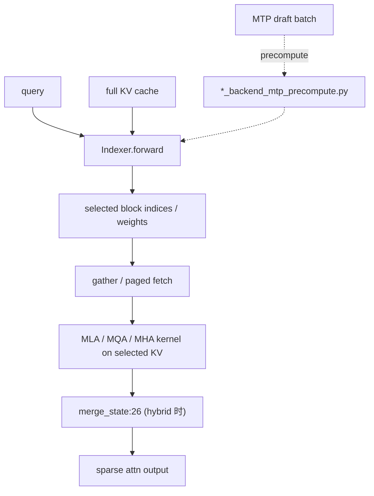

# 06.3.3 稀疏注意力后端

## 定位

Sparse-attention 后端族面向"长上下文 + 选择性参与"的模型（DeepSeek V3.2/V4、Kimi-K2、GLM DSA、MiniMax 等），它们在 prefill 阶段从完整 KV 中挑出 top-k 块参与注意力，把 O(N^2) 降为 O(N·k)。本族后端都实现 [06.3.1](06.3.1-attn-backend-abstraction.md) 的 `AttentionBackend` ABC。

## 职责

- 通过 indexer 子模块选出每个 query 关注的 KV 块索引（C4 indexer、NSA indexer、DSA indexer）。
- 在 `forward_extend` / `forward_decode` 中先用 gather/paged kernel 取出稀疏 KV，再调用 MLA/MQA/MHA 主注意力 kernel。
- 提供 MTP precompute 子组件，把投机 draft 时的索引计算提前并行化。
- 支持 `DeepseekSparseAttnMultiStepBackend` 与 `DeepseekV4MultiStepBackend`，给投机解码复用稀疏索引。

## 关键类与函数

| 名称 | 定义位置 | 说明 |
|---|---|---|
| `DeepseekSparseAttnBackend` | `layers/attention/dsa_backend.py:334` | DeepSeek V3.2 / Kimi-K2 稀疏后端 |
| `DeepseekSparseAttnMultiStepBackend` | `layers/attention/dsa_backend.py:3100` | DSA 投机后端 |
| `DSAIndexerMetadata` | `layers/attention/dsa_backend.py:250` | indexer 产出的元数据 |
| `DeepseekV4AttnBackend` | `layers/attention/deepseek_v4_backend.py:483` | DeepSeek V4 稀疏后端，`forward` 在 `:1598` |
| `DeepseekV4MultiStepBackend` | `layers/attention/deepseek_v4_backend.py:2032` | V4 投机后端 |
| `DSV4Metadata` | `layers/attention/deepseek_v4_backend.py:380` | V4 主 metadata |
| `C4Indexer` | `layers/attention/dsv4/indexer.py:790` | V4 C4 索引器，`forward` 在 `:868` |
| `MiniMaxSparseAttnBackend` | `layers/attention/minimax_sparse_backend.py:28` | MiniMax 稀疏后端 |
| `MiniMaxHybridAttnBackend` | `layers/attention/minimax_sparse_backend.py:493` | MiniMax hybrid（dense+sparse）后端 |
| `HybridAttnBackend` | `layers/attention/hybrid_attn_backend.py:12` | 通用 hybrid 包装（在 sparse 与 dense 间切换） |
| `merge_state` | `layers/attention/merge_state.py:26` | 把多个 branch 的 attn state 合并的函数 |

## 子模块树

- `layers/attention/dsa_backend.py` + `dsa/` — DeepSeek 稀疏后端
  - `dsa/dsa_indexer.py` — indexer 实现
  - `dsa/dsa_topk_backend.py` — DSATopKBackend 选择算法
  - `dsa/dsa_backend_mtp_precompute.py` — MTP 预计算
  - `dsa/paged_mqa_logits_backend.py` — paged MQA logits 路径
- `layers/attention/deepseek_v4_backend.py` + `dsv4/` + `deepseek_v4_backend_hip_radix.py` — DeepSeek V4
  - `dsv4/indexer.py` (C4Indexer)、`compressor.py` / `compressor_v2.py` / `compress_hip.py`、`dsv4/metadata.py`、`dsv4/sparse_prefill_utils.py`
- `layers/attention/nsa_backend.py` + `nsa/` — Native Sparse Attention
  - `nsa/nsa_indexer.py`、`nsa/quant_k_cache.py` / `dequant_k_cache.py`、`nsa/triton_kernel.py` / `tilelang_kernel.py`、`nsa/transform_index.py`、`nsa/index_buf_accessor.py`、`nsa/nsa_backend_mtp_precompute.py`
- `layers/attention/minimax_sparse_backend.py` + `minimax_sparse_ops/` — MiniMax 稀疏
- `layers/attention/hybrid_attn_backend.py` + `merge_state.py` — hybrid 包装与 state 合并

## 数据流 / 控制流

普通 forward：先由 indexer 在 Q×K 上算分（用 triton/cutlass/AMD hip 等 kernel），取 top-k 块索引，再 gather 这些块参与主注意力。Hybrid 后端（MiniMax/GLM）会把稀疏分支与稠密分支的输出用 `merge_state` 合并。MTP 路径下，`*_mtp_precompute` 模块把多步 draft 的索引在单步内串行算出，避免每步重复 indexer。

## 交叉引用

- 上游: [`06.3.1 注意力后端抽象`](06.3.1-attn-backend-abstraction.md) — ABC
- 上游: [`06.2 RadixAttention`](06.2-radix-attention-module.md) — `unified_sparse_attention_with_output:284` 入口
- 下游: [`15.2 sgl-kernel`](../15-kernels-hardware/15.2-sgl-kernel-aot.md) — topk / gather / sparse attn kernel
- 相关: [`10.2 Draft worker/runner`](../10-speculative/10.2-draft-worker-runner.md) — `MultiStepBackend`
- 相关: [`06.4.2 MoE topk`](06.4.2-moe-topk.md) — 同名 topk 概念但用于专家路由

## 进一步阅读

- 源码: `python/sglang/srt/layers/attention/dsa_backend.py`、`deepseek_v4_backend.py`、`nsa_backend.py`、`minimax_sparse_backend.py`
- DSA 类: `python/sglang/srt/layers/attention/dsa_backend.py:334`
- V4 类: `python/sglang/srt/layers/attention/deepseek_v4_backend.py:483`
