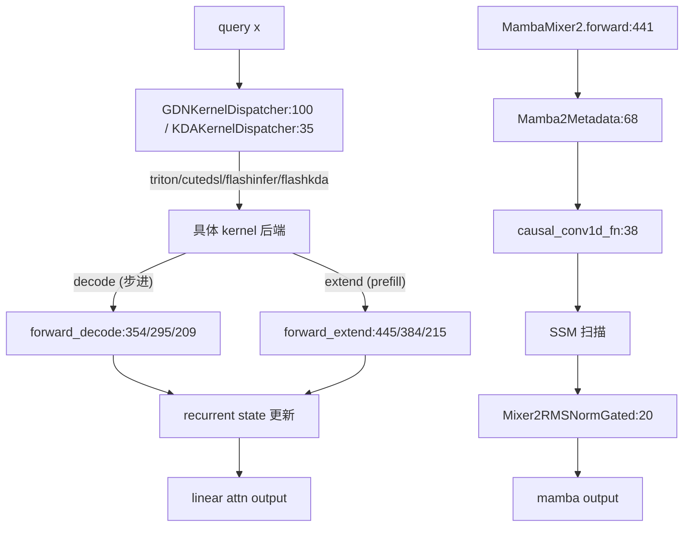

# 06.3.4 线性注意力后端

## 定位

Linear-attention / SSM 后端族面向 GLM4.5 attenuation（GDN）、KDA、Lightning、ShortConv，以及 Mamba2 等替代 Transformer 注意力的状态空间模型。它们通过递归更新 ` recurrent state` 而非维护长 KV cache，把 O(N) 推理成本对长序列友好。

## 职责

- 提供 `MambaAttnBackendBase` 抽象（在 `hybrid_linear_attn_backend.py` 中），统一 metadata、cuda graph state、forward 三态接口。
- 在 `forward_decode` / `forward_extend` 中分别处理"步进式 recurrent 更新"与"完整 prefill 计算两种工作模式"。
- 通过 `kernel_dispatcher` 在多 kernel 后端（Triton/CUTLDSL/FlashInfer/FlashKDA）间分派，按硬件能力选择最快路径。
- 与 `MambaMixer2` `nn.Module` 协同：`MambaMixer2.forward` 调用 backend 完成核心计算。

## 关键类与函数

| 名称 | 定义位置 | 说明 |
|---|---|---|
| `GDNAttnBackend` | `layers/attention/linear/gdn_backend.py:320` | GLM4.5 attenuation 后端，`forward_decode:354` / `forward_extend:445` |
| `GDNKernelDispatcher` | `layers/attention/linear/gdn_backend.py:100` | GDN kernel 选择器 |
| `KDAAttnBackend` | `layers/attention/linear/kda_backend.py:252` | KDA 线性注意力后端，`forward_decode:295` / `forward_extend:384` |
| `KDAKernelDispatcher` | `layers/attention/linear/kda_backend.py:35` | KDA kernel 选择器 |
| `LightningAttentionBackend` | `layers/attention/linear/lightning_backend.py:23` | Lightning linear attention 后端 |
| `ShortConvAttnBackend` | `layers/attention/linear/short_conv_backend.py:80` | ShortConv 后端，`forward_decode:209` / `forward_extend:215` |
| `LinearAttnKernelBackend` | `layers/attention/linear/utils.py:15` | kernel 后端枚举（Triton/Cutedsl/FlashInfer/FlashKDA/Custom） |
| `BailingLinearMetadata` | `layers/attention/linear/linear_metadata.py:10` | 线性 attn forward metadata |
| `MambaMixer2` | `layers/attention/mamba/mamba.py:191` | Mamba2 SSM 模块，`forward` 在 `:441` |
| `Mamba2Metadata` | `layers/attention/mamba/mamba2_metadata.py:68` | Mamba2 forward metadata（`ForwardMetadata` 在 `:29`） |
| `Mixer2RMSNormGated` | `layers/attention/mamba/mixer2_rms_norm_gated.py:20` | Mamba2 门控 RMSNorm |
| `causal_conv1d_fn` | `layers/attention/mamba/causal_conv1d.py:38` | Mamba2 因果卷积前向（`update` 在 `:121`） |

## 子模块树

- `layers/attention/linear/` — GDN/KDA/Lightning/ShortConv 后端
  - `gdn_backend.py` / `kda_backend.py` / `lightning_backend.py` / `short_conv_backend.py` — 各后端
  - `utils.py` — `LinearAttnKernelBackend` 枚举与配置初始化
  - `linear_metadata.py` — `BailingLinearMetadata`
  - `kernels/` — `gdn_triton.py:41`、`gdn_cutedsl.py`、`gdn_flashinfer.py`、`kda_triton.py`、`kda_cutedsl.py`、`kda_flashinfer.py`、`kda_flashkda.py`、`kernel_backend.py`
- `layers/attention/mamba/` — Mamba2 SSM
  - `mamba.py:191` (Mixer)、`mamba2_metadata.py:68`、`causal_conv1d.py:38`、`mixer2_rms_norm_gated.py:20`

## 数据流 / 控制流

`GDNKernelDispatcher` / `KDAKernelDispatcher` 在 init 时按 `LinearAttnKernelBackend` 选择一组 JIT/AOT kernel，并在每次 forward 复用其 workspace。`Mamba2Metadata` 持有 `conv_states`/`ssm_states` 等缓存张量，`MambaMixer2.forward` 串起 conv1d → SSM → 门控 norm。

## 交叉引用

- 上游: [`06.3.5 Hybrid wrapper`](06.3.5-attn-hybrid-wrapper.md) — hybrid 模型把 linear 与 full attn 混排
- 上游: [`06.3.1 注意力后端抽象`](06.3.1-attn-backend-abstraction.md) — ABC
- 下游: [`15.4 jit_kernel`](../15-kernels-hardware/15.4-jit-kernel.md) — Triton/CUTLDSL kernel 编译
- 相关: [`06.8 norm/activation`](06.8-norm-activation-conv-pooler.md) — `Mixer2RMSNormGated`

## 进一步阅读

- 源码: `python/sglang/srt/layers/attention/linear/`、`python/sglang/srt/layers/attention/mamba/`
- GDN 类: `python/sglang/srt/layers/attention/linear/gdn_backend.py:320`
- Mamba 模块: `python/sglang/srt/layers/attention/mamba/mamba.py:191`
