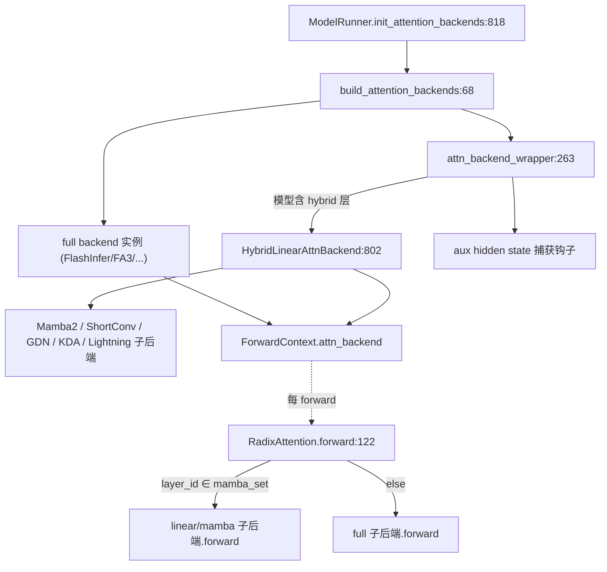

# 06.3.5 混合注意力 wrapper

## 定位

Hybrid wrapper 解决"同一个模型里既有 full attention 层又有 linear/Mamba/ShortConv 层"的部署问题——GLM4.5、MiniMax、Kimi-K2 等架构都采用 hybrid 设计。`HybridLinearAttnBackend` 不实现具体计算，而是把 full 后端与 linear/mamba 后端打包成单一 `AttentionBackend`，按 `layer_id` 在两者间切换。

## 职责

- `MambaAttnBackendBase` 提供所有 SSM/linear 后端的公共接口（metadata、cuda graph state、forward 三态）。
- `HybridLinearAttnBackend` 持有 full backend 与 linear backend 实例，按 `RadixAttention.layer_id` 查表的 attn 类型分派。
- `Mamba2AttnBackend` / `ShortConvHybridAttnBackend` 等 concrete 子类针对特定架构。
- `attn_backend_wrapper`（[06.3.1](06.3.1-attn-backend-abstraction.md)）在 `build_attention_backends` 阶段把 hybrid 装到 full backend 上；`ModelRunner.init_attention_backends:818` 是装配入口。

## 关键类与函数

| 名称 | 定义位置 | 说明 |
|---|---|---|
| `MambaAttnBackendBase` | `layers/attention/hybrid_linear_attn_backend.py:30` | 所有 SSM/linear 后端的基类 |
| `Mamba2AttnBackend` | `layers/attention/hybrid_linear_attn_backend.py:681` | Mamba2 hybrid 后端，`forward:737` / `forward_decode:791` / `forward_extend:796` |
| `HybridLinearAttnBackend` | `layers/attention/hybrid_linear_attn_backend.py:802` | 通用 hybrid 包装，`forward:966` / `forward_decode:906` / `forward_extend:936` |
| `ShortConvHybridAttnBackend` | `layers/attention/hybrid_linear_attn_backend.py:1071` | ShortConv hybrid 子类 |
| `attn_backend_wrapper` | `layers/attention/attention_registry.py:263` | 装配 hybrid 后端 + aux hidden 钩子 |
| `build_attention_backends` | `model_executor/model_runner_components/attention_backend_setup.py:68` | 由 `ModelRunner.init_attention_backends:818` 调用 |
| `ModelRunner.init_attention_backends` | `model_executor/model_runner.py:818` | 装配入口（详见 [04.1](../04-model-execution/04.1-model-runner.md)） |

## 子模块树

- `layers/attention/hybrid_linear_attn_backend.py` — hybrid 包装主文件
- `layers/attention/linear/` — linear/SSM 子后端（见 [06.3.4](06.3.4-attn-linear-backends.md)）
- `layers/attention/mamba/` — Mamba2 子后端
- `layers/attention/attention_registry.py:263` — `attn_backend_wrapper` 装配点
- `model_executor/model_runner_components/attention_backend_setup.py:68` — `build_attention_backends`

## 数据流 / 控制流

`attn_backend_wrapper` 接收 full backend，按模型架构判定是否需要 hybrid：需要就构造一个 `HybridLinearAttnBackend`（或具体子类）持有 full + linear/mamba 两个子后端，并把它存到 `ForwardContext`。每次 `RadixAttention.forward` 通过 `layer_id` 查 `attn_type`（`.config.attention_layer_ids` 或 mamba_set），命中的子后端完成实际计算。aux hidden 钩子同时把某些层的 hidden states 缓存出来供 MoE 路由/投机用。

## 交叉引用

- 上游: [`04.1 ModelRunner`](../04-model-execution/04.1-model-runner.md) — `init_attention_backends:818`
- 上游: [`06.3.1 注意力后端抽象`](06.3.1-attn-backend-abstraction.md) — ABC 与 `attn_backend_wrapper`
- 下游: [`06.3.2 全注意力后端`](06.3.2-attn-full-backends.md) — full 子后端
- 下游: [`06.3.4 线性注意力后端`](06.3.4-attn-linear-backends.md) — linear/mamba 子后端
- 相关: [`05.4 架构解析`](../05-model-loading/05.4-architecture-resolution.md) — 解析 hybrid arch 配置

## 进一步阅读

- 源码: `python/sglang/srt/layers/attention/hybrid_linear_attn_backend.py`
- Hybrid 类: `python/sglang/srt/layers/attention/hybrid_linear_attn_backend.py:802`
- 装配路径: `python/sglang/srt/model_executor/model_runner_components/attention_backend_setup.py:68`
