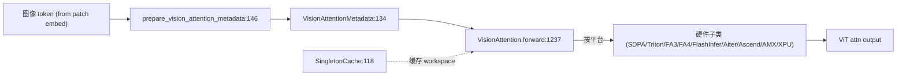

# 06.3.6 视觉注意力

## 定位

`VisionAttention` 是多模态 ViT 编码器内的注意力 `nn.Module`。它独立于文本侧的 `RadixAttention`——不使用 RadixCache，prefill 一次性处理图像 token，由 [`12 多模态`](../12-multimodal/index.md) 的处理器驱动。本族同时提供 native/Triton/Flash3/Flash4/FlashInfer/Aiter/Ascend/AMX/IntelXPU 一组硬件子类，按平台自动选择。

## 职责

- 在 ViT forward 内对 patch token 做窗口/全局 attention，输出供后续 transformer block 与 multi-modal projector 使用。
- 通过 `VisionAttentionMetadata` 持有 `cu_seqlens`、batch 形状等 ViT 专用元数据。
- 支持 ViT CUDA graph capture（见 [12.4](../12-multimodal/12.4-vit-cuda-graph.md)），通过 `SingletonCache` 缓存进图前的 workspace。
- `prepare_vision_attention_metadata` 由 multimodal processor 调用，构建每批 metadata。

## 关键类与函数

| 名称 | 定义位置 | 说明 |
|---|---|---|
| `VisionAttentionMetadata` | `layers/attention/vision.py:134` | ViT 注意力元数据 |
| `prepare_vision_attention_metadata` | `layers/attention/vision.py:146` | 由 mm processor 触发的构建函数 |
| `SingletonCache` | `layers/attention/vision.py:118` | ViT 跨 batch 缓存 workspace |
| `VisionAttention` | `layers/attention/vision.py:957` | ViT 注意力本体，`forward` 在 `:1237` |
| `VisionSdpaAttention` | `layers/attention/vision.py:243` | PyTorch SDPA 子类 |
| `VisionTritonAttention` | `layers/attention/vision.py:402` | Triton 子类 |
| `VisionFlash3Attention` | `layers/attention/vision.py:479` | FlashAttention 3 子类 |
| `VisionFlash4Attention` | `layers/attention/vision.py:543` | FlashAttention 4 子类 |
| `VisionFlashInferAttention` | `layers/attention/vision.py:595` | FlashInfer 子类 |
| `VisionAiterAttention` | `layers/attention/vision.py:727` | AMD Aiter 子类 |
| `VisionAscendAttention` | `layers/attention/vision.py:777` | Ascend NPU 子类 |
| `VisionAMXAttention` | `layers/attention/vision.py:841` | Intel AMX 子类 |
| `VisionIntelXPUAttention` | `layers/attention/vision.py:895` | Intel XPU 子类 |
| `update_vit_attn_dummy_heads_config` | `layers/attention/vision_utils.py:8` | dummy heads 配置（用于硬件兼容） |
| `pad_vit_attn_dummy_heads` | `layers/attention/vision_utils.py:26` | 权重 padding |

## 子模块树

- `layers/attention/vision.py` — ViT 注意力本体与子类
- `layers/attention/vision_utils.py` — dummy heads 与权重 padding
- `python/sglang/srt/model_executor/` — ViT cuda graph runner（见 [12.4](../12-multimodal/12.4-vit-cuda-graph.md)）

## 数据流 / 控制流

`prepare_vision_attention_metadata` 根据 `forward_batch.image_inputs` 重组 `cu_seqlens` 与 batch 维度，构造 `VisionAttentionMetadata`。`VisionAttention.forward` 按 `config._attn_implementation` 分派到具体子类；`SingletonCache` 在 ViT cuda graph 路径下缓存首次进图时的 workspace，避免重入时重新分配。

## 交叉引用

- 上游: [`12.2 每模型处理器`](../12-multimodal/12.2-per-model-processors.md) — 调用 `prepare_vision_attention_metadata`
- 上游: [`12.4 ViT CUDA graph`](../12-multimodal/12.4-vit-cuda-graph.md) — ViT 进图路径
- 上游: [`06.3.1 注意力后端抽象`](06.3.1-attn-backend-abstraction.md) — 不复用 ABC（独立分支）
- 下游: [`15.4 jit_kernel`](../15-kernels-hardware/15.4-jit-kernel.md) — Triton 子类 kernel

## 进一步阅读

- 源码: `python/sglang/srt/layers/attention/vision.py`、`python/sglang/srt/layers/attention/vision_utils.py`
- 本体类: `python/sglang/srt/layers/attention/vision.py:957`
