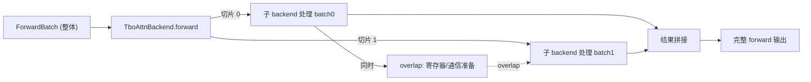

# 06.3.7 TBO

## 定位

`TboAttnBackend`（Two-Batch Overlap）是 06.3.1 抽象的一个特殊包装后端，配合 [`08.12 batch overlap TBO`](../08-distributed/08.12-batch-overlap-tbo.md) 把一个 forward batch 切成两半，让"前一批的 GPU 计算"与"后一批的通信/索引准备"重叠，从而掩盖 all-reduce / all-gather 之类的通信延迟。

## 职责

- 在 `forward_decode` / `forward_extend` 内重入两个子 backend（通常是同一个底层 full backend），分别处理两批切片。
- 为子 backend 提供"replay-able ForwardBatch view"——通过 `_build_tbo_child_replay_fb_view` 把 CUDA graph 路径下的子 batch 元数据预填好。
- 与 `attention_backend_setup.py` 在 `build_attention_backends` 阶段协作：当 `ServerArgs.enable_two_batch_overlap` 时把主后端包装成 `TboAttnBackend`。

## 关键类与函数

| 名称 | 定义位置 | 说明 |
|---|---|---|
| `TboAttnBackend` | `layers/attention/tbo_backend.py:11` | TBO 包装后端，实现 `AttentionBackend` |
| `_build_tbo_child_replay_fb_view` | `layers/attention/tbo_backend.py:186` | 为子后端构建可重放的 ForwardBatch 视图 |
| `build_attention_backends` | `model_executor/model_runner_components/attention_backend_setup.py:68` | 装配入口（TBO 选项在此判定） |
| `TboAttnBackend` 引入点 | `model_executor/model_runner_components/attention_backend_setup.py:14` | 由 setup 模块 `from ...tbo_backend import TboAttnBackend` |

## 子模块树

- `layers/attention/tbo_backend.py` — TBO 后端
- `model_executor/model_runner_components/attention_backend_setup.py` — 装配与选项判定
- `python/sglang/srt/overlap_utils/` — TBO 全局调度（与 08.12 联动）

## 数据流 / 控制流

`TboAttnBackend.forward` 把 `ForwardBatch` 按 `tbo_split_ratio` 切两半，对每一半各调用一次子 backend。在 cuda graph 路径下，`_build_tbo_child_replay_fb_view` 预先准备好两半的 metadata view，让 replay 期间的索引计算与另一半的 GPU 计算 overlap。TBO 的全局编排（什么时候两批都收集成、何时提交）由 `overlap_utils` 与 Scheduler 协作，详见 [08.12](../08-distributed/08.12-batch-overlap-tbo.md)。

## 交叉引用

- 上游: [`06.3.1 注意力后端抽象`](06.3.1-attn-backend-abstraction.md) — `AttentionBackend` ABC
- 上游: [`08.12 batch overlap TBO`](../08-distributed/08.12-batch-overlap-tbo.md) — TBO 全局编排
- 下游: [`06.3.2 全注意力后端`](06.3.2-attn-full-backends.md) — 被包装的子 backend
- 依赖: [`04.4 Runners`](../04-model-execution/04.4-runners.md) — cuda graph runner 在 replay 期使用 child view

## 进一步阅读

- 源码: `python/sglang/srt/layers/attention/tbo_backend.py`
- 类: `python/sglang/srt/layers/attention/tbo_backend.py:11`
- 装配: `python/sglang/srt/model_executor/model_runner_components/attention_backend_setup.py:14`
