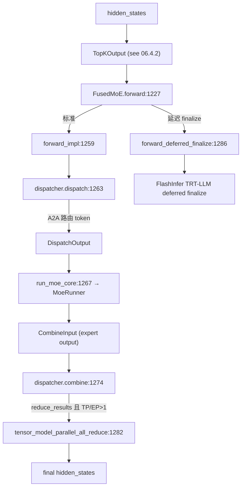

# 06.4.1 MoE 模块与流程

## 定位

`FusedMoE` 是 SGLang 中所有 Mixture-of-Experts 层的统一 `nn.Module`。它把一次 MoE 前向拆成 dispatcher→runner→combine→all-reduce 四段，按 EP/TP 拓扑与 A2A backend（DeepEP/Mooncake/Nixl/FlashInfer/…）灵活组合。这里定义的"四段流水"是 06.4 系列其他页面的总指挥。

## 职责

- 持有 `quant_method`、`dispatcher`、`runner`、`topk`、`reduce_results`、`moe_tp_size`/`moe_ep_size` 等运行期对象与拓扑参数。
- `forward` 入口：根据 cuda graph 状态决定走 `forward_impl`（4 段同步）还是 `forward_deferred_finalize`（延迟 finalize，配合 FlashInfer TRT-LLM FP8/FP4）。
- `forward_impl`：dispatch → `run_moe_core` → `dispatcher.combine` → `tensor_model_parallel_all_reduce`（仅 `reduce_results and tp/ep>1`）。
- 与 piecewise cuda graph 集成：`moe_forward_piecewise_cuda_graph_impl` / `fused_moe_bypassed_piecewise_cuda_graph_impl` 支持 MoE 子图单独进图。

## 关键类与函数

| 名称 | 定义位置 | 说明 |
|---|---|---|
| `FusedMoeWeightScaleSupported` | `layers/moe/fused_moe_triton/layer.py:147` | MoE 权重 scale 支持类型枚举 |
| `FusedMoE` | `layers/moe/fused_moe_triton/layer.py:154` | MoE 模块本体 |
| `FusedMoE.forward` | `layers/moe/fused_moe_triton/layer.py:1227` | 入口（input hidden_states / topk_output） |
| `FusedMoE.forward_impl` | `layers/moe/fused_moe_triton/layer.py:1259` | 标准 4 段流水 |
| `dispatcher.dispatch` | `layers/moe/fused_moe_triton/layer.py:1263` | 路由+发送 token 到专家 |
| `run_moe_core` | `layers/moe/fused_moe_triton/layer.py:1267` | 调 `MoeRunner` 算 expert output |
| `dispatcher.combine` | `layers/moe/fused_moe_triton/layer.py:1274` | 收回 + 加权求和 |
| `tensor_model_parallel_all_reduce` | `layers/moe/fused_moe_triton/layer.py:1282` | TP/EP 行 reduce |
| `FusedMoE.forward_deferred_finalize` | `layers/moe/fused_moe_triton/layer.py:1286` | 延迟 finalize 路径 |
| `moe_forward_piecewise_cuda_graph_impl` | `layers/moe/fused_moe_triton/layer.py:1476` | piecewise cuda graph 实现入口 |
| `fused_moe_bypassed_piecewise_cuda_graph_impl` | `layers/moe/fused_moe_triton/layer.py:1493` | 绕过路径 piecewise 入口 |
| `FusedOpPool` / `PermuteMethodPool` | `layers/moe/moe_runner/base.py:115` / `:142` | fused func / permute 注册池 |

## 子模块树

- `layers/moe/fused_moe_triton/layer.py` — MoE 模块本体
- `layers/moe/topk.py` — 见 [06.4.2](06.4.2-moe-topk.md)
- `layers/moe/moe_runner/` — 见 [06.4.3](06.4.3-moe-runner.md)
- `layers/moe/token_dispatcher/` — 见 [06.4.4](06.4.4-moe-token-dispatcher.md)
- `layers/moe/fused_moe_triton/fused_marlin_moe.py` / `triton_kernels_moe.py` — 见 [06.4.5](06.4.5-moe-fused-triton.md)
- `layers/moe/moe_ep_setup.py`（在 `model_runner_components/`）、`runner_utils/deepep_adapter.py` — 见 [06.4.6](06.4.6-moe-deepep.md)
- `layers/moe/utils.py` — `MoeA2ABackend` / `DeepEPMode` / `MoeRunnerBackend` 枚举与全局配置

## 数据流 / 控制流

`forward_impl` 四段：dispatch 把每个 token 按专家权重路由到目标 rank（DeepEP/Mooncake/Nixl 用 A2A kernel；NONE 走本地 permute）；`run_moe_core` 调 `MoeRunner` 在每个专家上做 grouped GEMM（Triton/Ascend/DeepGemm/Humming/Aiter/Marlin/FlashInfer 按 `MoeRunnerBackend` 选择）；combine 把各专家输出按权重收回原位；最后若启用 `reduce_results` 且 TP/EP 大于 1，再做一次 `tensor_model_parallel_all_reduce` 把跨 EP/TP 的 partial sum 合并。延迟 finalize 路径把 combine 与 all-reduce 推到后续 forward 里完成，借此与下一层的 attention overlap。

## 交叉引用

- 上游: [`04.1 ModelRunner`](../04-model-execution/04.1-model-runner.md) — `prepare_moe_topk` 与 piecewise cuda graph 编排
- 下游: [`06.4.2 topk`](06.4.2-moe-topk.md) / [`06.4.3 runner`](06.4.3-moe-runner.md) / [`06.4.4 dispatcher`](06.4.4-moe-token-dispatcher.md) / [`06.4.5 fused triton`](06.4.5-moe-fused-triton.md) / [`06.4.6 DeepEP`](06.4.6-moe-deepep.md)
- 下游: [`06.5 量化`](06.5-quantization.md) — `FusedMoEMethodBase` 各 scheme
- 依赖: [`08.5 通信算子`](../08-distributed/08.5-comm-ops.md) — `tensor_model_parallel_all_reduce`
- 相关: [`13.7 MoE LoRA runners`](../13-lora/13.7-moe-lora-runners.md) — LoRA 复用 runner 抽象

## 进一步阅读

- 源码: `python/sglang/srt/layers/moe/fused_moe_triton/layer.py`
- 类: `python/sglang/srt/layers/moe/fused_moe_triton/layer.py:154`
- 四段流水代码: `python/sglang/srt/layers/moe/fused_moe_triton/layer.py:1259`
