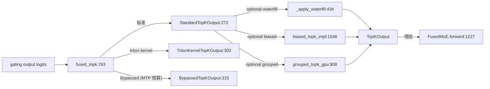

# 06.4.2 MoE topk

## 定位

`TopK` 是 MoE 路由的门控算子：从 gating logits 中选出每个 token 的 top-k 个专家，并按 softmax 权重归一化。它是 [`06.4.1 FusedMoE.forward`](06.4.1-moe-module-flow.md) 的前置步骤——`topk_output` 既喂给 `dispatcher.dispatch` 决定路由，也喂给 `dispatcher.combine` 决定加权。

## 职责

- 提供统一 `TopKOutput` 协议，支持 `StandardTopKOutput` / `StandardTopKOutputPacked` / `TritonKernelTopKOutput` / `BypassedTopKOutput` 四种格式（`TopKOutputChecker` 做 format 判定）。
- 在 CUDA/CPU/NPU/XPU 各平台有 `forward_*` 多平台实现，统一由 `MultiPlatformOp` 派发。
- 支持 `waterfill`（重新平衡专家容量）、`hash_topk`（hash-based 路由）、`biased_topk`（Kimi-K2 等带偏置）、`grouped_topk`（按 expert group 选）等路由变体。

## 关键类与函数

| 名称 | 定义位置 | 说明 |
|---|---|---|
| `TopKConfig` | `layers/moe/topk.py:209` | topk 配置 |
| `TopKOutput` | `layers/moe/topk.py:263` | topk 输出 Protocol |
| `TopKOutputFormat` | `layers/moe/topk.py:256` | 输出格式枚举 |
| `TopKOutputChecker` | `layers/moe/topk.py:232` | 格式判定与转换 |
| `StandardTopKOutput` | `layers/moe/topk.py:272` | 标准输出（topk_ids + topk_weights + …） |
| `StandardTopKOutputPacked` | `layers/moe/topk.py:289` | 打包后的标准输出 |
| `TritonKernelTopKOutput` | `layers/moe/topk.py:303` | Triton kernels 后端输出 |
| `BypassedTopKOutput` | `layers/moe/topk.py:315` | 跳过 topk（用于 MTP precompute 复用） |
| `TopK(MultiPlatformOp)` | `layers/moe/topk.py:363` | topk 算子本体，`forward_cuda` 在 `:463` / `forward_native` 在 `:444` |
| `TopK._apply_waterfill` | `layers/moe/topk.py:434` | waterfill 容量平衡 |
| `fused_topk` | `layers/moe/topk.py:763` | 通用入口（按 backend 分派） |
| `grouped_topk_gpu` / `grouped_topk_cpu` | `layers/moe/topk.py:908` / `:979` | grouped topk |
| `biased_topk_impl` | `layers/moe/topk.py:1048` | 带偏置 topk（Kimi-K2） |
| `biased_grouped_topk_impl` | `layers/moe/topk.py:1165` | grouped + biased |
| `hash_topk` 主入口 | `layers/moe/hash_topk.py` | hash-based 路由 |
| `waterfill` 主入口 | `layers/moe/waterfill.py` | waterfill 容量平衡算法 |

## 子模块树

- `layers/moe/topk.py` — topk 主文件
- `layers/moe/hash_topk.py` — hash-based 路由（DeepSeek V3/V4 hash routing 实验）
- `layers/moe/waterfill.py` — waterfill 容量平衡（防专家溢出）
- `model_executor/model_runner_components/moe_ep_setup.py:27` — `prepare_moe_topk` 给 cuda graph 预算 buffer（见 [06.4.6](06.4.6-moe-deepep.md)）

## 数据流 / 控制流

`fused_topk` 按 `topk_backend` 选择 raw logits 路径或 softmax 路径，并按需叠加 `waterfill`/`biased`/`grouped`/`hash` 变体。`TopKOutputChecker` 让下游 dispatcher/run 在不感知具体格式的情况下完成 format dispatch。Bypassed 输出对应 MTP precompute 路径，把上一步算好的 topk 直接复用，节省 gating matmul。

## 交叉引用

- 上游: [`04.1 ModelRunner`](../04-model-execution/04.1-model-runner.md) — `prepare_moe_topk`（在 `moe_ep_setup.py:27`）
- 下游: [`06.4.1 MoE 模块与流程`](06.4.1-moe-module-flow.md) — `forward` 接收 `TopKOutput`
- 下游: [`08.9 Elastic EP`](../08-distributed/08.9-elastic-ep.md) / [`08.10 EPLB/LPLB`](../08-distributed/08.10-eplb-lplb.md) — topk 与专家负载均衡协作
- 相关: [`06.4.6 DeepEP`](06.4.6-moe-deepep.md) — `prepare_moe_topk` 与 DeepEP 集成

## 进一步阅读

- 源码: `python/sglang/srt/layers/moe/topk.py`、`hash_topk.py`、`waterfill.py`
- 算子本体: `python/sglang/srt/layers/moe/topk.py:363`
- 协议: `python/sglang/srt/layers/moe/topk.py:263`
