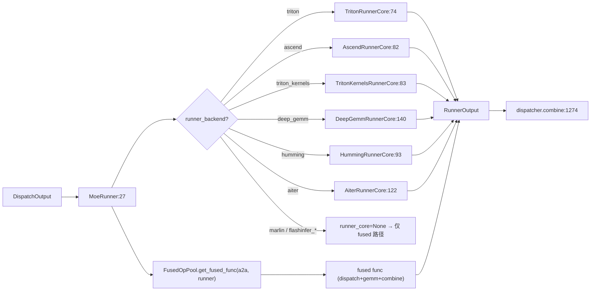

# 06.4.3 MoE runner

## 定位

`MoeRunner` 是 [`06.4.1`](06.4.1-moe-module-flow.md) 中 `run_moe_core` 的实现者：拿到 dispatcher 路由好的 token，在每个本地专家上做 grouped GEMM，再输出供 `combine` 使用。它把"runner backend（Triton/Ascend/DeepGemm/Aiter/Marlin/FlashInfer）"与"A2A backend"正交解耦，通过 `FusedOpPool` 把两者组合成一个 fused func 路径。

## 职责

- `MoeRunner.__init__` 按 `MoeRunnerBackend` 选择对应 `MoeRunnerCore` 子类，并按 A2A backend 在 `FusedOpPool` 中查已注册的 fused func。
- `MoeRunnerCore` 子类负责具体 grouped GEMM：构造 `RunnerInput`、调内核、产出 `RunnerOutput`；`MoeQuantInfo` 描述每种量化 scheme 的权重布局。
- 各 runner 子类与量化 scheme 绑定（DeepGemm→FP8/FP4、Marlin→Marlin、FlashInfer TRT-LLM→FP8/FP4/BF16、Aiter→Aiter quant、Ascend→NPU quant、Humming→Humming FP4）。
- 提供 `triton_utils`（`fused_moe.py`、`fused_moe_triton_config.py`、`moe_align_block_size.py`）等 Triton 公用工具。

## 关键类与函数

| 名称 | 定义位置 | 说明 |
|---|---|---|
| `MoeRunnerConfig` | `layers/moe/moe_runner/base.py:37` | runner 配置（ experts / shard / quant …） |
| `RunnerInput` / `RunnerOutput` | `layers/moe/moe_runner/base.py:68` / `:77` | runner IO 抽象 |
| `MoeQuantInfo` | `layers/moe/moe_runner/base.py:87` | 量化权重布局描述 |
| `MoeRunnerCore` | `layers/moe/moe_runner/base.py:93` | runner core ABC |
| `FusedOpPool` | `layers/moe/moe_runner/base.py:115` | (A2A backend, runner backend) → fused func 注册池 |
| `PermuteMethodPool` | `layers/moe/moe_runner/base.py:142` | pre-/post-permute 方法注册池 |
| `MoeRunner` | `layers/moe/moe_runner/runner.py:27` | runner 入口，按 backend 选 core |
| `TritonRunnerCore` | `layers/moe/moe_runner/triton.py:74` | Triton core（`RunnerInput:29`、`Output:44`、`QuantInfo:54`） |
| `AscendRunnerCore` | `layers/moe/moe_runner/ascend.py:82` | Ascend NPU core |
| `TritonKernelsRunnerCore` | `layers/moe/moe_runner/triton_kernels.py:83` | Triton_Kernels 后端 core |
| `DeepGemmRunnerCore` | `layers/moe/moe_runner/deep_gemm.py:140` | DeepGemm FP8/FP4 core |
| `HummingRunnerCore` | `layers/moe/moe_runner/humming.py:93` | Humming FP4 core |
| `AiterRunnerCore` | `layers/moe/moe_runner/aiter.py:122` | AMD Aiter core |
| `MarlinRunnerInput/Output/QuantInfo` | `layers/moe/moe_runner/marlin.py:27` / `:41` / `:52` | Marlin（仅 fused 路径） |
| `FlashInferCutlassMoeQuantInfo` | `layers/moe/moe_runner/flashinfer_cutlass.py:42` | FlashInfer CUTLASS |
| `invoke_fused_moe_kernel` | `layers/moe/moe_runner/triton_utils/fused_moe.py:18` | Triton fused 入口（由 `:516` / `:707` 调用） |

## 子模块树

- `layers/moe/moe_runner/` — runner 主目录
  - `base.py` — ABC 与两个注册池
  - `runner.py` — `MoeRunner` 总入口
  - `triton.py` / `triton_kernels.py` / `ascend.py` / `deep_gemm.py` / `humming.py` / `aiter.py` / `marlin.py` — 各 core 子类
  - `flashinfer_cutlass.py` / `flashinfer_trtllm.py` / `flashinfer_cutedsl.py` — FlashInfer 系
  - `triton_utils/` — `fused_moe.py` 含 `invoke_fused_moe_kernel`、`fused_moe_triton_config.py`、`moe_align_block_size.py`、`configs/`
- `layers/moe/utils.py` — `MoeRunnerBackend` 枚举与全局配置

## 数据流 / 控制流

`MoeRunner.__init__` 同时构造 `runner_core`（按 backend 选）与 `fused_func`（按 backend 组合查 `FusedOpPool`）。当 A2A backend 与 runner backend 都有 fused func 注册时，整条 dispatch→core→combine 走 fused 路径；否则 `run_moe_core` 显式调用 `runner_core` 分步完成。Triton 路径通过 `invoke_fused_moe_kernel` 调度融合内核，DeepGemm 路径走 [06.15](06.15-deep-gemm-wrapper.md) 的 FP8/FP4 grouped GEMM。

## 交叉引用

- 上游: [`06.4.1 MoE 模块与流程`](06.4.1-moe-module-flow.md) — `run_moe_core:1267`
- 下游: [`06.4.4 token dispatcher`](06.4.4-moe-token-dispatcher.md) — 提供 `DispatchOutput` 消费 `RunnerOutput`
- 下游: [`06.4.5 fused triton`](06.4.5-moe-fused-triton.md) — `invoke_fused_moe_kernel`
- 下游: [`06.15 deep_gemm_wrapper`](06.15-deep-gemm-wrapper.md) — `DeepGemmRunnerCore` 依赖
- 相关: [`13.7 MoE LoRA runners`](../13-lora/13.7-moe-lora-runners.md) — LoRA hook 复用 core

## 进一步阅读

- 源码: `python/sglang/srt/layers/moe/moe_runner/`
- 总入口类: `python/sglang/srt/layers/moe/moe_runner/runner.py:27`
- 注册池: `python/sglang/srt/layers/moe/moe_runner/base.py:115`、`:142`
