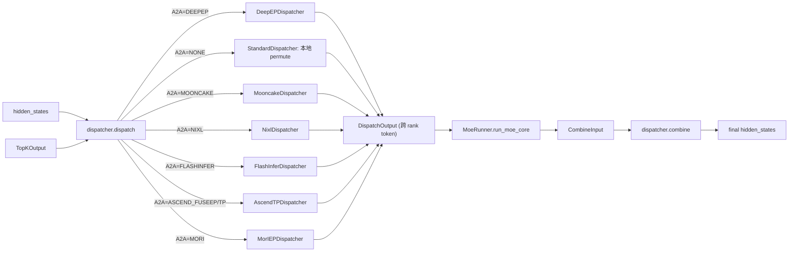

# 06.4.4 MoE token dispatcher

## 定位

token dispatcher 是 [`06.4.1 FusedMoE`](06.4.1-moe-module-flow.md) 中负责跨 rank 路由 token 的一段。它在 `dispatch` 时按 `topk_output` 把每个 token 打包发送给目标专家所在 rank；在 `combine` 时把各专家输出按权重收回原 token 位。SGLang 通过 `MoeA2ABackend` 枚举把"路由算法"从 runner 中正交分离出来。

## 职责

- 提供统一 `BaseDispatcher` ABC（`dispatch` / `combine`），让 FusedMoE 无感切换 A2A backend。
- 实现 DeepEP（NORMAL/LOW_LATENCY/AUTO）、Mooncake、Nixl、FlashInfer、Ascend FuseEP / TP、Mori、MegaMoE 等具体路由后端。
- 与 cuda graph 集成：DeepEP/Nixl/Mooncake 在 capture 阶段预分配 send/recv buffer，replay 时直接 A2A。
- `MoeA2ABackend` 全局配置由 `moe/utils.py:initialize_moe_config` 在 `ServerArgs` 加载期写入。

## 关键类与函数

| 名称 | 定义位置 | 说明 |
|---|---|---|
| `MoeA2ABackend` | `layers/moe/utils.py:28` | A2A backend 枚举：NONE/DEEPEP/MOONCAKE/NIXL/FLASHINFER/ASCEND_FUSEEP/ASCEND_TP/MORI/MEGAMOE/CUSTOMIZED |
| `MoeRunnerBackend` | `layers/moe/utils.py:90` | runner backend 枚举（AUTO + triton/ascend/...） |
| `DeepEPMode` | `layers/moe/utils.py:159` | NORMAL/LOW_LATENCY/AUTO，`:171` 提供 `resolve(is_extend_in_batch)` |
| `initialize_moe_config` | `layers/moe/utils.py:278` | 把 `ServerArgs` 的 MoE 选项写入全局配置 |
| `get_moe_a2a_backend` | `layers/moe/utils.py:306` | 取当前 A2A backend |
| `get_deepep_mode` | `layers/moe/utils.py:340` | 取 DeepEP 模式 |
| `DeepEPDispatcher` | `layers/moe/token_dispatcher/deepep.py` | DeepEP A2A 实现（详见 [06.4.6](06.4.6-moe-deepep.md)） |
| `MooncakeDispatcher` | `layers/moe/token_dispatcher/mooncake.py` | Mooncake RDMA 实现 |
| `NixlDispatcher` | `layers/moe/token_dispatcher/nixl.py` | Nixl 实现（与 [09 PD 分离](../09-disaggregation/index.md) 共用 Nixl 传输层） |
| `FlashInferDispatcher` | `layers/moe/token_dispatcher/flashinfer.py` | FlashInfer A2A 实现 |
| `AscendTPDispatcher` | `layers/moe/token_dispatcher/ascend_tp.py` | Ascend TP 路由 |
| `MorIEPDispatcher` | `layers/moe/token_dispatcher/moriep.py` | Mori 实现 |
| `StandardDispatcher` | `layers/moe/token_dispatcher/standard.py` | 无 A2A 的本地 permute 路径 |
| `create_moe_dispatcher` | `layers/moe/fused_moe_triton/layer.py:104` | 由 `MoeA2ABackend` 创建 dispatcher 工厂 |

## 子模块树

- `layers/moe/token_dispatcher/`
  - `base.py` — `BaseDispatcher` ABC 与 `DispatchOutput` / `CombineInput`
  - `deepep.py` — DeepEP A2A
  - `mooncake.py` / `nixl.py` — RDMA 传输系（与 09 共用）
  - `flashinfer.py` + `flashinfer_utils.py` — FlashInfer A2A
  - `ascend_tp.py` — Ascend NPU 路由
  - `moriep.py` — MorIEP（Mori）
  - `standard.py` — 无 A2A 的本地 fallback
- `layers/moe/utils.py` — A2A 与 runner backend 枚举与全局配置
- `layers/moe/token_dispatcher/__init__.py:104` — 工厂入口

## 数据流 / 控制流

`create_moe_dispatcher` 在 FusedMoE 构造期按 `MoeA2ABackend` 选择 dispatcher 子类。`dispatch` 把要发给每个 rank 的 token pack 起来（DeepEP/Nixl/Mooncake 用各自的 A2A kernel 完成跨 rank 传输），Standard 路径不做通信仅做本地 permute。`combine` 把每个 rank 算好的 expert 输出按权重还原到原 token 位——若不是 NONE，step 7 后还要 `tensor_model_parallel_all_reduce` 做跨 rank sum。

## 交叉引用

- 上游: [`06.4.1 MoE 模块与流程`](06.4.1-moe-module-flow.md) — `dispatch:1263` / `combine:1274`
- 下游: [`06.4.6 MoE DeepEP`](06.4.6-moe-deepep.md) — DeepEP 细节
- 依赖: [`08.5 通信算子`](../08-distributed/08.5-comm-ops.md) — `tensor_model_parallel_all_reduce`
- 相关: [`09 分离式推理`](../09-disaggregation/index.md) — Nixl/Mooncake 传输层共用
- 相关: [`08.9 Elastic EP`](../08-distributed/08.9-elastic-ep.md) — EP 规模变化时的 dispatcher 适配

## 进一步阅读

- 源码: `python/sglang/srt/layers/moe/token_dispatcher/`、`python/sglang/srt/layers/moe/utils.py`
- 枚举: `python/sglang/srt/layers/moe/utils.py:28`、`:90`、`:159`
- 工厂入口: `python/sglang/srt/layers/moe/fused_moe_triton/layer.py:104`
