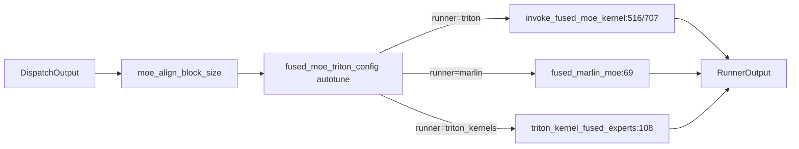

# 06.4.5 MoE fused triton

## 定位

本页聚焦 [`06.4.3 MoeRunner`](06.4.3-moe-runner.md) 中 Triton runner backend 的两条融合实现：基于 vLLM 风格 fused MoE 的 `invoke_fused_moe_kernel` 路径，以及面向 Marlin 量化的 `fused_marlin_moe` 路径。它们让"dispatch→gemm→combine"在一次 CUDA launch 里完成，最大化小专家 M 的吞吐。

## 职责

- `invoke_fused_moe_kernel`：把多个专家的 GEMM 融合到一个 Triton kernel，按 expert tile 调度，支持 w8a8/fp8/int4 等多种 quant。
- `fused_marlin_moe`：Marlin 16-bit 重量化路径，专门给 Marlin 量化 scheme 用，含 swiglu limit 变体。
- `triton_utils/fused_moe_triton_config.py`：trial-based autotune，覆盖 tile/block/num_warps/stages。
- `moe_align_block_size.py`：把 token 按对齐块大小排齐，避免 Triton global memory 越界。

## 关键类与函数

| 名称 | 定义位置 | 说明 |
|---|---|---|
| `invoke_fused_moe_kernel` import | `layers/moe/moe_runner/triton_utils/fused_moe.py:18` | Triton fused 入口 |
| `invoke_fused_moe_kernel` 调用 | `layers/moe/moe_runner/triton_utils/fused_moe.py:516` / `:707` | 调用点（两组限/非限分支） |
| `fused_moe_triton_config` | `layers/moe/moe_runner/triton_utils/fused_moe_triton_config.py` | autotune 配置生成 |
| `moe_align_block_size` | `layers/moe/moe_runner/triton_utils/moe_align_block_size.py` | 对齐 token 块 |
| `get_scalar_type` | `layers/moe/fused_moe_triton/fused_marlin_moe.py:18` | Marlin scalar 类型 |
| `swiglu_limit_func` | `layers/moe/fused_moe_triton/fused_marlin_moe.py:40` | swiglu limit 钩子 |
| `swiglu_gpt_oss_sigmoid_alpha_contiguous` | `layers/moe/fused_moe_triton/fused_marlin_moe.py:56` | GPT-OSS 变体 |
| `fused_marlin_moe` | `layers/moe/fused_moe_triton/fused_marlin_moe.py:69` | Marlin fused MoE 入口 |
| `triton_kernel_moe_forward` | `layers/moe/fused_moe_triton/triton_kernels_moe.py:61` | 走 `triton_kernels` 包的 MoE 前向 |
| `triton_kernel_fused_experts` | `layers/moe/fused_moe_triton/triton_kernels_moe.py:108` | fused experts 入口 |

## 子模块树

- `layers/moe/fused_moe_triton/`
  - `layer.py` — `FusedMoE` 本体（见 [06.4.1](06.4.1-moe-module-flow.md)）
  - `fused_marlin_moe.py` — Marlin 融合路径
  - `triton_kernels_moe.py` — `triton_kernels` 包路径（区别于 `invoke_fused_moe_kernel`）
- `layers/moe/moe_runner/triton_utils/`
  - `fused_moe.py:18` — re-export `invoke_fused_moe_kernel`
  - `fused_moe_triton_config.py` — autotune 配置
  - `moe_align_block_size.py` — block 对齐
  - `configs/` — 预算 config 子目录

## 数据流 / 控制流

`MoeRunner` 选 triton/marlin/triton_kernels 时，`run_moe_core` 把 token 与 expert 权重交给对应入口：triton 路径在 `invoke_fused_moe_kernel` 内按 expert loop 调一个 Triton GEMM+swiglu+weighted sum；marlin 路径走 `fused_marlin_moe`（Marlin kernel 只支持 GPTQ/AWQ 16-bit pack）；triton_kernels 路径调 `triton_kernel_fused_experts`，是更新的 kernels 路径，与 Sage Triton_Kernels 对齐。

## 交叉引用

- 上游: [`06.4.3 MoE runner`](06.4.3-moe-runner.md) — `TritonRunnerCore` / `Marlin` / `TritonKernels` 实例化
- 上游: [`06.4.1 MoE 模块与流程`](06.4.1-moe-module-flow.md) — `run_moe_core:1267`
- 下游: [`15.4 jit_kernel`](../15-kernels-hardware/15.4-jit-kernel.md) — Triton kernel 编译
- 相关: [`06.5 量化`](06.5-quantization.md) — Marlin/GPTQ/AWQ scheme
- 相关 skill: `.claude/skills/add-jit-kernel`

## 进一步阅读

- 源码: `python/sglang/srt/layers/moe/fused_moe_triton/`、`python/sglang/srt/layers/moe/moe_runner/triton_utils/`
- Marlin 入口: `python/sglang/srt/layers/moe/fused_moe_triton/fused_marlin_moe.py:69`
- Triton fused 入口: `python/sglang/srt/layers/moe/moe_runner/triton_utils/fused_moe.py:18`
