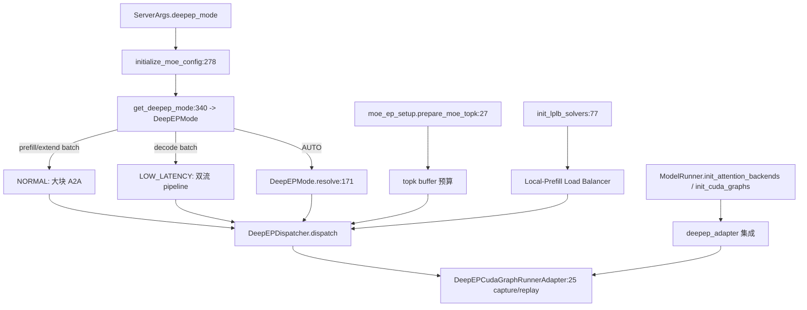

# 06.4.6 MoE DeepEP

## 定位

DeepEP 是 SGLang 在 EP（专家并行）拓扑下的高性能 A2A backend，专门为 MoE 的 dispatch/combine 设计。它有两种模式：NORMAL（高吞吐，prefill 用）、LOW_LATENCY（极低延迟，decode 用），由 `DeepEPMode.AUTO` 按 batch 类型自动选择。本页聚焦 DeepEP 的模式语义、cuda graph 集成与 setup 流程。

## 职责

- `DeepEPMode.NORMAL`：dispatch 走大块跨 rank send/recv，prefill 与 extend 用；`is_normal()` 判定。
- `DeepEPMode.LOW_LATENCY`：dispatch 走小块双流 pipeline，decode cuda graph 用；`is_low_latency()` 判定。
- `DeepEPMode.AUTO`：`resolve(is_extend_in_batch)` 根据 batch 类型归一为 NORMAL 或 LOW_LATENCY。
- `DeepEPCudaGraphRunnerAdapter`：把 DeepEP 的 cuda graph capture 集成到 `ModelRunner.init_cuda_graphs`。
- `moe_ep_setup.prepare_moe_topk` / `init_lplb_solvers`：在 init 期为 DeepEP 预算 topk buffer 与 Local-Prefill Load Balancer solver。

## 关键类与函数

| 名称 | 定义位置 | 说明 |
|---|---|---|
| `DeepEPMode` | `layers/moe/utils.py:159` | NORMAL/LOW_LATENCY/AUTO 三态枚举 |
| `DeepEPMode.resolve` | `layers/moe/utils.py:171` | 把 AUTO 解析成具体模式 |
| `DeepEPMode.is_normal` / `is_low_latency` | `layers/moe/utils.py:166` / `:169` | 模式判定 |
| `DeepEPDispatcher` | `layers/moe/token_dispatcher/deepep.py` | DeepEP A2A 实现 |
| `DeepEPCudaGraphRunnerAdapter` | `model_executor/runner_utils/deepep_adapter.py:25` | cuda graph 集成适配器 |
| `prepare_moe_topk` | `model_executor/model_runner_components/moe_ep_setup.py:27` | 预算 topk buffer |
| `init_lplb_solvers` | `model_executor/model_runner_components/moe_ep_setup.py:77` | 初始化 LPLB solver |
| `check_quantized_moe_compatibility` | `model_executor/model_runner_components/moe_ep_setup.py:107` | 量化 MoE 兼容性检查 |

## 子模块树

- `layers/moe/token_dispatcher/deepep.py` — `DeepEPDispatcher` 主体（dispatch/combine/cuda graph state）
- `model_executor/runner_utils/deepep_adapter.py` — `DeepEPCudaGraphRunnerAdapter` 把 capture 逻辑接到 runner
- `model_executor/model_runner_components/moe_ep_setup.py` — DeepEP/LPLB setup
- `layers/moe/utils.py:159` — `DeepEPMode` 枚举

## 数据流 / 控制流

`ServerArgs.deepep_mode` 决定全局模式；`AUTO` 时每次 forward 由 `resolve(is_extend_in_batch)` 在 NORMAL/LOW_LATENCY 间切换。`ModelRunner.init_cuda_graphs` 通过 `DeepEPCudaGraphRunnerAdapter` 为 DeepEP 单独 capture（DeepEP 的 A2A kernel 不在主 cuda graph 内，需要单独 capture 一张"MoE-only"小图并 replay）。`moe_ep_setup` 在 init 期完成 `prepare_moe_topk` 与 `init_lplb_solvers`，把 buffer 与 LPLB solver 准备好。

## 交叉引用

- 上游: [`06.4.4 token dispatcher`](06.4.4-moe-token-dispatcher.md) — `DeepEPDispatcher` 位置
- 上游: [`04.1 ModelRunner`](../04-model-execution/04.1-model-runner.md) — `init_cuda_graphs` 调 adapter
- 上游: [`06.4.2 topk`](06.4.2-moe-topk.md) — `prepare_moe_topk` 协作
- 相关: [`08.9 Elastic EP`](../08-distributed/08.9-elastic-ep.md) — EP 规模变化时 DeepEP 重建
- 相关: [`08.10 EPLB/LPLB`](../08-distributed/08.10-eplb-lplb.md) — `init_lplb_solvers:77`
- 相关: [`16.4 environ`](../16-config-runtime/16.4-environ.md) — DeepEP 相关 env

## 进一步阅读

- 源码: `python/sglang/srt/layers/moe/token_dispatcher/deepep.py`、`python/sglang/srt/model_executor/runner_utils/deepep_adapter.py`、`python/sglang/srt/model_executor/model_runner_components/moe_ep_setup.py`
- 枚举: `python/sglang/srt/layers/moe/utils.py:159`
- 适配器: `python/sglang/srt/model_executor/runner_utils/deepep_adapter.py:25`
