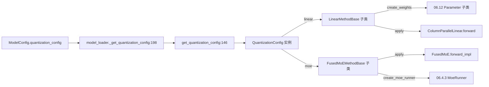

# 06.5 量化

## 定位

`layers/quantization/` 是 06 子系统的量化框架。它把"权重布局"抽象成 `QuantizationConfig`，把"算子行为"抽象成 `LinearMethodBase` / `FusedMoEMethodBase`，让 [`06.1 Linear`](06.1-linear.md) 与 [`06.4.1 FusedMoE`](06.4.1-moe-module-flow.md) 无感切换 FP8/FP4/AWQ/GPTQ/Marlin/INT4/ModelOpt/BnB 等方案。`model_loader._get_quantization_config` 在加载期解析 weights_config 并构造对应 `QuantizationConfig`。

## 职责

- 提供 `QuantizationConfig` ABC（`base_config.py:126`）与 scheme 基类 `BaseLinearScheme` / `BaseMoEScheme`（`base_scheme.py:11/50`）。
- 按 schema 暴露 `create_weights` / `process_weights_after_loading` / `apply` / `create_moe_runner`。
- 与 `Parameter.py` 协作：scheme 决定 weight 是 `PackedColumnParameter` / `ChannelQuantScaleParameter` 等。
- 与 `model_loader._get_quantization_config:198` 交互：把 `ModelConfig.quantization_config` 字符串映射到具体类。

## 关键类与函数

| 名称 | 定义位置 | 说明 |
|---|---|---|
| `QuantizeMethodBase` | `layers/quantization/base_config.py:20` | method ABC |
| `LinearMethodBase` | `layers/quantization/base_config.py:46` | 线性 method ABC |
| `FusedMoEMethodBase` | `layers/quantization/base_config.py:86` | MoE method ABC |
| `QuantizationConfig` | `layers/quantization/base_config.py:126` | config ABC |
| `get_quantization_config` | `layers/quantization/__init__.py:146` | 字符串→config factory（支持 platform override） |
| `DummyConfig` | `layers/quantization/__init__.py:14` | 不量化的占位 config |
| `BaseLinearScheme` / `BaseMoEScheme` | `layers/quantization/base_scheme.py:11` / `:50` | 新版 scheme 基类 |
| `_get_quantization_config` | `model_loader/loader.py:198` | loader 侧入口 |
| `FusedMoEWeightScaleSupported` | `layers/moe/fused_moe_triton/layer.py:147` | MoE 量化 weight scale 类型 |

## 子模块树

- `layers/quantization/base_config.py` / `base_scheme.py` — ABC 与新 scheme 基类
- `layers/quantization/__init__.py` — `get_quantization_config` 与 `DummyConfig`
- 按 scheme 分组：
  - FP8 系：`fp8.py`、`fp8_utils.py`、`w8a8_fp8.py`、`fp4_utils.py`、`fp4_kv_cache_quant_method.py`、`kvfp4_tensor.py`
  - FP4/MXFP4 系：`mxfp4.py`、`mxfp4_tensor.py`、`mxfp4_flashinfer_cutlass_moe.py`、`mxfp4_flashinfer_trtllm_moe.py`、`mxfp4_humming_moe.py`、`mxfp4_marlin_moe.py`、`nvfp4_online.py`、`npu_mxfp4.py`、`npu_mxfp4_w4a4.py`、`rocm_mxfp4_utils.py`、`mxfp8_block_convert.py`
  - AWQ/GPTQ 系：`awq/`、`gptq/`、`marlin_utils.py`、`marlin_utils_fp4.py`、`marlin_utils_fp8.py`、`compressed_tensors/`、`quark/`、`quark_int4fp8_moe.py`
  - INT 系：`blockwise_int8.py`、`w8a8_int8.py`、`int8_utils.py`、`w4afp8.py`
  - 平台/工具：`modelopt_quant.py`、`bitsandbytes.py`、`humming.py` / `humming_utils.py`、`mlx.py`、`modelslim/`、`petit.py` / `petit_utils.py`、`gguf.py`、`moe_wna16.py`、`unquant.py`、`utils.py`
  - KV Cache：`kv_cache.py`
- `model_loader/loader.py:198` — _get_quantization_config

## 数据流 / 控制流

`model_loader` 在加载权重前调用 `_get_quantization_config` 拿到 `QuantizationConfig`；模型构建期每个 Linear / FusedMoE 通过 `quant_config.get_quant_method(self)` 拿到 method；method 的 `create_weights` 决定 parameter 类型（[06.12](06.12-parameter.md)），`apply` 在 forward 期被调用，MoE 还额外用 `create_moe_runner` 决定 runner backend。

## 交叉引用

- 上游: [`05.2 loader classes`](../05-model-loading/05.2-loader-classes.md) — `_get_quantization_config:198`
- 下游: [`06.1 Linear`](06.1-linear.md) — `quant_method.apply`
- 下游: [`06.4.1 MoE 模块与流程`](06.4.1-moe-module-flow.md) — MoE method
- 下游: [`06.12 Parameter`](06.12-parameter.md) — `create_weights` 输出
- 下游: [`15.7 deep_gemm_wrapper`](../15-kernels-hardware/15.7-deep-gemm-wrapper.md) — FP8/FP4 内核
- 相关: [`16.6 模型配置`](../16-config-runtime/16.6-model-configs.md) — quantization 字段

## 进一步阅读

- 源码: `python/sglang/srt/layers/quantization/`
- ABC: `python/sglang/srt/layers/quantization/base_config.py:126`
- factory: `python/sglang/srt/layers/quantization/__init__.py:146`
