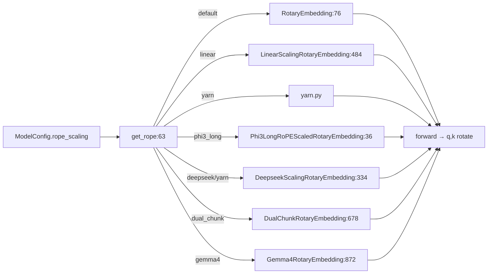

# 06.6 旋转位置编码

## 定位

`layers/rotary_embedding/` 提供 RoPE 及其变体实现。每种 Transformer 模型可能用不同的 scaling（Linear/NTK/ yarn/Phi3 long/DynamicNTKAlpha/DualChunk/Gemma4…），由 `get_rope` factory 按 `rope_scaling` 配置返回合适的子类。

## 职责

- 提供 `RotaryEmbedding` 基类（`base.py:76`）与 `MultiPlatformOp` 派发的多平台前向。
- `factory.get_rope` 解析 `rope_scaling` 字典并对各变体构造对应类。
- `rope_variant.py` 收集所有非默认变体；`yarn.py` 实现 YaRN；`mrope.py` / `mrope_rope_index.py` 服务多模态旋转。

## 关键类与函数

| 名称 | 定义位置 | 说明 |
|---|---|---|
| `RotaryEmbedding` | `layers/rotary_embedding/base.py:76` | RoPE 基类 |
| `LinearScalingRotaryEmbedding` | `layers/rotary_embedding/base.py:484` | Linear scaling 变体 |
| `get_rope` | `layers/rotary_embedding/factory.py:63` | 工厂入口 |
| `get_rope_cpu` | `layers/rotary_embedding/factory.py:352` | CPU 后端工厂 |
| `get_rope_wrapper` | `layers/rotary_embedding/factory.py:424` | 包装入口 |
| `_get_rope_param` | `layers/rotary_embedding/factory.py:34` | 参数解析辅助 |
| `Phi3LongRoPEScaledRotaryEmbedding` | `layers/rotary_embedding/rope_variant.py:36` | Phi-3 long RoPE |
| `FourierRotaryEmbedding` | `layers/rotary_embedding/rope_variant.py:172` | Fourier 嵌入 |
| `DeepseekScalingRotaryEmbedding` | `layers/rotary_embedding/rope_variant.py:334` | DeepSeek YaRN 变体 |
| `Llama3RotaryEmbedding` | `layers/rotary_embedding/rope_variant.py:537` | Llama3 scaling |
| `Llama4VisionRotaryEmbedding` | `layers/rotary_embedding/rope_variant.py:583` | Llama4 ViT 专用 |
| `DynamicNTKAlphaRotaryEmbedding` | `layers/rotary_embedding/rope_variant.py:643` | 带 alpha 的 NTK |
| `DualChunkRotaryEmbedding` | `layers/rotary_embedding/rope_variant.py:678` | Qwen dual chunk |
| `DynamicNTKScalingRotaryEmbedding` | `layers/rotary_embedding/rope_variant.py:836` | 动态 NTK |
| `Gemma4RotaryEmbedding` | `layers/rotary_embedding/rope_variant.py:872` | Gemma4 专用 |

## 子模块树

- `layers/rotary_embedding/base.py` — `RotaryEmbedding` 与 `LinearScalingRotaryEmbedding`
- `layers/rotary_embedding/factory.py` — `get_rope*` 工厂
- `layers/rotary_embedding/rope_variant.py` — 各模型专用变体
- `layers/rotary_embedding/yarn.py` — YaRN 实现
- `layers/rotary_embedding/mrope.py` / `mrope_rope_index.py` — 多模态 RoPE
- `layers/rotary_embedding/utils.py` — 通用辅助

## 数据流 / 控制流

模型代码在 `__init__` 期调一次 `get_rope`，得到子类实例；`forward` 期对 q/k 调 `forward_cuda`/`forward_native` 做旋转。每个变体的差异在于 cos/sin 表的构造与是否对部分维度做缩放。

## 交叉引用

- 上游: [`05.5 模型实现模式`](../05-model-loading/05.5-model-pattern.md) — 模型 `__init__` 调 `get_rope`
- 下游: [`06.2 RadixAttention`](06.2-radix-attention-module.md) — q/k 就绪后参与 attention
- 相关: [`06.3.6 视觉注意力`](06.3.6-attn-vision.md) — `Llama4VisionRotaryEmbedding`
- 相关: [`16.6 模型配置`](../16-config-runtime/16.6-model-configs.md) — `rope_scaling` 配置

## 进一步阅读

- 源码: `python/sglang/srt/layers/rotary_embedding/`
- 工厂: `python/sglang/srt/layers/rotary_embedding/factory.py:63`
- 基类: `python/sglang/srt/layers/rotary_embedding/base.py:76`
